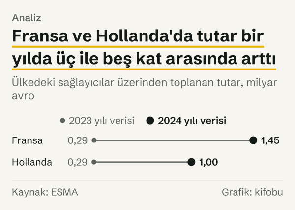
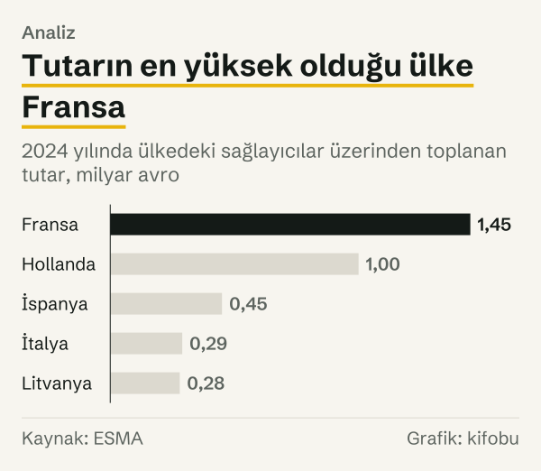
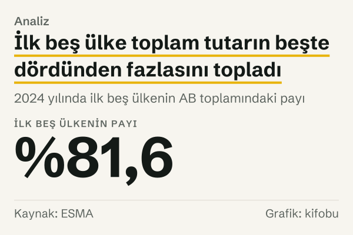

AB'de kitle fonlaması hizmeti veren şirketlerin sayısı arttığında, toplanan tutar da aynı hızda mı arttı? İlk bakışta evet gibi görünüyor: Avrupa Menkul Kıymetler ve Piyasalar Otoritesi'nin (ESMA) iki ardışık raporunda hem sağlayıcı sayısı hem toplanan tutar yükseliyor. Ama iki sayı aynı hızda gitmiyor.

Rakamlar şöyle. ESMA'nın 2023 yılı verisini kapsayan raporu 98 sağlayıcılık bir örneklem için en az 1 milyar euro'luk fon toplandığını yazıyor. 2024 yılı verisini kapsayan ikinci rapor 181 sağlayıcının 4,25 milyar euro topladığını bildiriyor. Sağlayıcı sayısı %84,7 artmış; tutar ise bu artışın çok üstünde, en çok 4,25 kat. Üst sınır diyoruz, çünkü ilk rapor tutar için yalnız bir alt sınır veriyor.

İki sayı aynı yöne gidiyor, ama hızları farklı. Farkın nereden geldiğini birkaç ipucu üzerinden arıyoruz. Önce sağlayıcı sayısının kendisi ne anlatıyor, sonra tutar, ardından ülkeler, fon türleri ve en sonda ABD'deki benzer ölçü. Hepsinde ESMA'nın kendi uyarısını göz önünde tutuyoruz: ikinci raporda ESMA, “year-on-year trends in this Report should be interpreted with caution” diyor; yani yıllar arası eğilimlerin dikkatle yorumlanmasını istiyor.

Yazı tek bir sağlayıcıyı, projeyi ya da ülkeyi öne çıkarmıyor; AB düzeyindeki toplu veriyi okuyor.

*ESMA raporlarında sağlayıcı sayısı. Kaynak: ESMA.*
## İlk ipucu: sağlayıcı sayısı

Raporlar iki ayrı sayı veriyor. Birincisi raporun kapsadığı, yani ulusal otoritelerin veri gönderdiği ve o yıl fon toplamış sağlayıcılar. İkincisi ESMA'nın tuttuğu sicilde yetkili görünen sağlayıcılar.

Birinci rapor 17 ülkede 98 sağlayıcıyı kapsıyor. İkinci rapor 21 ülkede 181 sağlayıcıyı kapsıyor. Kapsanan ülke sayısı da arttı; örneklem iki rapor arasında genişledi. Birinci rapora göre sicilde 2023 yılı sonuna kadar 159 sağlayıcı yetkilendirilmişti; ikinci rapor 2024 yılı sonu için bu sayıyı 229 veriyor. Sicildeki artış %44,0.

İki artış farklı şeyleri sayıyor. Örneklemdeki %84,7'lik artış, daha çok ülkenin veri göndermesini de içerebilir; sicildeki %44,0'lık artış ise yalnız yetkilendirmeleri sayıyor. Hangi artışın pazarın büyümesini daha iyi yansıttığını raporlar vermiyor.

Başka bir ipucu etkin sağlayıcıların sicildeki payı. ESMA ilk raporda aynı ülkelerden 134 sağlayıcının sicilde yetkili göründüğünü, bunların 98'inin örneklemde yer aldığını yazıyor; pay %73,1. İkinci raporda sicildeki 229 sağlayıcıdan 181'i fon toplamış; pay %79,0. Pay 5,9 puan arttı. Ama bu iki oranın tabanı aynı değil: ilki yalnız örneklemdeki ülkelerin sicilini, ikincisi tüm sicili kullanıyor. Yani 5,9 puanlık fark kaba bir işaret; tam bir ölçü değil.

## İkinci ipucu: toplanan tutar

İlk rapor için tutar en az 1 milyar euro, ikinci rapor için 4,25 milyar euro. İkinci rakamın birinciye oranı en çok 4,25. Yani tutar sağlayıcı sayısından hızlı arttı; ama tam oranı vermek için ilk yılın gerçek toplamını bilmek gerekirdi. Bir ipucu var: ilk rapor, bir sektöre giden 390 milyon euro'yu toplamın üçte biri olarak tanımlıyor. Bu, 1.170 milyon euro civarında bir toplama işaret ediyor; 4,25 milyar euro'nun buna oranı yaklaşık 3,6.

Sağlayıcı başına ortalamaya bakınca aynı yön çıkıyor. 2024 yılında sağlayıcı başına 23,5 milyon euro düşüyor. 2023 yılında ise en az 10,2 milyon euro. Yani ortalama sağlayıcı iki yılda en çok iki katından biraz fazla büyüdü. Bu hesabın sınırı aynı: ilk yıl için yalnız alt sınır var.

Ortalama bireysel yatırımcının tutarı da 590 euro'dan 660 euro'ya, %11,9 arttı; bireysel yatırımcıların payı %87'den %88'e geldi. Proje başına ortalamayı da ESMA yayımlıyor, ama burada kullanmadık. İkinci raporda krediye dayalı bir projenin ortalaması yaklaşık 240.000 euro; ilk raporda yaklaşık 15.000 euro. Aradaki fark 16 kat. ESMA bunu ikinci raporda şöyle ele alıyor: “a relatively high share of projects may not have completed fundraising by year-end, which may explain why the average amounts raised per project were far higher in this year’s Report than in the previous edition”. ESMA'ya göre tamamlanmamış projeler ortalamayı etkilemiş olabilir; biz de proje başına ortalamayı pazar büyümesi ölçüsü olarak kullanmadık. 

## Ülke düzeyinde iki ipucu birlikte

Ülke verisi daha temiz bir karşılaştırma sunuyor, çünkü iki raporda da Fransa ve Hollanda var ve ikisi de tutarını açıkça yazıyor. Fransa'da sağlayıcı sayısı 30'dan 50'ye çıktı; bu %66,7'lik bir artış. Aynı ülkede toplanan tutar 292 milyon euro'dan 1.450 milyon euro'ya çıktı; yani 4,97 katına. Hollanda'da tutar 291 milyon euro'dan 1.000 milyon euro'ya, 3,44 katına çıktı. ESMA ikinci raporda ülke tutarlarını yuvarlak veriyor; bu yüzden ülke oranları yaklaşık değerdir.

Fransa'da sağlayıcı sayısındaki artış %66,7, tutardaki artış 4,97 kat. Yani en az bir ülkede iki ölçü farklı hızlarda gitti. Sağlayıcı başına tutar 9,7 milyon euro'dan 29,0 milyon euro'ya çıktı. Yeni sağlayıcılar toplamı büyütmüş olabilir, ama toplamdaki büyümeyi yalnız onlara bağlamak mümkün değil.

Bir uyarı: Birinci raporda ESMA, “Due to data quality issues that some NCAs faced for this first reporting exercise” diyerek örneklemin bu nedenle daraldığını belirtiyor.

*Ülkedeki sağlayıcılar üzerinden toplanan tutar. Kaynak: ESMA.*
## Fon türlerinin payı

Tutarın içinde fon türlerinin payı da değişti. ESMA üç türü ayırıyor: krediye dayalı (sağlayıcının platformunda doğrudan borç verilen), borçlanma senedine dayalı ve paya dayalı kitle fonlaması. Paya dayalı kitle fonlamasında kaynak sağlayan kişi girişimin ortağı olur; borçlanma senedine dayalı fonlamada girişim bir senet çıkarır ve parayı vadesinde geri öder.

İlk raporda krediye dayalı pay %65, borçlanma senedine dayalı pay %17, paya dayalı pay %6 idi. İkinci raporda bu paylar %58, %23 ve %12. Krediye dayalı pay 7,0 puan azaldı; borçlanma senedine dayalı pay 6,0 puan, paya dayalı pay 6,0 puan arttı. Yani tutarın bileşimi iki yılda kaydı: krediye dayalı fonlama en büyük tür olarak kaldı, ama ağırlığı azaldı.

Türlerin payı sağlayıcı sayısındaki artışın bir parçasını açıklayabilir. Sağlayıcı sayılarında da aynı yön var. Krediye dayalı hizmet veren sağlayıcı 53'ten 92'ye, borçlanma senedine dayalı hizmet veren 30'dan 50'ye, paya dayalı hizmet veren 25'ten 64'e çıktı. Artışlar sırasıyla %73,6, %66,7 ve %156,0. Bir sağlayıcı birden çok tür sunabildiği için bu üç sayının toplamı sağlayıcı sayısını vermiyor; ama paya dayalı hizmet veren sağlayıcıların artışı en hızlı ve bu türün tutardaki payı da iki katına çıktı.

Paya dayalı kitle fonlamasında girişim başarısız olursa yatırılan sermayenin tamamı kaybedilebilir. Borçlanmaya dayalı kitle fonlamasında borç alan şirket ödeme yapamazsa yatırılan paranın tamamı kaybedilebilir.

*Fon türlerinin toplanan tutardaki payı, yüzde. Kaynak: ESMA.*
## Tutar kimde toplanıyor

Tutarın dağılımı da bir ipucu. İkinci raporda en çok tutar toplanan beş ülke Fransa (1.450 milyon euro), Hollanda (1.000 milyon euro), İspanya (450 milyon euro), İtalya (290 milyon euro) ve Litvanya (280 milyon euro). Beşinin toplamı 3.470 milyon euro; AB toplamı olan 4.250 milyon euro'nun %81,6'sı. ESMA bu payı yüzde 80'in üzerinde olarak yazıyor; bizim hesabımız aynı sonuca ulaşıyor. Yalnız Fransa'nın payı %34,1.

*2024 yılında ülkedeki sağlayıcılar üzerinden toplanan tutar. Kaynak: ESMA.*
Dağılım yoğun olduğu için AB toplamındaki artışın büyük bölümü birkaç ülkeden geliyor. Yeni sağlayıcıların çoğunun bulunduğu ülkelerde tutar küçük kaldıysa, sağlayıcı sayısı ile toplam tutar arasındaki ilişki zayıflar. Bu varsayımı sınamak için ülke ve sağlayıcı bazında seri gerekirdi; ESMA'nın raporlarında iki yıl için yalnız birkaç ülke var.

*2024 yılında ilk beş ülkenin AB toplamındaki payı. Kaynak: ESMA.*
## ABD'de aynı soru

ABD'nin Menkul Kıymetler ve Borsa Komisyonu (SEC) Regulation Crowdfunding için yarıyıllık özet istatistik yayımlıyor. Bu sayfada 2016'dan beri bütün teklifler birikimli olarak veriliyor. Birikimli sayıların farkları yarıyıllık yeni teklif sayısını veriyor: 511 teklif 2025 yılı birinci yarısında, 458 teklif ikinci yarısında, 390 teklif 2026 yılı birinci yarısında eklendi. Bir yıl arayla birinci yarıyıldan birinci yarıyıla teklif sayısı %23,7 azaldı.

Raporlanan toplam tutar ise 2024 yılı sonunda 1.339,2 milyon dolar, 2025 yılı ortasında 1.456 milyon dolar, 2025 yılı sonunda 1.546 milyon dolar, 2026 yılı ortasında 1.644 milyon dolar. Yarıyıllık artışlar sırasıyla 116,8 milyon dolar, 90,0 milyon dolar ve 98,0 milyon dolar. Teklif sayısı düşerken raporlanan tutardaki artış aynı oranda düşmüyor. Ama SEC bu tutarın teklif sahiplerinin ilerleme bildirimlerinden derlendiğini ve toplamların büyük olasılıkla alt sınır tahmini olduğunu belirtiyor; ayrıca birikimli tutardaki artış, o yarıyılda açılan tekliflerin değil, o yarıyılda bildirilen ilerlemelerin toplamı. Bu yüzden iki seri doğrudan birbirine bölünemez.

Yine de AB ile ABD'yi yan yana koymak bir fikir veriyor: AB'de sağlayıcı sayısı ve tutar yükselirken ABD'de yeni teklif sayısı yarıyıldan yarıyıla azalıyor. İki pazarın kuralları, ölçüleri ve kapsamı farklı; bu karşılaştırma bir sıralama ya da üstünlük iddiası değil.

## Karşı okuma

Sağlayıcı sayısı ile tutar arasındaki hız farkını okumanın üç yolu var; üçü de birbirinden bağımsız.

Birinci karşı okuma ölçümle ilgili. ESMA yıllar arası eğilimlerin dikkatle yorumlanmasını istiyor ve ilk raporda örneklemin daraldığını belirtiyor; yukarıdaki alıntılar bu çekinceleri gösteriyor.

İkinci karşı okuma sağlayıcı sayısının zaten bir ölçü olarak zayıf olduğu. Sağlayıcının büyüklüğü, ülkesi ve fon türü sayıda görünmüyor. Bir sağlayıcının eklenmesi ile onlarca sağlayıcının eklenmesi aynı rakamı veriyor.

Üçüncü karşı okuma fiyat etkisi. Tutarlar euro cinsinden ve fiyatlardan arındırılmadı; bu yazıda fiyat etkisi ayrıca hesaplanmadı.

## Ölçümün ve örneklemin sınırları

Üç sınır öne çıkıyor.

İlki örneklem. İlk rapor 22 ulusal otoritenin verisine, bunlardan 17'sinin ülkesindeki 98 sağlayıcıya dayanıyor; ESMA, veri kalitesi sorunları nedeniyle örneklemin 22 otoriteye dayandığını yazıyor. İkinci rapor 21 ülkedeki 181 sağlayıcıyı kapsıyor. İki raporun kapsamı aynı değil.

İkincisi alt sınır. 2023 yılı tutarı için ESMA yalnız en az 1 milyar euro diyor. Bu yazıdaki oranlar (en çok 4,25 kat, sağlayıcı başına en az 10,2 milyon euro) bu yüzden bir yöne bağlı.

Üçüncüsü tanım. ESMA yalnız yatırım ve borç verme biçimindeki kitle fonlamasını sayıyor; bağış ve ödül karşılığı kitle fonlaması kapsam dışı. Düzenlemenin kapsamı, on iki aylık dönemde 5 milyon euro'yu aşan teklifleri dışarıda bırakıyor. Bu yüzden rakam, AB'de her türlü kitle fonlamasının toplamı değil.

## Nasıl hesapladık

ESMA'nın iki pazar raporundan sağlayıcı sayısını, toplanan tutarı, ülke tutarlarını ve fon türü paylarını aldık; rapordaki milyar euro değerlerini milyon euroya çevirdik. Yüzde değişim, iki yılın değerinin farkının ilk yıla oranıdır. Etkin sağlayıcı payı, örneklemdeki sağlayıcı sayısının sicildeki sağlayıcı sayısına oranıdır; ilk rapor için ESMA'nın aynı ülkeler için verdiği 134 sayısını, ikinci rapor için tüm sicili kullandık. İlk beş ülkenin payı, beş ülkenin tutarlarının toplamının AB toplamına oranıdır. ABD verisi için SEC'in yarıyıllık birikimli istatistik tablosundaki ardışık sütunların farkını aldık. Hiçbir rakam elle girilmedi; her hesap kanıt dosyasındaki kayıtlardan yeniden üretilebiliyor.

## Kaynaklar

- [ESMA: Market Report, Crowdfunding in the EU, Ocak 2025 yayımı](https://www.esma.europa.eu/sites/default/files/2025-01/ESMA50-2085271018-4039_ESMA_Market_Report_-_Crowdfunding_in_the_EU_2024.pdf)
- [ESMA: Market Report, Crowdfunding in the EU, Aralık 2025 yayımı](https://www.esma.europa.eu/sites/default/files/2025-12/ESMA50-481369926-30854_ESMA_Market_Report_Crowdfunding_in_the_EU_2025.pdf)
- [SEC: Regulation Crowdfunding (CF) Offerings, istatistikler](https://www.sec.gov/data-research/statistics-data-visualizations/regulation-crowdfunding-cf-offerings)
- [SEC: Regulation CF Offering Statistics Guide](https://www.sec.gov/files/sec-stats-guide-regulation-cf-offerings.pdf)
