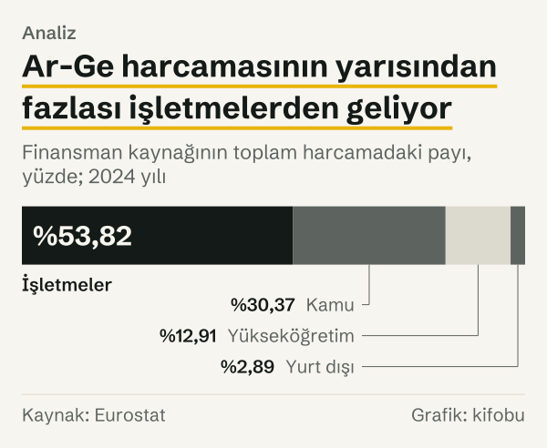
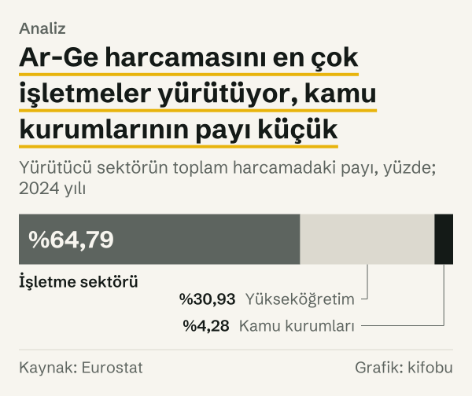
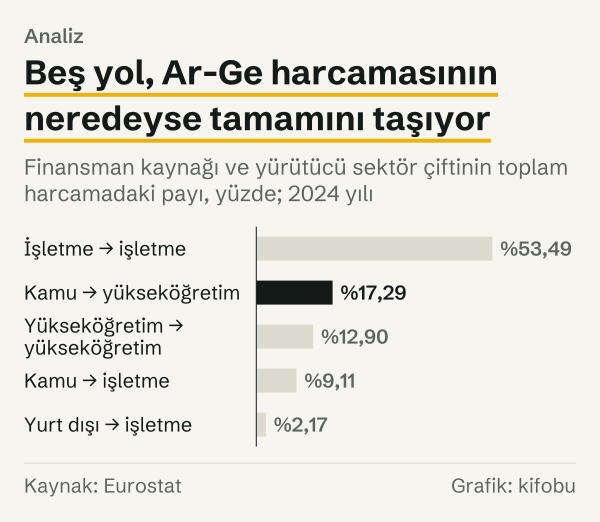
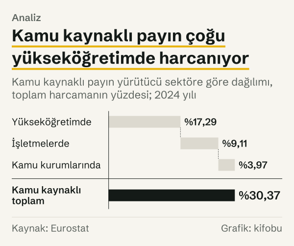

Markette yüz lira ödeyen kişi parayı kasadaki kişiye verir; ödeyen ile harcayan aynı yerde buluşur. Ar-Ge harcamasında böyle olmuyor. Türkiye’de 2024 yılında Ar-Ge için 651,82 milyar TL harcandı. Bunun %53,82’si işletmelerden geldi, ama harcamanın %64,79’unu işletmeler yürüttü. Kamunun payı finansmanda %30,37, harcamayı yürütmede ise %4,28.

Finansman ve yürütme iki ayrı ölçü. Kamunun payı finansmanda %30,37, yürütmede %4,28. Kamunun finanse ettiği Ar-Ge’nin büyük kısmı yükseköğretimde (%17,29) ve işletmelerde (%9,11) yürütülüyor. İşletmelerde ise finansman payı %53,82, yürütme payı %64,79.

Bu yazı, yüz liralık bir Ar-Ge harcamasının izini sürüyor: finansman hangi sektörlerden geliyor, harcama hangi sektörlerde yürütülüyor ve iki ölçü birbirine nasıl bağlanıyor? Eurostat’ın Ar-Ge harcamasını hem finansman kaynağına hem yürütücü sektöre göre ayıran tablosuna baktık. Aşağıda her pay, harcamanın toplamı içindeki yüzdesi olarak yazıldı; yüz lira, o toplamın simgesi.

*Finansman kaynağının toplam harcamadaki payı, yüzde; 2024 yılı. Kaynak: Eurostat.*
## Para kimden geliyor?

Kaynak tarafında beş sektör var. İşletmeler %53,82 ile ilk sırada. Kamu %30,37, yükseköğretim sektörü %12,91, yurt dışı %2,89. Kâr amacı gütmeyen özel kuruluşların payı %0,01; bu kadar küçük olduğu için yazının sonraki tablolarında yer almıyor.

Kamu payı, bütçeden doğrudan yapılan harcamayı ve üniversitelere verilen genel fonları içeriyor. Bunlar Eurostat tablosunda ayrı satırlar: kamunun yükseköğretimde yürütülen harcamaya ayırdığı, toplam harcamanın %17,29’u kadar olan pay; bunun toplam harcamanın %15,95’i kadarı genel üniversite fonlarından, %1,34’ü kadarı doğrudan kamu finansmanından geliyor. Yani kamunun yükseköğretime akıttığı payın büyük kısmı genel üniversite fonları.

İşletmelerin finansmanının neredeyse tamamı kendi harcamalarına gidiyor: işletmelerin finanse ettiği tutarın %99,39’u işletme sektöründe harcandı. İşletmelerin finanse ettiği Ar-Ge’nin kamu kurumlarında yürütülen bölümü %0,41, yükseköğretimde yürütülen bölümü %0,20; yani başka sektörlerde yürütülen Ar-Ge’yi çok az finanse ediyorlar.

Tutarlar da aynı sırayı veriyor. İşletmelerin finanse ettiği tutar 350,81 milyar TL, kamununki 197,99 milyar TL, yükseköğretimin 84,14 milyar TL, yurt dışının 18,81 milyar TL. Toplam 651,82 milyar TL.

## Para kimin elinde harcanıyor?

Harcamayı yürüten sektörlere bakınca sıra farklı. İşletme sektörü %64,79 ile ilk sırada. Yükseköğretim %30,93, kamu kurumları %4,28. Kamu tarafında iki ölçü en çok ayrışıyor: kamu finansmanın %30,37’sini sağlıyor, harcamanın %4,28’ini kendi kurumlarında yürütüyor.

Tutar olarak işletme sektörü 422,31 milyar TL, yükseköğretim 201,62 milyar TL, kamu kurumları 27,90 milyar TL harcadı. Harcamanın GSYH’ye oranı da bu sırayı izliyor: toplam %1,46; bunun %0,95’i işletme sektöründe, %0,45’i yükseköğretimde, %0,06’sı kamu kurumlarında yürütülüyor.

İşletme tarafında tablo tersine dönüyor: işletmelerin finansman payı %53,82, yürütme payı %64,79. İşletme sektörü, finanse ettiğinden 10,97 puan daha fazla harcama yürütüyor. Finansmanın geri kalanını kamu, yükseköğretim ve yurt dışı sağlıyor.

*Yürütücü sektörün toplam harcamadaki payı, yüzde; 2024 yılı. Kaynak: Eurostat.*
## Beş yol, toplamın neredeyse tamamı

Kaynak ile yürütücü sektör bir matris oluşturuyor; matrisin her hücresi bir yol. Toplamın yüz liralık simgesi bu hücrelere dağıldığında beş yol payın büyük kısmını taşıyor. Birincisi, işletmelerin kendi kaynağıyla kendi bünyesinde harcadığı pay: %53,49. İkincisi, kamudan yükseköğretime giden pay: %17,29. Üçüncüsü, yükseköğretimin kendi kaynağıyla kendi bünyesinde harcadığı pay: %12,90. Dördüncüsü, kamudan işletmelere giden pay: %9,11. Beşincisi, yurt dışından işletmelere giden pay: %2,17. Bu beş yolun toplamı %94,96.

Geriye kalan küçük yolların en büyüğü, kamu kaynağının kamu kurumlarında harcanan bölümü: %3,97.

Yolların tutar karşılığı da var: kamudan yükseköğretime 112,70 milyar TL gitti; bunun 103,97 milyar TL’si genel üniversite fonu, 8,73 milyar TL’si doğrudan kamu finansmanı. Kamudan işletmelere 59,41 milyar TL, kamu kurumlarına 25,88 milyar TL gitti.

*Finansman kaynağı ve yürütücü sektör çiftinin toplam harcamadaki payı, yüzde; 2024 yılı. Kaynak: Eurostat.*
## Kamunun finanse ettiği pay nerede yürütülüyor?

Kamunun finanse ettiği %30,37’lik payın büyük kısmı kendi kurumlarında kalmıyor. Yükseköğretimde %17,29, işletmelerde %9,11, kamu kurumlarında %3,97 harcanıyor. Yani kamu kaynaklı payın kamu kurumlarına dönen bölümü küçük; en büyük bölüm üniversitelere gidiyor.

*Kamu kaynaklı payın yürütücü sektöre göre dağılımı, toplam harcamanın yüzdesi; 2024 yılı. Kaynak: Eurostat.*
Aynı akışı yürütücünün gözünden de okuyabiliriz. Aşağıdaki tablo, her yürütücü sektörün harcamasının hangi kaynaktan finanse edildiğini gösteriyor.

| Yürütücü sektör | İşletme kaynağı | Kamu kaynağı | Yükseköğretim kaynağı | Yurt dışı kaynağı |
|---|---|---|---|---|
| İşletme sektörü | %82,56 | %14,07 | %0,01 | %3,35 |
| Yükseköğretim sektörü | %0,35 | %55,90 | %41,70 | %2,05 |
| Kamu kurumları sektörü | %5,15 | %92,77 | %0,10 | %1,96 |

*Her yürütücü sektörün 2024 yılı Ar-Ge harcamasının finansman kaynağına göre payı, yüzde. Kâr amacı gütmeyen özel kuruluşlar tabloda yok. Kaynak: Eurostat.*

Tablo üç ayrı tabloyu bir arada gösteriyor. İşletme sektörünün harcamasının %82,56’sı işletmelerin kendi kaynağından, %14,07’si kamudan. Yükseköğretimde harcamanın yarısından fazlası, %55,90’ı kamu kaynaklı; %41,70’i yükseköğretimin kendi kaynaklarından. Kamu kurumlarında %92,77 kamu kaynaklı. Üç sektörde de yurt dışı kaynaklı pay %1,96 ile %3,35 arasında.

## Üç yürütücü, üç ayrı akış

Yürütücü sektörlerin her biri, farklı bir kaynak bileşimiyle çalışıyor. Üçünü ayrı ayrı izlemek, toplam rakamın arkasındaki farkı gösteriyor.

İşletme sektörü 422,31 milyar TL harcadı. Bunun 348,66 milyar TL’si işletmelerin kendi kaynağı, 59,41 milyar TL’si kamu kaynağı, 14,13 milyar TL’si yurt dışı kaynağı. Kamu kaynağının payı %14,07. Bu işletme tarafındaki kamu payı, toplam harcamanın %9,11’ine denk geliyor; bu, kamunun %30,37’lik toplam finansman payının bir bölümü.

Yükseköğretim 201,62 milyar TL harcadı. Bunun 112,70 milyar TL’si kamu kaynağı, 84,07 milyar TL’si yükseköğretimin kendi kaynağı, 4,13 milyar TL’si yurt dışı kaynağı, 0,71 milyar TL’si işletme kaynağı. Burada kamu payı %55,90; işletme kaynaklı pay ise %0,35. Yani üniversitelerde yürütülen Ar-Ge’nin finansmanı büyük ölçüde kamu ve üniversitelerin kendi kaynaklarına dayanıyor; işletme finansmanı çok küçük.

Kamu kurumları 27,90 milyar TL harcadı. Bunun 25,88 milyar TL’si kamu kaynağı, 1,44 milyar TL’si işletme kaynağı. Kamu payı %92,77. Bu sektör, üçü arasında kendi finansmanını en yüksek oranda kendi içinden sağlayan sektör.

Üç akışın ortak noktası yurt dışı kaynağının her birinde küçük olması: %3,35, %2,05, %1,96. Ayrılan nokta ise kamunun rolü: işletmelerde yürütülen harcamanın küçük bir bölümünü, yükseköğretimde yürütülen harcamanın yarısından fazlasını, kamu kurumlarında yürütülen harcamanın neredeyse tamamını finanse ediyor.

Toparlarsak: yüz liralık simgenin yarısından fazlası işletmelerden çıkıp işletmelerde harcanıyor; kalan bölümün büyük kısmı kamudan üniversitelere ve işletmelere, üniversitelerin kendi kaynaklarından yine üniversitelere gidiyor. Kamu kurumlarında harcanan pay çok küçük. Bu tablo bir tercih ya da başarı ölçüsü değil, yalnızca akışın haritası: paranın hangi sektörden çıkıp hangisinde harcandığı.

## Kaynaklar yer değiştirdi mi? On yıllık karşılaştırma

Paylar 2015 yılı ile 2024 yılı arasında karşılaştırıldı; tablonun daha eski yılları kaynakta kırılma işareti taşımadan sıçrıyor, bu yüzden başlangıcı 2015 yılı aldık. İşletmelerin finansman payı %44,11’den %53,82’ye çıktı; fark 9,71 puan. Kamunun payı %35,45’ten %30,37’ye indi; 5,07 puan düşüş. Yükseköğretimin payı %19,23’ten %12,91’e geriledi; 6,32 puan düşüş. Yurt dışının payı %1,18’den %2,89’a çıktı; 1,71 puan artış.

Yürütme tarafında da benzer bir kayma var. İşletme sektörünün yürütme payı %49,28’den %64,79’a çıktı; fark 15,51 puan. Yükseköğretimin payı %41,35’ten %30,93’e, 10,42 puan düştü. Kamu kurumlarının payı %9,37’den %4,28’e, 5,09 puan geriledi.

İki taraftaki kayma birbirine benziyor: işletmelerin hem finansman hem yürütme payı arttı; kamunun ve yükseköğretimin payları ise azaldı. Ama yürütmedeki artış (15,51 puan), finansmandaki artıştan (9,71 puan) büyük.

Bir ipucu daha var: kaynak ile yürütme arasındaki fark, iki yılda farklı davranıyor. Kamu tarafında fark 2015 yılında 26,08 puandı, 2024 yılında 26,10 puan; neredeyse hiç değişmedi. İşletme tarafında fark 2015 yılında 5,17 puandı, 2024 yılında 10,97 puana çıktı. Yani kamunun finansman payı ile yürütme payı arasındaki açıklık sabit kaldı; işletmelerin harcadığı ile finanse ettiği arasındaki açıklık ise iki katından fazla büyüdü. Kamunun finansman payı küçülürken yürütme payı da yaklaşık aynı puan kadar küçüldü; işletmelerin yürütme payı ise finansman payından daha çok büyüdü.

*Finansman kaynağının toplam harcamadaki payı, yüzde. Kaynak: Eurostat.*

*Yürütücü sektörün toplam harcamadaki payı, yüzde. Kaynak: Eurostat.*
## Karşı okuma: paylar neyi söylemiyor?

Dört karşı okuma var.

Birincisi, payların düşmesinin tutarın düşmesi demek olmaması. Türkiye’nin Ar-Ge harcaması 2015–2024 arasında TL cinsinden %2.766,27 arttı. TL cinsinden nominal artış fiyat ve kur değişimlerini de içerir; bu yazı TL tutarını yıllar arasında karşılaştırmıyor, yalnızca payları karşılaştırıyor. Bir sektörün payı azalırken kendi tutarı artmış olabilir.

İkincisi, kamu finansmanının tek tür olmaması. Kamu payı hem doğrudan harcamayı hem de genel üniversite fonlarını içeriyor. Tablo, genel fonun Ar-Ge’ye ayrılan bölümünün nasıl hesaplandığını göstermiyor.

Üçüncüsü, kaynağın karar vericiyle aynı olmaması. Bir harcamanın hangi sektörden finanse edildiği, harcamanın nasıl yönlendirildiğini söylemiyor. Tablo yalnızca paranın hangi sektörden çıkıp hangisinde harcandığını gösteriyor.

Dördüncüsü, yüzde puan ile yüzde değişimin ayrı şeyler olması. Yazıdaki 9,71 puanlık artış, iki payın aritmetik farkı; işletme payının göreli olarak aynı oranda büyüdüğü anlamına gelmiyor. Aynı puan, küçük bir payda büyük, büyük bir payda küçük bir göreli değişim demek. Yurt dışının payındaki 1,71 puan, payı %1,18’den %2,89’a çıkardı; bu, payın göreli olarak katlanması demek ama toplam içindeki yeri hâlâ küçük.

## Ölçüm sınırları

Eurostat’ın sektör tanımları tek tek kurum ya da şirket düzeyinde değil, sektör düzeyinde çalışıyor; bu yüzden hangi kurumun ne yaptığı bu tablodan okunamıyor. Yurt dışı kaynaklı pay, yurt dışındaki işletmeleri, uluslararası kuruluşları ve diğer kaynakları birlikte sayıyor.

Karşılaştırmayı 2015 yılından başlattık. Seride 2014–2015 arasında bazı payların büyük sıçrama yaptığı görülüyor (örneğin kâr amacı gütmeyen özel kuruluşların payı); kaynak bu geçiş için bir kırılma işareti koymuyor. Bu yüzden daha eski yıllarla karşılaştırma yapmadık. Ayrıca iki yıl arasındaki fark bir eğilim değil, iki nokta arasındaki net değişimdir; aradaki yıllarda paylar farklı yönde hareket etmiş olabilir.

Tablo satırlarındaki paylar yürütücü sektörün kendi harcamasına bölündüğü için, toplam harcamaya bölünen paylarla aynı ölçekte değil. Örneğin kamu kaynağının işletme sektöründeki payı %14,07 iken toplam içindeki payı %9,11; iki rakam aynı tutarı farklı paydalara bölüyor. Okurken paydanın ne olduğuna bakmak gerekiyor.

Bu yazıdaki her pay üç ayrımla okunmalı: paydanın toplam harcama mı yoksa bir yürütücünün harcaması mı olduğu, yılın hangisi olduğu ve payın kaynağı mı yürütmeyi mi gösterdiği. Üçünden biri karıştığında aynı rakam başka bir şey söylüyor. Yazıda rakamlar bu ayrımla, her tablonun altındaki italik satırda tanımlandı.

Son olarak, tüm payların toplamı yuvarlama nedeniyle tam yüzde yüz görünmeyebilir; kâr amacı gütmeyen özel kuruluşlar tabloya alınmadığı için satır toplamları da yüzde yüzün birkaç yüzde biri altında kalabiliyor.

## Nasıl hesapladık

Veri, Eurostat’ın Ar-Ge harcamasını yürütücü sektöre ve finansman kaynağına göre veren tablosundan (rd_e_gerdfund) ve yürütücü sektöre göre veren tablosundan (rd_e_gerdtot) çekildi. Tutarlar ulusal para (milyon TL) cinsindendir. Her pay, ilgili tutarın ilgili toplama bölünmesiyle bulundu: kaynak payları ve yürütme payları toplam harcamaya, tablodaki satır payları o satırın yürütücü sektörünün harcamasına bölündü. Yıllar arası farklar, iki yılın payları arasındaki yüzde puan farkıdır. Kaynak ile yürütme paylarının farkı da yüzde puandır. Her rakam, kaynak tablodan bu yazı hazırlanırken çekildi ve çekim tarihiyle kanıt dosyasına kaydedildi.

## Kaynaklar

- [Eurostat: Yürütücü sektöre ve finansman kaynağına göre Ar-Ge harcaması, rd_e_gerdfund](https://ec.europa.eu/eurostat/databrowser/view/rd_e_gerdfund/default/table)
- [Eurostat: Yürütücü sektöre göre Ar-Ge harcaması, rd_e_gerdtot](https://ec.europa.eu/eurostat/databrowser/view/rd_e_gerdtot/default/table)
