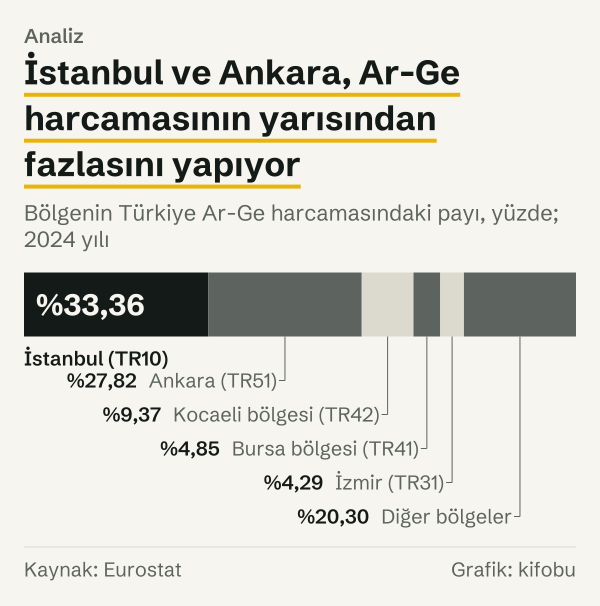

Kişi başına Ar-Ge harcaması sıralamasının ilk satırı Ankara’ya (TR51) ait: 2024 yılında kişi başına 878,25 euro. Son satırda TRC3 var (Mardin, Batman, Şırnak, Siirt): 24,79 euro. Ankara’daki değer, TRC3’tekinin 35,43 katı. Türkiye ortalaması 214,63 euro.

Toplam harcamaya bakınca tablo daha da keskin. Türkiye’de 2024 yılında Ar-Ge için 651,82 milyar TL harcandı. Bunun %33,36’sı İstanbul’da (TR10), %27,82’si Ankara’da yapıldı. İki bölgenin toplamı %61,18; geri kalan bölgelerin hepsi birlikte harcamanın kalan bölümünü paylaşıyor.

Yazı, Türkiye’nin 26 istatistiki bölgesinin hepsine bakıyor ve üç şey soruyor: Yoğunlaşma ne kadar? Hangi ölçüyle bakınca değişiyor? Son yıllarda arttı mı? Bölge verisi Eurostat’ın bölgesel Ar-Ge tablolarından geliyor; adlar Eurostat’ın istatistiki bölge adlarıdır. Uzun bölge adları grafiklerde ve tablolarda ilk il adıyla kısaltıldı: TR42 için Kocaeli bölgesi, TR41 için Bursa bölgesi gibi.

*Bölgenin Türkiye Ar-Ge harcamasındaki payı, yüzde; 2024 yılı. Kaynak: Eurostat.*
## İki bölge, toplamın yarısından fazlası

Ar-Ge harcamasının bölgelere dağılımı eşit olmaktan çok uzak. İstanbul %33,36, Ankara %27,82 paya sahip. Üçüncü sırada TR42 var (Kocaeli, Sakarya, Düzce, Bolu, Yalova): %9,37. Ardından TR41 (Bursa, Eskişehir, Bilecik) %4,85 ve İzmir (TR31) %4,29 geliyor. İlk beş bölgenin toplamı %79,70; geri kalan bölgelerin toplamı %20,30. Tutar olarak bu, İstanbul’da 217,46 milyar TL, Ankara’da 181,31 milyar TL, TR42’de 61,09 milyar TL, TR41’de 31,64 milyar TL ve İzmir’de 27,97 milyar TL demek.

Payı en düşük üç bölge birbirine yakın: TR82 (Kastamonu, Çankırı, Sinop) %0,31, TRC3 %0,33 ve TRA2 (Ağrı, Kars, Iğdır, Ardahan) %0,36. İki ucun arasındaki mesafe, ortadaki bölgelerin payları düşünülünce daha iyi görünüyor: İstanbul’un harcaması, harcaması en düşük bölgeninkinin 106,79 katı.

Tek başına bu karşılaştırma eksik kalıyor, çünkü bölgeler eşit büyüklükte değil. İstanbul, Ankara ve İzmir tek ilden oluşuyor; TR42 beş ilden, TR41 üç ilden. Toplam harcama büyük bir bölgenin büyüklüğünü de taşıyor. Bu yüzden ikinci ölçüye, kişi başına harcamaya bakmak gerekiyor.

## Kişi başına bakınca sıra değişiyor

Kişi başına Ar-Ge harcamasında Ankara ilk sırada ve fark büyük. 2024 yılında Ankara’da 878,25 euro, TR42’de 404,98 euro, İstanbul’da 390,46 euro. Ardından TR41 (204,10 euro) ve İzmir (175,53 euro) geliyor. Türkiye ortalaması 214,63 euro. Yani yalnızca üç bölge ortalamanın üzerinde: Ankara, TR42 ve İstanbul.

Sıra, toplam harcamadakinden farklı. İstanbul toplamda birinci, kişi başına üçüncü. TR42 toplamda üçüncü, kişi başına ikinci. Ankara iki ölçüde de ilk iki içinde, ama kişi başına birinci. Ankara’daki kişi başı harcama Türkiye ortalamasının 4,09 katı, İstanbul’daki 1,82 katı.

Beşinci sıradan sonra değerler birbirine yaklaşıyor: altıncı TRA1 (Erzurum, Erzincan, Bayburt) 144,20 euro, yedinci TR21 (Tekirdağ, Edirne, Kırklareli) 142,48 euro. Sıradaki komşu bölgeler arasındaki mesafe de eşit değil: ikinci TR42 ile üçüncü İstanbul arasında yalnızca 14,52 euro var; üçüncü İstanbul ile dördüncü TR41 arasında 186,36 euro; beşinci İzmir ile altıncı TRA1 arasında 31,33 euro.

Sıranın öbür ucunda TRC3 (24,79 euro), TRC2 (Şanlıurfa, Diyarbakır; 31,83 euro), TR63 (Hatay, Kahramanmaraş, Osmaniye; 35,88 euro), TRB2 (Van, Muş, Bitlis, Hakkari; 44,89 euro) ve TRC1 (Gaziantep, Adıyaman, Kilis; 51,17 euro) yer alıyor. TRC3, Türkiye ortalamasının 0,12 katı.

İki ölçü yan yana okununca şu çıkıyor: İstanbul’un toplamdaki ağırlığı, bölgenin büyüklüğünün de sonucu. Kişi başına bakınca İstanbul’daki harcama, Ankara’dakinin 0,44 katı; TR42’nin de gerisinde. Yoğunlaşma, harcamanın toplamında kişi başına olduğundan daha belirgin.

*Kişi başına Ar-Ge harcaması; ilk beş bölge, Türkiye ortalaması ve son beş bölge; 2024 yılı. Kaynak: Eurostat.*
## Nüfus payı ile harcama payı

Toplam harcama ile kişi başına harcamayı birbirine bağlamanın bir yolu var: her bölgenin nüfus payını harcama payıyla karşılaştırmak. Eurostat’ın nüfus verisine göre 1 Ocak 2024 itibarıyla İstanbul Türkiye nüfusunun %18,34’ünü, Ankara %6,80’ini barındırıyor. Harcama payları ise %33,36 ve %27,82. İki bölgenin toplam nüfus payı %25,14, harcama payı %61,18; aradaki fark 36,04 puan.

| Bölge | Nüfus payı | Harcama payı | Fark (puan) |
|---|---|---|---|
| İstanbul (TR10) | %18,34 | %33,36 | +15,02 |
| Ankara (TR51) | %6,80 | %27,82 | +21,02 |
| Kocaeli bölgesi (TR42) | %4,97 | %9,37 | +4,41 |
| Bursa bölgesi (TR41) | %5,10 | %4,85 | −0,25 |
| İzmir (TR31) | %5,25 | %4,29 | −0,96 |
| Diğer bölgeler | %59,54 | %20,30 | −39,24 |

*Bölgenin Türkiye nüfusundaki payı (1 Ocak 2024) ve Ar-Ge harcamasındaki payı (2024 yılı), yüzde. Fark: harcama payı eksi nüfus payı. Kaynak: Eurostat.*

Tablo üç grup gösteriyor. İstanbul, Ankara ve TR42’de harcama payı nüfus payından yüksek; fark en çok Ankara’da, 21,02 puan. TR41’de harcama payı nüfus payından 0,25 puan düşük, İzmir’de 0,96 puan düşük; yani bu iki bölge nüfuslarına yakın bir paya sahip. Diğer bölgelerin hepsi birlikte nüfusun %59,54’ünü barındırıyor ve harcamanın %20,30’unu yapıyor; fark 39,24 puan düşük. Artı yöndeki farkların toplamı, eksi yöndeki farkların toplamına eşit; çünkü iki pay da yüzde yüze tamamlanıyor.

*Bölgenin Türkiye nüfusundaki ve Ar-Ge harcamasındaki payı, yüzde; 2024 yılı. Kaynak: Eurostat.*
## Üç yılda yoğunlaşma arttı mı?

Bölgesel Ar-Ge tablosunda veri 2021 yılında başlıyor; bu yüzden karşılaştırma üç yıllık: 2021–2024. Tablo, ilk beş bölgenin ve diğer bölgelerin payını gösteriyor.

| Bölge | 2021 yılı payı | 2024 yılı payı | Fark (puan) |
|---|---|---|---|
| İstanbul (TR10) | %29,69 | %33,36 | +3,67 |
| Ankara (TR51) | %28,17 | %27,82 | −0,36 |
| Kocaeli bölgesi (TR42) | %9,17 | %9,37 | +0,20 |
| Bursa bölgesi (TR41) | %5,90 | %4,85 | −1,05 |
| İzmir (TR31) | %4,11 | %4,29 | +0,19 |
| Diğer bölgeler | %22,96 | %20,30 | −2,65 |

*Türkiye Ar-Ge harcamasındaki bölge payları, yüzde. Kaynak: Eurostat.*

İstanbul’un payı 3,67 puan arttı. Ankara’nınki 0,36 puan geriledi. Birleşik pay %57,86’dan %61,18’e çıktı; fark 3,31 puan. Diğer bölgelerin toplam payı 2,65 puan azaldı.

Ama artış düz bir çizgi değil. İki bölgenin birleşik payı 2021 yılında %57,86, 2022 yılında %59,95, 2023 yılında %58,61 ve 2024 yılında %61,18’di. Yani 2022–2023 arasında yoğunlaşma geriledi, 2024 yılında yeniden arttı. Dört yıllık bu seriden yoğunlaşmanın sürekli arttığı sonucu çıkmıyor; çıkan sonuç, 2021–2024 arasındaki net farkın artı yönde olduğu.

*Bölgenin Türkiye Ar-Ge harcamasındaki payı, yüzde. Kaynak: Eurostat.*
## Harcamayı kim yapıyor?

Eurostat Ar-Ge harcamasını yürütücü sektöre göre de ayırıyor: işletme sektörü, yükseköğretim sektörü ve kamu kurumları sektörü. Bölgelerin harcama bileşimi birbirinden farklı.

| Bölge | İşletme sektörü | Kamu kurumları sektörü | Yükseköğretim sektörü |
|---|---|---|---|
| Türkiye | %64,8 | %4,3 | %30,9 |
| İstanbul (TR10) | %73,3 | %0,2 | %26,5 |
| Ankara (TR51) | %79,4 | %6,5 | %14,1 |
| Kocaeli bölgesi (TR42) | %67,7 | %20,5 | %11,9 |
| İzmir (TR31) | %58,4 | %1,2 | %40,3 |

*Bölgenin Ar-Ge harcamasının yürütücü sektöre göre payı, 2024 yılı, yüzde. Kaynak: Eurostat.*

Ankara’da harcamanın %79,4’ü işletme sektöründe yapılıyor; bu, listedeki en yüksek işletme payı. İzmir’de yükseköğretimin payı %40,3, Türkiye ortalamasının (%30,9) üzerinde. TR42’de kamu kurumları sektörünün payı %20,5; Türkiye ortalaması %4,3. Bu bileşim, aynı euro ya da liranın bölgeler arasında farklı kurumlarda harcandığını gösteriyor.

Harcamayı personele bölmek de bir ölçü verir. Eurostat tam zaman eşdeğeri Ar-Ge personelini de bölgelere göre yayımlıyor. Türkiye genelinde personel başına harcama 2,10 milyon TL. Ankara’da 2,85 milyon TL, TR42’de 2,14 milyon TL, İstanbul’da 2,01 milyon TL, TR41’de 1,89 milyon TL, İzmir’de 1,61 milyon TL. Personelin %34,85’i İstanbul’da, %20,48’i Ankara’da çalışıyor. Ankara’nın harcama payı (%27,82), personel payından yüksek; İstanbul’un harcama payı (%33,36), personel payından biraz düşük.

Eurostat bölgesel personel değerlerini tahmin işaretiyle (“e”) yayımlıyor; bu bölümdeki personel başına rakamlar bu işaretli personel değerlerine dayanıyor.

*Tam zaman eşdeğer Ar-Ge personeli başına harcama; ilk beş bölge ve Türkiye; 2024 yılı. Kaynak: Eurostat.*
## GSYH’ye oran ve dört ölçünün özeti

Üçüncü ölçü, bölgenin Ar-Ge harcamasının kendi gayrisafi yurt içi hasılasına (GSYH) oranı. Türkiye’de bu oran 2021 yılında %1,37, 2024 yılında %1,46. Ankara’da 2021 yılında %4,30, 2024 yılında %3,88; yani 0,42 puan düştü, ama oran yine Türkiye ortalamasından %165,75 yüksek. İstanbul’da %1,37’den %1,67’ye, TR42’de %1,94’ten %2,21’e çıktı. TR41’de %1,47’den %1,38’e indi; İzmir’de %0,90’dan %1,09’a çıktı.

Oran küçük bölgelerde de ilginç: TRA1 (Erzurum, Erzincan, Bayburt) 2024 yılında %1,52 ile Türkiye ortalamasının (%1,46) üzerinde, oysa kişi başına harcaması ortalamanın altında. TRC3’te oran %0,53’ten %0,33’e düştü. İki ölçü aynı sıralamayı vermiyor: biri harcamayı nüfusa, öbürü bölgenin GSYH’sine bölüyor.

![Halter grafik: Ar-Ge harcamasının GSYH’ye oranı Ankara’da geriledi, İstanbul’da arttı: 2021 yılı: Türkiye: %1,37, Ankara (TR51): %4,30, Kocaeli bölgesi (TR42): %1,94, İstanbul (TR10): %1,37, Bursa bölgesi (TR41): %1,47, İzmir (TR31): %0,90, Erzurum bölgesi (TRA1): %1,72, Mardin bölgesi (TRC3): %0,53; 2024 yılı: Türkiye: %1,46, Ankara (TR51): %3,88, Kocaeli bölgesi (TR42): %2,21, İstanbul (TR10): %1,67, Bursa bölgesi (TR41): %1,38, İzmir (TR31): %1,09, Erzurum bölgesi (TRA1): %1,52, Mardin bölgesi (TRC3): %0,33.](./graf-6.svg)
*Bölgenin Ar-Ge harcamasının bölge GSYH’sine oranı, yüzde. Kaynak: Eurostat.*
Dört ölçüye birlikte bakınca Ankara aynı yerde duruyor: toplam harcamada ikinci, ama kişi başına birinci (878,25 euro), nüfus payına göre, ilk beş bölge arasında en büyük fazlalıkta (21,02 puan) ve GSYH’ye oranda birinci (%3,88). İstanbul toplamda birinci (%33,36), kişi başına üçüncü (390,46 euro), GSYH’ye oranda üçüncü (%1,67). Erzurum bölgesi (TRA1) ilk beşin dışında kalan bölgeler arasında öne çıkıyor: kişi başına altıncı (144,20 euro), GSYH’ye oranda dördüncü (%1,52).

Yoğunlaşma dört ölçüde de görünüyor, ama genişliği ölçüye göre değişiyor. Harcama payının %61,18 olduğu iki bölgede nüfus payı %25,14; kişi başına oran Ankara’da Türkiye ortalamasının 4,09 katı; GSYH’ye oran Ankara’da %3,88, Türkiye’de %1,46.

## Karşı okuma: ortalamanın ve payın başka okunuşları

Dört karşı okuma var.

Birincisi, TL cinsinden toplamın kendisi. Türkiye’nin Ar-Ge harcaması 2021–2024 arasında TL cinsinden %540,69 arttı; euro cinsinden artış %89,33. Euro cinsinden harcama 2021 yılında 9,68 milyar euro, 2024 yılında 18,32 milyar euro. İki rakamın arasındaki fark, TL’nin euro karşısındaki değerinin değişimini de içeriyor. Bu yüzden yazıda TL tutarlarını bölgeler arasında pay olarak, yıllar arasında ise yalnızca pay farkı olarak karşılaştırdık.

İkincisi, bölgelerin büyüklüğü. Tek ilden oluşan bölgelerle birkaç ilden oluşan bölgeleri aynı sıralamaya koymak, farklı ölçekleri karıştırmak anlamına geliyor. Kişi başına ölçü bunu kısmen düzeltiyor, ama bölgenin içindeki dağılımı göstermiyor.

Üçüncüsü, Türkiye ortalamasının ne olduğu. Türkiye ortalaması, ülke toplamının ülke nüfusuna bölünmesiyle bulunur; nüfusu büyük bölgelerin değerleri daha ağır basar. 26 bölgenin kişi başına değerlerinin basit ortalaması 141,92 euro; bu, Türkiye ortalamasından 72,71 euro düşük. Yani ortalama bir bölge, ülke ortalamasının belirgin biçimde gerisinde. Bu, yüksek değerli bölgelerin nüfus ağırlığının büyük olmasıyla uyumlu.

Dördüncüsü, harcamanın nerede kaydedildiği. Tablo, bölge payının harcamanın yapıldığı yere göre mi, yoksa harcamayı yapan kurumun bağlı olduğu yere göre mi hesaplandığını göstermiyor. Bu yazı bu ayrımı veriden yapamıyor.

## Ölçüm sınırları

Birkaç sınır var. Bölgesel Ar-Ge verisi bu tabloda yalnızca 2021 yılından itibaren yayımlanıyor; daha uzun bir seri olmadığı için on yıllık bir eğilimden söz edilemez. Bölgesel personel değerleri tahmin işaretli. Üç yıllık fark (2021–2024) bir eğilim değil, iki yıl arasındaki net değişimi gösteriyor; arada iniş çıkış olabiliyor ve olmuş.

Bir sınır daha: bölgeler birden çok ilden oluşabiliyor. Uzun adlı bölgelerde (örneğin TR42) tek bir ilin payı ayrı görünmüyor. Bu yüzden bu yazıda tek bir ile ait pay rakamı yok; yalnızca bölgelerin payı var.

## Nasıl hesapladık

Veri, Eurostat’ın bölgesel Ar-Ge harcaması (rd_e_gerdreg) ve bölgesel Ar-Ge personeli (rd_p_persreg) tablolarından çekildi. Harcama, ulusal para (milyon TL) cinsinden alındı; bölge payları, bölge harcamasının Türkiye toplamına bölünmesiyle bulundu. Kişi başına euro, GSYH oranı ve sektör payları Eurostat’ın kendi göstergeleridir; biz bu üçünü yeniden hesaplamadık. Personel başına harcama, bölgenin harcamasının aynı bölgenin tam zaman eşdeğer personeline bölünmesiyle, iki ondalığa yuvarlanarak hesaplandı.

İlk beş bölge, 2024 yılı harcamasına göre seçildi. Yıllar arası pay farkı, iki yılın pay değerlerinin farkıdır (yüzde puan). Euro ve TL büyümeleri, 2021 yılı ve 2024 yılı değerlerinin yüzde değişimidir. Her rakam, kaynak tablodan bu yazı hazırlanırken çekildi ve çekim tarihiyle kanıt dosyasına kaydedildi.

## Kaynaklar

- [Eurostat: Sektöre ve istatistiki bölgeye göre Ar-Ge harcaması, rd_e_gerdreg](https://ec.europa.eu/eurostat/databrowser/view/rd_e_gerdreg/default/table)
- [Eurostat: Sektöre ve istatistiki bölgeye göre Ar-Ge personeli ve araştırmacılar, rd_p_persreg](https://ec.europa.eu/eurostat/databrowser/view/rd_p_persreg/default/table)
