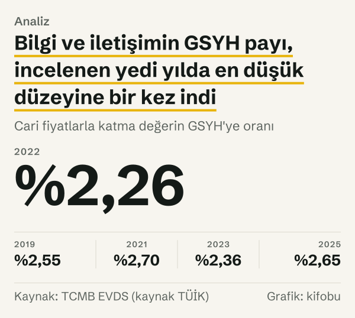
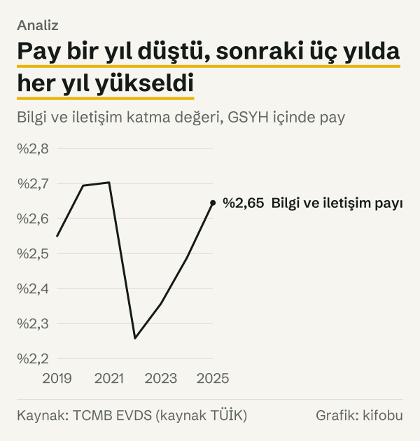
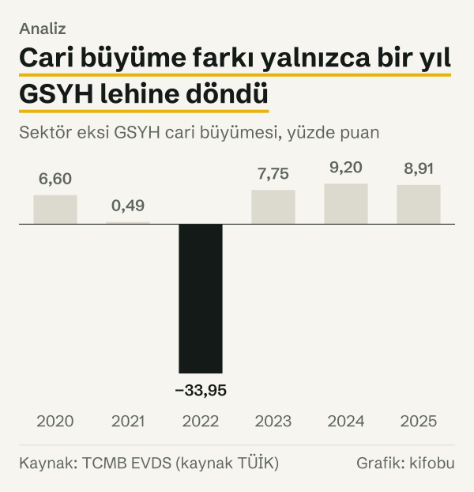

Bilgi ve iletişim sektörünün gayrisafi yurt içi hasıla (GSYH) içindeki payı 2022 yılında bir önceki yıla göre 0,45 puan geriledi: %2,70'ten %2,26'ya. Sektörün o yıl küçüldüğünü düşünmek kolay, ama veri bunu göstermiyor. Cari fiyatlarla katma değeri 2021 yılında 200,9 milyar TL iken 2022'de 346,0 milyar TL'ye çıktı; yani %72,2 arttı. Aynı yıl paydanın, yani GSYH'nin büyümesi daha da hızlıydı: %106,2.

*Cari fiyatlarla katma değerin GSYH'ye oranı. Kaynak: TCMB EVDS (kaynak TÜİK).*

Bu yazı tek cümlelik bir cevap vermiyor, çünkü cevap yıldan yıla değişiyor. Payı ve paydayı hacim ile fiyat bileşenlerine ayırınca 2019–2025 aralığında üç ayrı dönem çıkıyor. İlk dönemde (2020–2021) sektörün hacim büyümesi GSYH'nin çok önünde seyretti ama fiyat bileşeni geride kaldı; pay 2020'de 0,14 puan yükseldi, 2021 yılında neredeyse yerinde saydı. İkinci dönemde, 2022 yılında, iki tarafın hacmi neredeyse aynı hızda büyüdü; GSYH'nin fiyat bileşeni ise sektörünkinden çok daha hızlı arttı. Üçüncü dönemde (2023–2025) sektörün fiyat bileşeni öne geçti ve pay yeniden yükseldi.

Yedi yılın sonunda pay %2,65. 2019'daki %2,55'in yalnızca yaklaşık 0,1 puan üzerinde. Bu arada GSYH cari fiyatlarla 14,4 kat, sektörün katma değeri 14,9 kat büyüdü. Rakamlar TÜİK'in üretim yöntemiyle GSYH serilerinden, Türkiye Cumhuriyet Merkez Bankası (TCMB) Elektronik Veri Dağıtım Sistemi (EVDS) üzerinden alındı.

## Pay ve payda neyi sayıyor?

Pay, bilgi ve iletişim faaliyetlerinin (yayımcılık, telekomünikasyon, bilgisayar programlama ve bilgi hizmetleri) yarattığı katma değerdir. TÜİK bu grubu faaliyet kolları sınıflamasında J harfiyle gösteriyor. Payda ise GSYH'dir: bütün faaliyet kollarının katma değerine, ürün vergileri ile sübvansiyonların farkı eklenmiş toplam.

Her iki taraf da cari fiyatlarla ölçülüyor. Cari fiyat, her yılın kendi fiyatıyla ölçüm demektir; dolayısıyla bir yıldan ötekine geçişte hem üretilen miktardaki değişimi hem fiyatlardaki değişimi taşır. Pay bu yüzden iki farklı şeyle oynayabilir. Birincisi, sektörün miktar olarak ekonominin geri kalanından hızlı ya da yavaş büyümesi. İkincisi, iki tarafın fiyat bileşenlerinin farklı hızda artması.

TÜİK aynı tabloyu zincirlenmiş hacim olarak da yayımlıyor. Cari değeri zincirlenmiş hacme bölünce üçüncü bir ölçü çıkıyor: katma değerin örtük fiyat göstergesi. Hacim yalnızca miktar değişimini, örtük fiyat göstergesi yalnızca fiyat hareketini taşıyor. Bu göstergeyi kendimiz hesapladık; TÜİK'in ayrıca yayımladığı bir seri değil.

Bir kural işimizi kolaylaştırıyor: pay ancak iki büyüme oranı farklıysa oynar. Sektör ile GSYH aynı oranda büyürse, ne kadar hızlı büyürlerse büyüsünler pay yerinde kalır. Bu yüzden 2021 yılında cari büyüme farkı yalnızca 0,5 puan iken pay neredeyse oynamadı; 2022 yılında fark 34,0 puan iken pay 0,45 puan düştü. Payın yüzde olarak değişimi, sektörün büyüme çarpanının GSYH'nin büyüme çarpanına oranıyla belirlenir. Aşağıdaki bölümler bu kuralı yıl yıl uyguluyor: önce cari farkı, sonra o farkın hacim ve fiyat parçalarını gösteriyor.

## Yedi yıllık seyir

2019'da pay %2,55'ti. Sonraki iki yılda yükseldi: 2020'de %2,69, 2021'de %2,70 oldu. 2022'de %2,26'ya düştü, sonra her yıl biraz toparlandı: 2023'te %2,36, 2024'te %2,49 ve 2025'te %2,65. Yedi yılın en yüksek değeri 2021'in %2,70'i, en düşüğü 2022'nin %2,26'sı. İki uç arasında 0,45 puan var; payın kendisi 2022 yılında %16,5 azaldı.

Payda ise bambaşka bir hızda büyüdü. GSYH 2019'da 4.402,1 milyar TL idi, 2025'te 63.240,5 milyar TL oldu. Sektörün katma değeri aynı sürede 112,2 milyar TL'den 1.672,7 milyar TL'ye çıktı. İki seri de büyük cari fiyat artışları içerdiği için tek başına bu rakamlar bir şey söylemiyor; önemli olan iki serinin birbirine oranı.

*Bilgi ve iletişim katma değeri, GSYH içinde pay. Kaynak: TCMB EVDS (kaynak TÜİK).*

## 2020–2021: hacim öne geçti, fiyat geri kaldı

2020'de sektörün cari katma değeri %23,4, GSYH %16,8 arttı. Fark 6,6 puan oldu ve pay 0,14 puan yükseldi. Bu farkı hacim ve fiyat olarak ayırınca iki zıt etki görülüyor. Sektörün zincirlenmiş hacmi %14,0, GSYH'ninki %1,8 arttı; hacimde fark 12,2 puan sektör lehine. Örtük fiyat göstergesi ise sektörde %8,3, GSYH'de %14,7 arttı; fiyatta fark 6,5 puan sektör aleyhine.

2021'de aynı kalıp daha da belirgin. Sektörün hacmi %22,4, GSYH'nin hacmi %11,8 arttı; fark 10,6 puan. Örtük fiyat göstergesi sektörde %18,5, GSYH'de %29,3 arttı; fark 10,8 puan sektör aleyhine. İki etki neredeyse birbirini götürdü. Cari katma değer sektörde %45,1, GSYH'de %44,6 arttı ve pay yalnızca 0,01 puan oynadı.

Her iki yıl da pandemi dönemine (2020–2021) denk geliyor. Verinin gösterdiği yalnızca zamandaşlık: aynı dönemde sektörün hacim büyümesi GSYH'nin belirgin biçimde üzerindeydi. Nedenini bu seriler söylemiyor.

## 2022 yılı: paydanın fiyatı öne çıktı

Oran en sert 2022 yılında hareket etti. Sektör cari fiyatlarla %72,2 büyürken GSYH %106,2 büyüdü; fark 34,0 puan GSYH lehine. Hacim tarafında ise ayrışma neredeyse yok: sektör %6,2, GSYH %5,4 büyüdü; fark yalnızca 0,7 puan, üstelik sektör lehine. Asıl açık fiyat tarafında: sektörün örtük fiyat göstergesi %62,2, GSYH'ninki %95,5 arttı; fark 33,4 puan.

Yani 2022 yılında sektör miktar olarak geride kalmadı; paydanın fiyat bileşeni sektörünkinden çok daha hızlı yükseldi. Hesabın aritmetiği bu kadar net. Fiyat bileşeninin neden bu kadar farklı hızda arttığı ise bu verilerle cevaplanamayan bir soru: GSYH'nin fiyat göstergesi bütün faaliyet kollarının ve ürün vergilerinin bileşimini yansıtıyor, sektörünki yalnızca kendi faaliyetlerini.

*Sektör eksi GSYH cari büyümesi, yüzde puan. Kaynak: TCMB EVDS (kaynak TÜİK).*

## 2023–2025: yön tersine döndü

Tablo, 2023 yılında ters yüze döndü. Sektörün cari katma değeri %84,5, GSYH %76,8 arttı; fark 7,7 puan sektör lehine. Bu kez hacim farkı eksi: sektör %3,1, GSYH %5,1 büyüdü; fark 2,0 puan GSYH lehine. Fiyat tarafında ise sektörün örtük fiyat göstergesi %79,0, GSYH'ninki %68,3 arttı; fark 10,7 puan sektör lehine. Pay 0,10 puan yükseldi.

Cari büyüme farkı 2024'te 9,2 puan sektör lehineydi (%74,1 ile %64,9). Hacim farkı 0,3 puan, fiyat farkı 8,5 puan. 2025'te ise sektörün cari katma değeri %50,5, GSYH %41,6 arttı; fark 8,9 puan. Bu kez hacim de katkı verdi: sektör %7,9, GSYH %3,7 büyüdü; hacim farkı 4,2 puan. Fiyat farkı 3,0 puan kaldı. Pay 2025'te 0,16 puan yükseldi; bu, yedi yılın en büyük yıllık artışı.

Üç yılın ortak yanı, sektörün fiyat bileşeninin GSYH'ninkini geçmesi. Hacim farkı 2023 yılında GSYH lehine, 2024 yılında sıfıra yakın, 2025 yılında ise belirgin biçimde sektör lehineydi.

![Küçük çoklu grafik: Cari büyüme iki tarafta da yüksek, hacim büyümesi cari büyümenin çok altında: Sektör, cari fiyatlarla: 2021 yılında %45,07, 2022 yılında %72,21, 2023 yılında %84,52, 2024 yılında %74,11, 2025 yılında %50,47; GSYH, cari fiyatlarla: 2021 yılında %44,58, 2022 yılında %106,16, 2023 yılında %76,77, 2024 yılında %64,91, 2025 yılında %41,55; Sektör, hacim: 2021 yılında %22,40, 2022 yılında %6,19, 2023 yılında %3,08, 2024 yılında %3,75, 2025 yılında %7,93; GSYH, hacim: 2021 yılında %11,81, 2022 yılında %5,44, 2023 yılında %5,05, 2024 yılında %3,48, 2025 yılında %3,74.](./graf-4.svg)
*Önceki yıla göre yüzde değişim. Kaynak: TCMB EVDS (kaynak TÜİK).*

## Altı yılın toplamı: hacim payı yükseldi, cari pay yerinde saydı

Yıl yıl bakmak ayrıntıyı gösteriyor; altı yılın toplamı ise başka bir şey söylüyor. Zincirlenmiş hacim serileriyle hesaplanan hacim payı, yani sektörün hacminin GSYH'nin hacmine oranı, 2019'da %2,90 idi, 2025'te %3,66. Aradaki fark 0,76 puan. Cari pay aynı sürede yalnızca yaklaşık 0,1 puan arttı.

Makas, fiyat göstergelerindeki farkla aynı yönde. Sektörün örtük fiyat göstergesi 2019–2025 aralığında 8,72 kat, GSYH'ninki 10,62 kat arttı. Yani altı yılın tamamında paydanın fiyat bileşeni sektörünkinden hızlı yükseldi ve miktar olarak kazanılan pay cari ölçümde büyük ölçüde görünmedi.

Hacim payının düzeyi tek başına anlam taşımıyor. Zincirlenmiş hacim serileri bir referans fiyat düzeyine göre kurulduğu için %3,66, sektörün ekonomideki gerçek payı değil; cari fiyatlardaki %2,65 de eksik ölçüm değil. İki ölçü aynı ekonomiyi farklı fiyat düzeylerinde tartıyor. Bu yüzden iki oranın birbirinden ayrışma yönü, yani makasın açılması, düzeylerinden daha anlamlı.

Bu bulgu 2022 yılını başka bir ışıkta gösteriyor. 2023–2025 aralığındaki fiyat farkı sektör lehine döndü, ama altı yılın toplam hesabı hâlâ paydanın lehine.

*Sektör eksi GSYH büyümesi, yüzde puan. Kaynak: TCMB EVDS (kaynak TÜİK).*

## Karşı okuma: düşen pay küçülen sektör değil

Payın düşmesi sektörün zayıfladığı anlamına gelmediği gibi, yükselmesi de sektörün güçlendiği anlamına gelmiyor. 2022 yılında pay düşerken sektörün hacmi GSYH'den hızlı büyüdü. 2023–2024 aralığında pay yükselirken hacim farkı ya GSYH lehineydi ya da sıfıra yakındı; aynı aralıkta fiyat farkı sektör lehineydi.

Gözlemler aynı sonuca varıyor: payın seyri, sektörün miktar olarak ne yaptığıyla zayıf bağlı. Pay ancak hacim farkı ile fiyat farkı birlikte okunduğunda anlam kazanıyor. 2020–2021 aralığında iki fark zıt yönde ve büyüktü; pay 2020 yılında 0,14 puan, 2021 yılında 0,01 puan oynadı. Oysa her iki yılda da sektörün hacim büyümesi GSYH'nin çok üstündeydi.

Pay ile payda ayrımı bir sebep göstermez. Oran, payın paydaya göre yavaş kalmasıyla düşer; aynı durum payın yavaşladığı söylenerek de anlatılabilir. Bu yazı yalnızca iki serinin hangi yılda ne kadar hareket ettiğini gösteriyor: 2022 yılında GSYH'nin fiyat bileşeni sektörünkinden daha hızlı arttı ve oran düştü; iki olgu arasındaki ilişkiyi veri kendiliğinden kurmuyor.

Bir de şu var: bu yazıdaki örtük fiyat göstergesi, TÜİK'in yayımladığı bir fiyat endeksi değil; cari değerin hacme oranı. Sektörün sattığı hizmetlerin fiyatı hakkında doğrudan bilgi vermiyor, yalnızca katma değerin cari ve hacim ölçülerinin birbirinden ne kadar ayrıştığını gösteriyor.

## Ölçümün sınırları: revizyon, çeyrek toplamı ve kapsam

Üç sınır var. Birincisi, TÜİK geçmiş çeyrekleri revize edebiliyor; bu yazıdaki değerler 23 Ekim 2026'da EVDS'den çekilen sürümdür ve sonraki bir revizyon rakamları değiştirebilir. İkincisi, yıllık değerleri dört çeyreğin toplamı olarak biz kurduk. Zincirlenmiş hacim serilerinde çeyrek toplamı yıllık büyüme için yaklaşık bir ölçüdür; TÜİK'in yıllık tablosundaki büyüme oranı küçük farklarla ayrışabilir. Üçüncüsü, payda GSYH olduğu için ürün vergileri ve sübvansiyonlar da içeride. Payı yalnız faaliyet kollarının toplam katma değerine oranlamak mümkündür, ama bu yazıda yapmadık.

2026 yılında ilk iki çeyrek yayımlanmış durumda, fakat yıl tamamlanmadığı için hesaba katılmadı. Çeyrekler arası mevsimsellik güçlü: sektörün cari katma değeri her yılın dördüncü çeyreğinde belirgin biçimde yüksek; bu yüzden tek çeyrek karşılaştırmaları yerine yıllık toplam kullandık.

## Nasıl hesapladık

Dört seriyi kullandık: bilgi ve iletişim faaliyetinin cari fiyatlarla ve zincirlenmiş hacimle katma değeri ile GSYH'nin cari fiyatlarla ve zincirlenmiş hacimle değeri. Hepsi TÜİK'in üretim yöntemiyle, A10 faaliyet kolu sınıflamasına göre yayımladığı üç aylık serilerdir. 2019–2025 aralığındaki her yıl için dört çeyreği topladık.

Payı, sektörün yıllık cari katma değerinin GSYH'ye oranı olarak hesapladık. Hacim payını aynı işlemle zincirlenmiş hacim toplamlarından kurduk. Yıllık büyümeyi iki yıllık toplam arasındaki yüzde değişim olarak aldık. Örtük fiyat göstergesini cari toplamın zincirlenmiş hacim toplamına oranı olarak hesapladık ve onun yıllık yüzde değişimini fiyat büyümesi saydık. Büyüme oranları arasındaki farkları yuvarlanmamış değerlerden hesaplayıp yazıda tek ondalığa yuvarladık; bu yüzden yazıdaki yuvarlanmış iki orandan elle alınan fark, yazılan farktan bir ondalık kadar ayrışabilir.

## Kaynaklar

- [TCMB EVDS: Gayrisafi Yurt İçi Hasıla, üretim yöntemiyle, iktisadi faaliyet kollarına göre, cari fiyatlarla](https://evds3.tcmb.gov.tr/)
- [TCMB EVDS: Gayrisafi Yurt İçi Hasıla, üretim yöntemiyle, iktisadi faaliyet kollarına göre, zincirlenmiş hacim](https://evds3.tcmb.gov.tr/)
