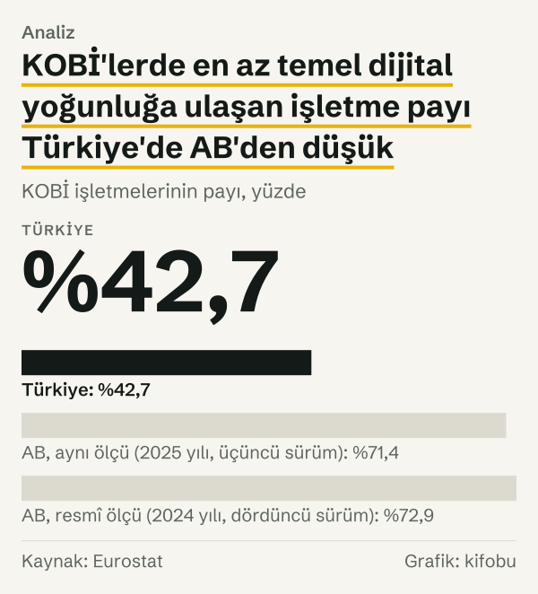
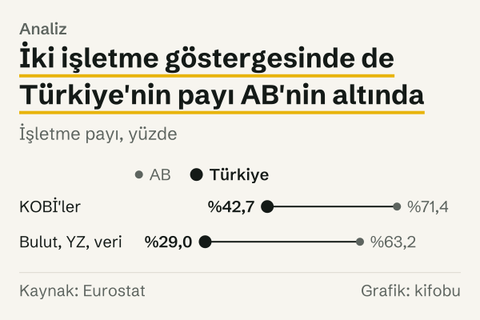
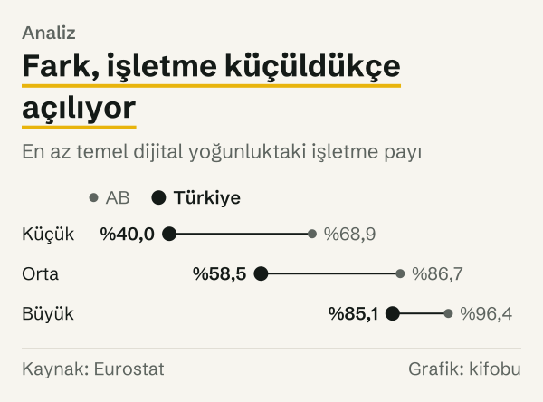
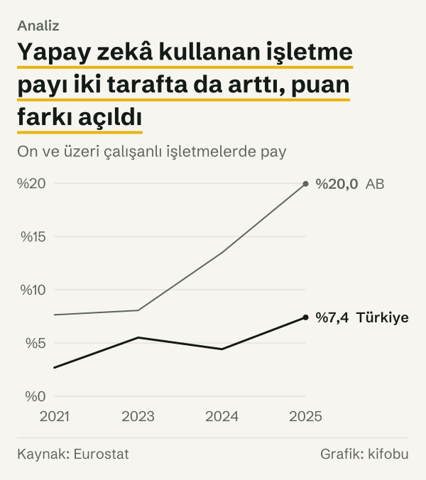
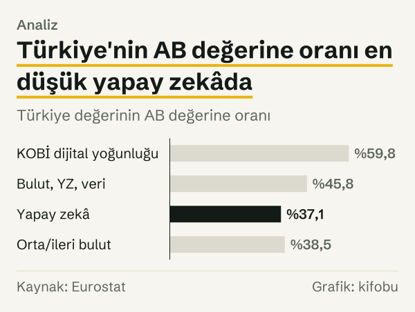

Avrupa Birliği, 2030 yılına kadar Birlik KOBİ'lerinin %90'ından fazlasının en az temel düzeyde dijital yoğunluğa ulaşmasını hedefliyor. Eurostat'ın Türkiye için yayımladığı en son değer %42,7. Hedef ile bu değer arasında 47,3 puan var; Türkiye hedefin %47,4'üne ulaşmış durumda. AB'nin kendi ortalaması aynı ölçüde %71,4: hedefin 18,6 puan altında.

İkinci işletme hedefi, Birlik işletmelerinin en az %75'inin bulut hizmeti, büyük veri ya da yapay zekâdan birini benimsemesi. Eurostat'ın bu üç alanı birleştiren göstergesinde Türkiye'de işletmelerin %28,95'i, AB'de %63,2'si en az birini kullanıyor.

*KOBİ işletmelerinin payı, yüzde. Kaynak: Eurostat.*

Bu iki rakam birlikte okununca bir şey söylüyor, ayrı ayrı okununca başka bir şey. Mesafe puan olarak büyük; oran olarak ise ikinci hedefte Türkiye hedefin %38,6'sında, ilk hedefte %47,4'ünde. İkisi arasındaki ayrım yazının ikinci yarısında önem kazanıyor: gösterge yapay zekâya yaklaştıkça Türkiye'nin AB değerine oranı düşüyor.

Aşağıda önce hedeflerin tam olarak ne söylediğine, sonra Türkiye ve AB değerlerine, en sonda da bu karşılaştırmanın nerede sınırlandığına bakıyoruz. Yazı hedefleri değerlendirmiyor; yalnız hedef, gerçekleşen ve aradaki farkı rakam olarak veriyor.

## Hedefler neyi söylüyor?

Hedefler, Avrupa Parlamentosu ile Avrupa Birliği Konseyi'nin Aralık 2022 tarihli Dijital On Yıl Politika Programı kararında yer alıyor. Karar, AB kurumları ile üye ülkelerin 2030 yılına kadar birlikte ulaşmaya çalışacağı hedefleri sayıyor. İşletmelerin dijital dönüşümüyle ilgili üç hedeften ikisi bu yazının konusu: işletmelerin en az %75'inin bulut hizmeti, büyük veri ya da yapay zekâdan birini ya da birkaçını benimsemesi ve KOBİ'lerin %90'dan fazlasının en az temel dijital yoğunluğa ulaşması.

Karar, dijital yoğunluğu bir işletmeye, kullandığı teknolojilerin sayısına göre bir teknoloji karnesi üzerinden atanan toplam değer olarak tanımlıyor. Eurostat bu değeri bir endekse çeviriyor ve işletmeleri dört gruba ayırıyor. Hedefteki ifade, bu dört gruptan temel düzeyin ve üstünün toplam payını ölçüyor. Eurostat'ın serisi KOBİ'yi 10–249 çalışanı olan işletme olarak alıyor; bu yazıdaki KOBİ rakamları hep bu aralığa ait. Kararın metni birinci hedefte %90'dan fazla, ikinci hedefte en az %75 ifadesini kullanıyor; yazı iki eşiği de verildiği gibi, %90 ve %75 olarak kullanıyor. Hedef yılı 2030 yılı; Eurostat'ın son değerleri 2025 yılına ait, yani hedefe giden yolun ortasındaki bir ölçümden söz ediyoruz.

Hedef değerleri bu yazıda Aralık 2022 tarihli karardaki değerlerdir. Karar, hedeflerin ve tanımların Komisyon tarafından gözden geçirilmesini öngörüyor; gözden geçirme sonucunda hedef değerleri değişirse bu karşılaştırma da değişir.

## KOBİ'lerde temel dijital yoğunluk

Eurostat'ın serisinde Türkiye için tek bir gözlem var: 2025 yılında 10–249 çalışanlı işletmelerin %42,7'si en az temel dijital yoğunluğa ulaşmış. Aynı yıl AB ortalaması %71,4. İki değer arasında 28,7 puan var; Türkiye'nin değeri AB değerinin %59,8'i.

Hedefle karşılaştırınca tablo şöyle: AB'nin 2025 yılında ölçülen değeri hedefin %79,3'üne, Türkiye'nin değeri %47,4'üne denk geliyor. AB'nin resmî raporlamada kullandığı dördüncü sürümle ise ölçüm 2022'de %69, 2024'te %72,9 olmuş; yani iki yılda 3,9 puan artmış. Bu sürümle AB, 2024 yılında hedefin %81,0'ındaydı ve 17,1 puan uzaktaydı.

AB içinde dağılım geniş. Finlandiya %94,04 ve Danimarka %92,45 ile 2025 yılında hedef eşiğinin üstündeydi: hedefin sırasıyla %104,5'i ve %102,7'si. Eurostat'ın o yıl değer yayımladığı ülkeler arasında yalnız Bulgaristan'ın (%38,33) değeri Türkiye'nin altında.

*İşletme payı, yüzde. Kaynak: Eurostat.*

## Büyüklük sınıfına göre fark

Büyüklük sınıfları ayrı bakılınca fark tek bir sayıdan daha değişken. 10–49 çalışanlı işletmelerde Türkiye'de oran %39,97, AB'de %68,85; fark 28,9 puan. 50–249 çalışanlı işletmelerde Türkiye %58,51, AB %86,67; fark 28,2 puan. 250 ve üzeri çalışanlı işletmelerde ise Türkiye %85,11, AB %96,39; fark 11,3 puan.

Yani Türkiye'nin AB değerine oranı küçük işletmelerde %58,1, orta işletmelerde %67,5, büyüklerde %88,3. Fark, işletme küçüldükçe açılıyor. Hedef yalnız KOBİ'leri kapsadığı için büyük işletmeler hedef hesabına girmiyor.

Sınıflar arası karşılaştırma bir şeyi daha gösteriyor. Türkiye'deki büyük işletmelerin değeri (%85,11), AB'deki orta işletmelerin değerine (%86,67) yakın. Türkiye'deki orta işletmelerin değeri (%58,51) ise AB'deki küçük işletmelerin değerinin (%68,85) altında. Küçük ve orta sınıflarda Türkiye ile AB arasındaki fark benzer büyüklükte, büyük sınıfta ise belirgin biçimde dar. Bu bir değerlendirme değil, tabloların yan yana okunuşu.

Her sınıfın hedefle ilişkisi de farklı. AB'de büyük işletmelerin değeri %96,39 ile %90 eşiğinin üstünde; hedef ise KOBİ'ler için konmuş olduğundan bu sınıf hedef hesabına girmiyor. Eurostat'ın verdiği sınıf kırılımı, hedefe giden yolda sınıfların nasıl dağıldığını görmeye yarıyor, hedefin kendisini sınıf bazında ölçmeye değil.

*En az temel dijital yoğunluktaki işletme payı. Kaynak: Eurostat.*

## Aynı mesafe, üç ölçüyle

KOBİ dijital yoğunluğunda Türkiye'nin konumunu üç farklı biçimde söylemek mümkün. Hedef ile değer arasındaki fark 47,3 puan; bu, hedefe ulaşmak için kaç puan gerektiğini söylüyor. Değerin hedefe oranı %47,4; bu, hedefin ne kadarına ulaşıldığını söylüyor. Türkiye'nin AB değerine oranı %59,8; bu, AB ortalamasının neresinde durulduğunu söylüyor. Üç rakam aynı veriden çıkıyor, ama üçü aynı şeyi söylemiyor.

İlk iki ölçü hedefin seviyesine bağlı. Hedef %90 olduğu için puan farkı ile oran birbirinden türetilebiliyor. Üçüncü ölçü hedeften bağımsız: AB'nin kendisi hedefin altındayken Türkiye'nin AB'ye oranı yine hesaplanabiliyor. AB'nin kendi mesafesi üçüncü sürümle 18,6 puan, resmî dördüncü sürümle 2024 yılında 17,1 puan. Türkiye ile AB arasındaki fark ise 28,7 puan; yani Türkiye'nin hedefe mesafesinin büyük bölümü, AB'nin zaten hedefin gerisinde olmasından değil, Türkiye ile AB arasındaki farktan geliyor.

Bileşik göstergede de aynı ayrım geçerli: Türkiye hedefin 46,1 puan gerisinde, AB 11,8 puan; Türkiye'nin AB değerine oranı %45,8. Bu oran KOBİ dijital yoğunluğundaki %59,8'den düşük. Yani iki hedefte aynı ülke, AB'ye göre farklı mesafelerde duruyor.

## İkinci hedef: bulut, yapay zekâ ve veri analitiği

İkinci göstergede Eurostat, işletmelerin yapay zekâ kullanıp kullanmadığına, orta ya da ileri düzey ücretli bulut hizmeti alıp almadığına ve veri analitiği yapıp yapmadığına bakıyor; üçünden en az birini yapan işletmeleri sayıyor. Kapsam 10 ve üzeri çalışanlı işletmeler.

2025 yılında Türkiye'de bu oran %28,95, AB'de %63,2. Hedefe oran olarak Türkiye %38,6, AB %84,3. Puan olarak Türkiye hedefin 46,1 puan, AB 11,8 puan gerisinde. İki yıl önce, 2023'te, Türkiye %25,54, AB %54,7 idi. İki yılda Türkiye 3,4 puan, AB 8,5 puan artırdı. Bu yüzden aradaki fark 2023'te 29,2 puanken 2025'te 34,3 puana çıktı.

Ülkeler arasında hareket yönü aynı değil. Danimarka %77,36'dan %82,31'e, Almanya %57,97'den %63,22'ye çıktı. Polonya %51,77'den %52,73'e, yani neredeyse yerinde. Macaristan %65,63'ten %59,66'ya geriledi. Romanya ve Bulgaristan ise Türkiye'ye yakın bir noktadan başlayıp farklı hızlarda ilerledi: Romanya %28,74'ten %43,57'ye, Bulgaristan %29,34'ten %34,62'ye.

*Yapay zekâ, orta/ileri bulut ya da veri analitiği kullanan işletme payı. Kaynak: Eurostat.*

## Yapay zekâ: oran ve puan aynı hikâyeyi anlatmıyor

Bileşik göstergenin içinde yapay zekâ en az yayılmış alan. 2025 yılında yapay zekâ teknolojisi kullanan işletme payı Türkiye'de %7,41, AB'de %19,95. Fark 12,5 puan; Türkiye'nin değeri AB değerinin %37,1'i. Orta ya da ileri düzey bulut hizmetinde Türkiye %17,95, AB %46,69; oran %38,5. Böylece Türkiye'nin AB değerine oranı KOBİ dijital yoğunluğunda %59,8 iken yapay zekâda %37,1.

2021 yılından 2025'e baktığımızda iki ölçü ters yöne işaret ediyor. Yapay zekâ kullanan işletme payı Türkiye'de %2,69'dan %7,41'e, yani %175,5 arttı; AB'de %7,65'ten %19,95'e, yani %160,8 arttı. Yüzde değişim olarak Türkiye daha hızlı artmış görünüyor. Puan farkı ise 2021'de 5,0 puan iken 2025'te 12,5 puan. Düşük bir tabandan başlayan seri, yüzde olarak hızlı büyürken puan olarak geride kalabiliyor.

*On ve üzeri çalışanlı işletmelerde pay. Kaynak: Eurostat.*

*Türkiye değerinin AB değerine oranı. Kaynak: Eurostat.*

## Karşı okuma: hedef Türkiye'nin hedefi değil

Bu hedefler Birlik işletmeleri için konmuş. Bu eşiklerin Türkiye için resmî bir karşılığı bu yazıda ele alınmıyor; Eurostat Türkiye'yi karşılaştırma için kapsıyor, hedefin muhatabı olarak değil. Bu yüzden Türkiye için hesapladığımız hedefe oran, bir yükümlülüğe uzaklığı değil, AB'nin kendine koyduğu çıtaya göre konumu gösteriyor.

Bir başka okuma ölçünün belirlenmesiyle ilgili. Aynı veri hedefin kendisine değil, AB'nin ortalamasına oranlanırsa Türkiye'nin konumu %59,8 çıkıyor; hedefe oranlanırsa %47,4. İkisi aynı olgunun iki ölçüsü; hangisinin kullanıldığı mesafenin büyüklüğünü değiştiriyor, yönünü değil.

Üçüncü okuma, düşük taban etkisi. Türkiye'de bulut kullanan işletme payı hızla artmış olabilir, ama yapay zekâ gibi alanlarda AB'nin de hızlı arttığı yıllar var: AB yapay zekâ ortalaması 2023–2025 aralığında %8,06'dan %19,95'e çıktı. Hareketli bir hedefe yetişmek, durağan bir hedefe yetişmekten farklı.

Dördüncü okuma ölçünün zamanıyla ilgili. Türkiye'nin değeri 2025 yılında, AB'nin resmî değeri 2024 yılında ölçüldü; aynı ölçü için bile bir yıl fark var. Türkiye'nin dördüncü sürüm değeri yayımlanmadan resmî sürümle bire bir karşılaştırma yapılamıyor. Bu yüzden yazıdaki tüm Türkiye hesapları, üçüncü sürümün değeriyle kurulmuş yaklaşık bir konumu gösteriyor; tam bir hedef mesafesi değil.

## Ölçümün sınırları: sürüm, sıklık ve kapsam

Dört sınır var. Birincisi, dijital yoğunluk endeksinin sürümü. Eurostat 2022 yılı ve 2024 yılı verilerini dördüncü sürümle; 2021 yılı, 2023 yılı ve 2025 yılı verilerini üçüncü sürümle yayımlıyor. AB'nin resmî raporlamasında dördüncü sürüm kullanılıyor. Türkiye için yalnız 2025 yılında üçüncü sürüm ölçümü var; dördüncü sürüm değeri yok. Bu yüzden Türkiye'yi AB'nin üçüncü sürüm değeriyle (%71,4) karşılaştırdık; hedefe oran hesabında ise Türkiye'nin üçüncü sürüm değeri hedefe bölündü. İki sürüm doğrudan karşılaştırılamaz; Türkiye'nin dördüncü sürüm değerinin hedefe oranı farklı çıkabilir.

İkincisi, ölçüm sıklığı. Dijital yoğunluk iki yılda bir sürüm değiştirerek ölçülüyor. Türkiye için tek nokta olduğu için bir seyir gösteremiyoruz. Üçüncüsü, kapsam: bileşik gösterge Eurostat'ın kendi hesabı ve hedefteki ifadeyle bire bir aynı olmayabilir; hedef üç alanı ayrı sayıyor, Eurostat bulutta yalnız orta ve ileri düzey hizmetleri sayıyor. Dördüncüsü, örneklem: bu veriler işletme anketlerine dayanıyor ve küçük farklar örnekleme hatasıyla açıklanabilir. Beşincisi, yuvarlama: yazıdaki oranlar gösterildikleri basamağa yuvarlanmış değerlerdir; 47,3 puan ile %47,4 birbirinin yuvarlaması değil, iki ayrı ölçüdür (biri hedef ile değerin farkı, öteki değerin hedefe oranı).

## Nasıl hesapladık

Rakamlar Eurostat'ın yayımladığı üç veri tablosundan alındı: dijital yoğunluk, yapay zekâ ve bulut hizmeti kullanımı. Hedef değerleri Dijital On Yıl Politika Programı kararının metninden alındı. Her değeri API'den çektikten sonra ayrı bir istekle yeniden çekip karşılaştırdık.

Hedefe oranı, değerin hedefe bölünmesiyle yüzde olarak hesapladık. Mesafeyi puan olarak, hedef ile değerin farkından aldık. Türkiye'nin AB değerine oranı için Türkiye değerini AB değerine böldük. Yüzde değişimi ilk ve son yıl değeri arasındaki orandan hesapladık. Bütün hesaplar yuvarlanmamış değerlerden yapıldı ve yazıda gösterildikleri basamağa yuvarlandı.

## Kaynaklar

- [Avrupa Parlamentosu ve Konsey: Dijital On Yıl Politika Programı Kararı](https://eur-lex.europa.eu/eli/dec/2022/2481/oj/eng)
- [Eurostat: Büyüklük sınıfına göre dijital yoğunluk](https://ec.europa.eu/eurostat/databrowser/view/isoc_e_dii/default/table)
- [Eurostat: Büyüklük sınıfına göre yapay zekâ kullanımı](https://ec.europa.eu/eurostat/databrowser/view/isoc_eb_ai/default/table)
- [Eurostat: Büyüklük sınıfına göre bulut hizmeti kullanımı](https://ec.europa.eu/eurostat/databrowser/view/isoc_cicce_use/default/table)
