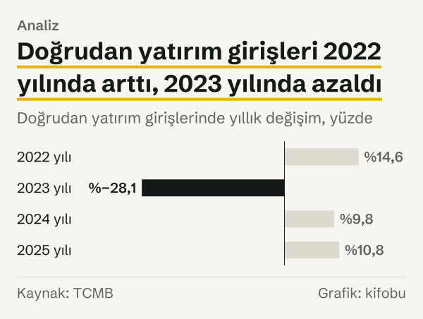
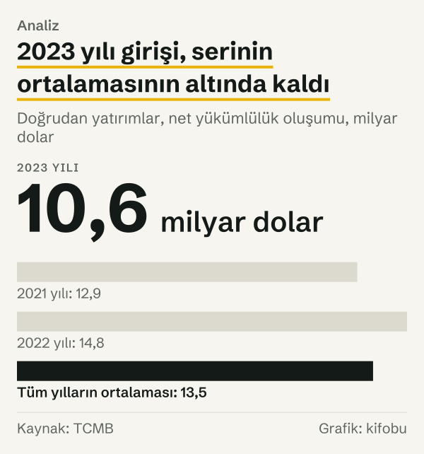

ECB ve Fed faizleri yükselirken Türkiye'ye gelen doğrudan yatırım ne yaptı? Kısa cevap: iki seri her dönemde aynı yöne gitmedi. Avrupa Merkez Bankası (ECB) mevduat kolaylığı faizi 27 Temmuz 2022'de %0'a çıktı ve 20 Eylül 2023'te %4,00'e ulaştı. Aynı dönemde ABD'de gecelik faiz 2021'de %0,08 iken 2023'te %5,33 oldu. Türkiye'ye doğrudan yatırım girişleri ise 2021 yılında 12,9 milyar dolar, 2022 yılında 14,8 milyar dolar, 2023 yılında 10,6 milyar dolar oldu: önce %14,6 arttı, sonra %28,1 azaldı.

Tabloyu zamanda geriye ve ileriye uzatınca çıkan şey bir ilişki değil, dalgalanma. 2008 yılında 19,9 milyar dolar olan giriş 2009 yılında 8,6 milyar dolara geriledi; 2008 yılına göre %56,8 azaldı, o yıllarda faizler de düşüyordu. 2024–2025 yıllarında ise faizler inerken giriş %9,8 ve %10,8 arttı. Bu yazı bir faiz–yatırım ilişkisi kurmuyor; eriştiğimiz kurum belgelerinde de böyle bir nedensellik anlatımı bulamadık. Yalnızca iki serinin hangi yıllarda aynı, hangi yıllarda farklı yönde hareket ettiğini zaman sırasıyla gösteriyoruz.

Doğrudan yatırım, yurt dışı yerleşiğin bir işletmede kalıcı pay ya da kontrol edinmesidir. Türkiye Cumhuriyet Merkez Bankası (TCMB) ödemeler dengesinde bunu net yükümlülük oluşumu adıyla yayımlıyor; yani yurt dışı yerleşiklerin Türkiye'de oluşturduğu doğrudan yatırım yükümlülüklerinin net artışı. Aşağıda giriş derken bu seriyi kastediyoruz.

## 2005–2009: yüksek faizden düşük faize

Seri 2005 yılında 10,0 milyar dolarla başlıyor. 2006 yılında 20,2 milyar dolara, 2007 yılında 22,0 milyar dolara çıktı. Bu yıllarda ABD'de gecelik faiz %4 civarındaydı: 2005'te %4,16, 2006'da %5,24, 2007'de %4,24. Girişler ve faiz birlikte yüksekti. Dönemin en yüksek girişi 2007 yılında görüldü, en düşüğü 2009 yılında. Yani aynı beş yıl, birbirinden çok farklı giriş düzeyleri taşıyor.

2008 yılında girişler 19,9 milyar dolara geriledi, ABD faizi ise %0,16'ya indi. 2009 yılında giriş 8,6 milyar dolara düştü: 2008 yılına göre %56,8 azaldı, 2007 yılına göre %61,1 azaldı. Euro bölgesinde aynı dönemde gecelik faiz 2007'de %3,88 iken 2009'da %0,35'e indi. Yani 2007–2009 aralığında faiz ve giriş birlikte aşağı yöndeydi.

![Çizgi grafik: Doğrudan yatırım girişleri 2023 yılında azaldı: Giriş: 2005 yılında 10,0 milyar dolar, 2006 yılında 20,2 milyar dolar, 2007 yılında 22,0 milyar dolar, 2008 yılında 19,9 milyar dolar, 2009 yılında 8,6 milyar dolar, 2010 yılında 9,1 milyar dolar, 2011 yılında 16,2 milyar dolar, 2012 yılında 13,7 milyar dolar, 2013 yılında 13,6 milyar dolar, 2014 yılında 13,3 milyar dolar, 2015 yılında 19,3 milyar dolar, 2016 yılında 13,8 milyar dolar, 2017 yılında 11,2 milyar dolar, 2018 yılında 12,5 milyar dolar, 2019 yılında 9,5 milyar dolar, 2020 yılında 7,5 milyar dolar, 2021 yılında 12,9 milyar dolar, 2022 yılında 14,8 milyar dolar, 2023 yılında 10,6 milyar dolar, 2024 yılında 11,7 milyar dolar, 2025 yılında 12,9 milyar dolar.](./graf-1.svg)
*Doğrudan yatırımlar, net yükümlülük oluşumu, yıllık toplam. Kaynak: TCMB.*
## 2010–2021: faizin sıfıra yakın olduğu yıllar

ABD'de gecelik faiz 2010–2015 yıllarında %0,07 ile %0,24 arasında seyretti. Girişler bu yıllarda geniş bir aralıkta oynadı: 2010 yılında 9,1 milyar dolar, 2011 yılında 16,2 milyar dolar, 2015 yılında 19,3 milyar dolar. Faiz değişmezken giriş tarafında büyük bir salınım vardı.

Faiz 2016–2018 yıllarında yükselmeye başladı: ABD'de %0,54, %1,30, %2,27. Girişler bu yıllarda 13,8 milyar dolar, 11,2 milyar dolar ve 12,5 milyar dolar oldu; 2019 yılında 9,5 milyar dolara indi. 2020 yılında giriş 7,5 milyar dolarla serinin en düşük düzeyindeydi, faiz ise %0,09 idi. 2021 yılında giriş 12,9 milyar dolara çıktı, faiz %0,08 idi.

![Çizgi grafik: ABD ve euro bölgesinde gecelik faiz 2022 yılından sonra yükseldi: ABD: 2005 yılında %4,160, 2006 yılında %5,240, 2007 yılında %4,240, 2008 yılında %0,160, 2009 yılında %0,120, 2010 yılında %0,180, 2011 yılında %0,070, 2012 yılında %0,160, 2013 yılında %0,090, 2014 yılında %0,120, 2015 yılında %0,240, 2016 yılında %0,540, 2017 yılında %1,300, 2018 yılında %2,270, 2019 yılında %1,550, 2020 yılında %0,090, 2021 yılında %0,080, 2022 yılında %4,100, 2023 yılında %5,330, 2024 yılında %4,330, 2025 yılında %3,640; Euro bölgesi: 2005 yılında %2,276, 2006 yılında %3,501, 2007 yılında %3,879, 2008 yılında %2,486, 2009 yılında %0,355, 2010 yılında %0,498, 2011 yılında %0,627, 2012 yılında %0,073, 2013 yılında %0,169, 2014 yılında %−0,030, 2015 yılında %−0,199, 2016 yılında %−0,350, 2017 yılında %−0,342, 2018 yılında %−0,361, 2019 yılında %−0,540, 2020 yılında %−0,556, 2021 yılında %−0,576, 2022 yılında %1,504, 2023 yılında %3,903, 2024 yılında %3,103, 2025 yılında %1,929.](./graf-2.svg)
*Gecelik faiz, yıllık ortalama, yüzde. Kaynak: OECD.*
Sıfıra yakın faiz yıllarında dikkat çeken şey, girişlerin oynaklığı. Aynı düşük faiz düzeyinde 2020 yılında seri en düşük değerini aldı (7,5 milyar dolar), 2015 yılında ise en yüksek değerlerinden birini (19,3 milyar dolar). Aynı faiz iki çok farklı giriş düzeyinin yanında durdu.

## 2022–2023: iki merkez bankasında faiz artışı

2022 yılında ABD'de gecelik faiz %4,10'a çıktı, 2023 yılında %5,33 oldu. Euro bölgesinde aynı faiz 2021 yılında %−0,58 iken 2022 yılında %1,50'ye, 2023 yılında %3,90'a çıktı. ECB'nin mevduat kolaylığı faizi 18 Eylül 2019'dan beri %−0,5'teydi; 27 Temmuz 2022'de %0'a, 20 Eylül 2023'te %4,00'e çıktı: bir yıl iki ay içinde 4 puan artış.

Girişler bu dönemde iki aşamalı hareket etti. 2022 yılında %14,6 arttı: 12,9 milyar dolardan 14,8 milyar dolara. 2023 yılında %28,1 azaldı: 14,8 milyar dolardan 10,6 milyar dolara. İki yıllık toplam değişim 2021 yılına göre %17,6 azalma. 2023 yılı değeri, serinin tüm yıllarının ortalamasının 2,9 milyar dolar altında kaldı.

2022 yılında faiz de giriş de arttı: ABD'de gecelik faiz %4,10'a çıktı, giriş %14,6 arttı. 2023 yılında faiz yükselmeyi sürdürdü, giriş %28,1 azaldı. İki serinin yönü birinci yılda aynı, ikinci yılda farklı oldu. 2023 yılında görülen azalmanın faizle ilgili olup olmadığını bu seri söylemiyor. OECD'nin 2026 yılı karnesi, Türkiye'nin kendi politika faizinin %8,5'ten %50'ye çıktığını yazıyor; biz bu rakamı giriş serisiyle ilişkilendirmiyoruz.

*Doğrudan yatırım girişlerinde yıllık değişim, yüzde. Kaynak: TCMB.*
## 2024–2026: faiz inerken ve yeniden yükselirken

2024 yılında ABD'de gecelik faiz ortalama %4,33'e, 2025 yılında %3,64'e indi. Euro bölgesinde aynı faiz %3,10 ve %1,93 oldu. ECB'nin mevduat kolaylığı faizi 12 Haziran 2024'te %3,75'e, 11 Haziran 2025'te %2,00'e indi. Girişler 2024 yılında %9,8 arttı (11,7 milyar dolar), 2025 yılında %10,8 arttı (12,9 milyar dolar). Bu iki yılın sonunda giriş, 2021 yılında görülen düzeye döndü: 2021–2025 aralığında değişim yalnızca %0,2.

*Doğrudan yatırımlar, net yükümlülük oluşumu. Kaynak: TCMB.*
ECB 2026 yılında faizi iki kez yukarı çekti: 17 Haziran 2026'da %2,25'e, 16 Eylül 2026'da %2,50'ye. Aynı yılın ilk sekiz ayında Türkiye'ye doğrudan yatırım girişi 6,8 milyar dolar oldu; 2025 yılında aynı sekiz ayda 10,6 milyar dolardı. Bir önceki yılın aynı dönemine göre %35,2 azaldı. Bu tam bir yıllık veri değil; aylar ilerledikçe değişebilir. Aylık değerler 2026 yılında 0,3 milyar dolar ile 1,4 milyar dolar arasında, 2025 yılında 0,3 milyar dolar ile 2,6 milyar dolar arasında kaldı. Yılın geri kalanı hakkında bir şey söylemiyoruz.

## Yıl yıl yönlere bakınca

Yıllık seriyi sadeleştirmenin bir yolu, her yıl için iki yönü karşılaştırmak: ABD faizi bir önceki yıla göre arttı mı azaldı mı, giriş arttı mı azaldı mı? 2006–2025 yıllarının yirmisi için bu karşılaştırmayı yaptık. Dört olası birleşimin her biri tam beşer yılda görüldü. Faiz arttığında giriş beş yılda arttı, beş yılda azaldı. Faiz azaldığında giriş beş yılda arttı, beş yılda azaldı.

Bu eşit dağılım, yönler arasında tutarlı bir ilişki olmadığını gösteriyor; ama bu, ilişki olmadığını kanıtlamıyor. Yön karşılaştırması büyüklüğü hesaba katmıyor: faizin neredeyse hiç değişmediği bir yıl ile dört puan yükseldiği bir yıl aynı kutuya giriyor. Bir yıllık gecikmeler de dışarıda kalıyor.

## Gruplara ayırınca

Faizin yüksek olduğu yıllarla düşük olduğu yılların girişlerini iki gruba ayırarak karşılaştırdık. ABD gecelik faizinin en yüksek olduğu altı yıl var: 2005–2007 ve 2022–2024. Bu yıllarda faizin ortalaması %4,57, girişlerin ortalaması 14,9 milyar dolar. Faizin en düşük olduğu on yıl var: 2008–2015 ve 2020–2021. Bu yıllarda faizin ortalaması %0,13, girişlerin ortalaması 13,4 milyar dolar. İki grup arasındaki fark 1,5 milyar dolar ve yüksek faiz grubunda daha yüksek.

Bu fark, yüksek faizin girişleri artırdığı anlamına gelmez. Yüksek faiz grubunda 2006–2007 yılları gibi serinin en yüksek girişleri var; düşük faiz grubunda ise 2009 yılı ve 2020 yılı gibi en düşükleri. Grupları sıralamayla biz seçtik; farklı bir ayırma ölçütüyle fark değişir. Orta düzeydeki faiz yılları bu hesabın dışında kaldı: 2016–2019 yıllarıyla 2025 yılı iki gruba girmiyor.

## Ayrı okumalar ve ölçeğin sınırı

Ölçtüğümüz yalnızca üç seri var: Türkiye'ye doğrudan yatırım girişi, ABD'nin gecelik faizi ve euro bölgesinin gecelik faizi. İki faiz serisi de aynı yönde hareket etti ama aynı düzeyde değil: 2023 yılında euro bölgesinin gecelik faizi ABD'ninkinden 1,4 puan düşüktü. Başka serilerle karşılaştırma yapmadık; Türkiye'nin kendi faizi, döviz kuru ya da sektörel veriler bu yazının kapsamı dışında. İki seriyi yan yana koymak, aralarında bir ilişki olduğunu ya da olmadığını göstermiyor.

Giriş serisi yıldan yıla geniş oynuyor. Serinin en yüksek yılı 2007 (22,0 milyar dolar), en düşük yılı 2020 (7,5 milyar dolar); ikisi arasındaki fark 14,5 milyar dolar. Aradaki yıllarda seri 2009 yılında 8,6 milyar dolara indi, 2015 yılında 19,3 milyar dolara çıktı. Bu salınımların büyüklüğü, iki yıllık bir faiz hareketinin giriş üzerindeki izini ayırt etmeyi güçleştiriyor.

İkincisi, karşılaştırma ölçeği. Yıllık ortalama faiz ile yıllık toplam giriş yan yana konunca, yıl içindeki dalgalanmalar silinir. ABD'de faiz 2022 yılında yıl içinde hızla çıktı; yıllık ortalama bu hareketi tek rakama sıkıştırıyor. Aynı şekilde girişin yıl içindeki aylık seyri de yıllık toplamda görünmüyor. Aylık giriş verisi var, ama faiz tarafında aynı sıklıkta ve aynı tanımda seri kullanmadığımız için ay ay bir karşılaştırma kurmadık.

## Ölçümün sınırları

Seri, yurt dışı yerleşiklerin Türkiye'deki doğrudan yatırım yükümlülüklerinin net artışıdır; ödemeler dengesi ilkelerine göre hesaplanır ve zamanla revize edilebilir. Dolar cinsindendir ve enflasyondan arındırılmamıştır; 2005 yılında kullanılan dolar ile 2025 yılında kullanılan dolar aynı satın alma gücünde değildir. Yıllık toplam, aylık değerlerin toplamıdır; ay içi zamanlama farkları yıl sınırında kayabilir.

Kullandığımız faiz, OECD'nin gecelik faiz serisinin yıllık ortalamasıdır; politika faizinin yıl sonu düzeyi değildir. ABD için bu seri federal fonlar faizine yakın bir piyasa faizidir, politika hedefinin kendisi değildir. Euro bölgesi için ECB'nin mevduat kolaylığı faizi ayrıca tarih tarih verildi.

Son olarak, giriş serisi yatırımın hangi ülkeden geldiğini söylemiyor. Euro bölgesinden ya da ABD'den gelen yatırımın payını göstermediği için ECB ve Fed faizleriyle Türkiye'ye gelen yatırım arasında doğrudan bir yatırımcı–faiz eşleşmesi kurulamaz.

## Nasıl hesapladık

TCMB'nin Elektronik Veri Dağıtım Sistemi'nden (EVDS) TP.ODANA6.Q15 serisini (doğrudan yatırımlar, net yükümlülük oluşumu) 2005–2025 yılları için yıllık toplam olarak çektik; 2025–2026 yıllarının ilk sekiz ayı için aylık değerleri toplayarak karşılaştırdık. Yüzde değişimler iki yılın değerleri arasındadır ve bir ondalığa yuvarlanmıştır. Faiz grupları, ABD gecelik faizinin yıllık ortalamasına göre en yüksek altı ve en düşük on yılı kapsar; ayırma ölçütü bizimdir. Grup ortalamaları sade ortalamadır. Yön karşılaştırması, her yıl için ABD faizinin ve girişin bir önceki yıla göre işaretine dayanır. Faiz farkının ve giriş farkının işareti iki ayrı sütunda, yalnızca artış ya da azalış olarak alındı; büyüklük hesaba katılmadı. İşareti sıfır olan bir yıl çıkmadığı için hiçbir yıl dışarıda bırakılmadı.

Faiz verisi için OECD'nin gecelik faiz serisinin yıllık ortalamalarını (ABD ve euro bölgesi) kullandık; ECB faiz değişikliklerinin tarihlerini ECB veri portalındaki mevduat kolaylığı serisinden aldık. Türkiye'nin politika faizi değişimi OECD'nin KOBİ karnesinden aktarıldı; biz hesaplamadık. Bütün değerler 23 Ekim 2026'da çekildi. Hiçbir değer tahmin ya da kestirim değildir; yazıdaki her rakam bu kaynaklardan okunmuş ya da bu rakamlardan hesaplanmıştır, hesaplar kanıt dosyasında tek tek kayıtlıdır.

## Kaynaklar

- [TCMB: Elektronik Veri Dağıtım Sistemi, Ödemeler Dengesi Analitik Sunum (TP.ODANA6.Q15)](https://evds3.tcmb.gov.tr/)
- [OECD: Key short-term economic indicators, financial market](https://data-explorer.oecd.org/?df[ds]=dsDisseminateFinalDMZ&df[id]=DSD_STES%40DF_FINMARK&df[ag]=OECD.SDD.STES)
- [Avrupa Merkez Bankası: Mevduat kolaylığı faizi (Deposit facility)](https://data.ecb.europa.eu/data/datasets/FM/FM.B.U2.EUR.4F.KR.DFR.LEV)
- [OECD: Financing SMEs and Entrepreneurs, 2026 yılı baskısı (OECD Scoreboard)](https://www.oecd.org/en/publications/financing-smes-and-entrepreneurs-2026_075d8058-en.html)
