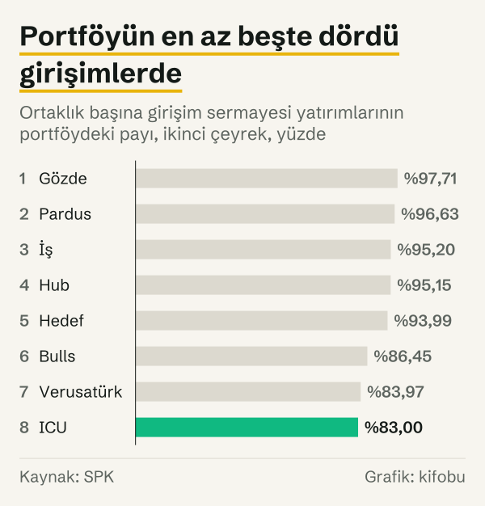

Borsada işlem gören 8 girişim sermayesi yatırım ortaklığının toplam piyasa değeri Haziran 2026'da 39,47 milyar TL oldu. Bu, Haziran 2025'teki 19,69 milyar TL'ye göre %100,5'lik artış demek. Sermaye Piyasası Kurulu (SPK) verisine göre 2026'nın ikinci çeyreğinde bu ortaklıkların her birinde girişim sermayesi yatırımlarının portföydeki payı %83,00 ile %97,71 arasında.

Bu yazıdaki bütün rakamlar SPK'nın 6 Ekim 2026'da güncellediği Temmuz 2026 aylık istatistik bülteninden geliyor. Tutarlar bültende yayımlandığı gibi nominal TL'dir.

## Bir bakışta

- Toplam piyasa değeri Aralık 2024'te 19,50 milyar TL, Aralık 2025'te 32,62 milyar TL, Mart 2026'da 38,64 milyar TL idi.
- Aralık 2025'ten Haziran 2026'ya artış %21,0. İki yıl sonu arasındaki artış %67,3.
- Ortaklık sayısı Haziran 2025'ten bu yana 8.
- İki ortaklık, Bulls ve İş, toplam piyasa değerinin %54'ünü oluşturuyor.

## Piyasa değeri 2008'den bu yana

Bültendeki uzun dönem seride Aralık 2008'de 2 ortaklık ve 40,8 milyon TL piyasa değeri yer alıyor. Aralık 2013'te 6 ortaklık ve 1,02 milyar TL vardı. Aralık 2013'ten Haziran 2026'ya piyasa değeri %3.752,9, ortaklık sayısı 2 arttı.

![Çubuk grafik: Toplam piyasa değeri serinin en yüksek düzeyinde: Piyasa değeri: 2008 yılında 41 milyon TL, 2012 yılında 872 milyon TL, 2013 yılında 1.025 milyon TL, 2014 yılında 1.471 milyon TL, 2015 yılında 1.331 milyon TL, 2016 yılında 1.086 milyon TL, 2017 yılında 2.595 milyon TL, 2018 yılında 1.494 milyon TL, 2019 yılında 3.044 milyon TL, 2020 yılında 7.619 milyon TL, 2021 yılında 6.469 milyon TL, 2022 yılında 15.577 milyon TL, 2023 yılında 15.904 milyon TL, 2024 yılında 19.500 milyon TL, 2025 yılında 32.622 milyon TL, Haz 2026: 39.474 milyon TL.](./graf-1.svg)
*Tüm girişim sermayesi yatırım ortaklıkları, yıl sonu ve Haziran 2026 sonu piyasa değeri, nominal TL. Kaynak: SPK.*

Seri düz bir çizgi değil. Aralık 2017'de 2,59 milyar TL olan piyasa değeri Aralık 2018'de 1,49 milyar TL'ye indi. Aralık 2020'de 7,62 milyar TL olan değer Aralık 2021'de 6,47 milyar TL oldu. Ortaklık sayısı da 6 ile 8 arasında değişti.

| Dönem | Ortaklık sayısı | Piyasa değeri |
|---|---|---|
| Aralık 2008 | 2 | ₺40,8 milyon |
| Aralık 2013 | 6 | ₺1,02 milyar |
| Aralık 2017 | 8 | ₺2,59 milyar |
| Aralık 2018 | 7 | ₺1,49 milyar |
| Aralık 2020 | 6 | ₺7,62 milyar |
| Aralık 2021 | 6 | ₺6,47 milyar |
| Aralık 2022 | 7 | ₺15,58 milyar |
| Aralık 2024 | 7 | ₺19,50 milyar |
| Aralık 2025 | 8 | ₺32,62 milyar |
| Haziran 2026 | 8 | ₺39,47 milyar |

*Dönem sonu piyasa değeri, nominal TL. Kaynak: SPK.*

## Ortaklıklar arasında dağılım

Bültenin şirket bazındaki tablosuna göre 8 ortaklığın ikinci çeyrek sonundaki piyasa değerlerinin toplamı 39.473.716.433 TL. En büyük iki ortaklık Bulls (10,77 milyar TL) ve İş (10,54 milyar TL); ardından Gözde (9,25 milyar TL) geliyor. Üçü birlikte toplamın %77'sinden fazlası.

*Ortaklıkların toplam piyasa değerindeki payı, 2026'nın ikinci çeyrek sonu, yüzde. Kaynak: SPK.*

## Portföyün ne kadarı girişimlerde?

SPK, ikinci çeyrek için portföy dağılımını ortaklık başına üç kalemde veriyor: girişim sermayesi yatırımları, para ve sermaye piyasası araçları ve diğer. Girişim sermayesi yatırımlarının payı Gözde'de %97,71 ile en yüksek, ICU'da %83,00 ile en düşük. Para ve sermaye piyasası araçlarının payı %0,00 ile %12,83, diğer kalemlerin payı %0,05 ile %17,00 arasında.

*Girişim sermayesi yatırımlarının portföydeki payı, ortaklık başına, 2026'nın ikinci çeyreği, yüzde. Kaynak: SPK.*

Bu oranlar ortaklık başınadır. Bültende sekiz ortaklık için toplu bir portföy oranı yer almıyor.

## Toplu portföy verisi neden 2013'te kalıyor?

Bültenin uzun dönem tablosu tüm ortaklıkların toplu portföy dağılımını da veriyordu. Girişim sermayesi yatırımlarının payı Aralık 2008'de %52,41, Aralık 2012'de %80,08, Aralık 2013'te %77,15 idi. Seri burada bitiyor. SPK dipnotta nedenini şöyle açıklıyor: “(*) Tebliğ değişikliği nedeniyle 31.12.2013 tarihinden itibaren girişim sermayesi yatırım ortaklıklarının portföy tablosu hazırlama yükümlülüğü bulunmamaktadır.”

Bugünkü portföy verisi şirket bazındaki çeyreklik tablodan geliyor. Eski seri ile yeni tablo aynı kalemleri kullanmıyor: eski seride kamu borçlanma senetleri ayrı bir kalem, yeni tabloda para ve sermaye piyasası araçları tek kalem. Bu yüzden iki dönemin oranları yan yana konabilir ama birebir karşılaştırılamaz.

## Rakamlar neyi ölçüyor?

Piyasa değeri, ortaklığın paylarının borsadaki fiyatı üzerinden hesaplanan değerdir; ortaklığın girişimlere yatırdığı tutar ya da portföyündeki girişimlerin değeri değildir. Eski seride yer alan net aktif değeri ayrı bir ölçüdür: Aralık 2013'te net aktif değeri 769,4 milyon TL, piyasa değeri 1,02 milyar TL idi.

Portföy dağılımı, portföyün hangi kalemlere ayrıldığını gösterir; girişimlerin ne kadar büyüdüğünü ya da kaç girişime yatırım yapıldığını ölçmez. Uzun dönemdeki artış oranları nominal tutarlar arasındaki değişimdir. Bu yazı bir yatırım önerisi değildir.

## Kaynaklar

- [SPK: 2026 yılı aylık istatistik bültenleri](https://spk.gov.tr/istatistikler/aylik-istatistik-bultenleri/2026-yili-istatistik-bultenleri)
- [SPK: Aylık İstatistik Bülteni, Temmuz 2026](https://spk.gov.tr/data/6a2bef208f95db18b4eeb547/Aylik_istatistik_bulteni_2026_07.xls)
