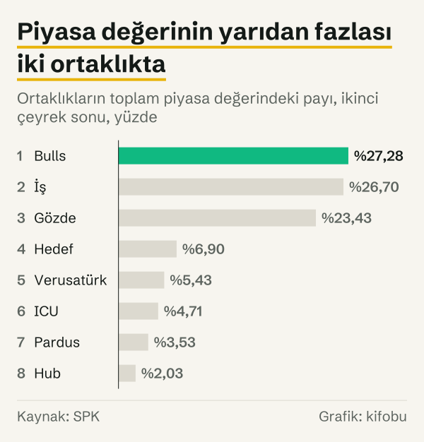

Borsada işlem gören 8 girişim sermayesi yatırım ortaklığının toplam piyasa değeri Haziran 2026'da 39,47 milyar TL oldu. Bu, Haziran 2025'teki 19,69 milyar TL'ye göre %100,5'lik artış demek. Piyasa değeri ise ortaklıkların girişimlere ne kadar yatırdığını söylemez. Sermaye Piyasası Kurulu (SPK) verisine göre 2026'nın ikinci çeyreğinde bu ortaklıkların her birinde girişim sermayesi yatırımlarının portföydeki payı %83,00 ile %97,71 arasında.

SPK bülteni girişim sermayesi yatırım ortaklıklarının her biri için hisse fiyatını, piyasa değerini ve portföy dağılımını veriyor. Bu yazıdaki bütün rakamlar SPK'nın 6 Ekim 2026'da güncellediği Temmuz 2026 aylık istatistik bülteninden geliyor.

## Piyasa değeri son bir yılda nasıl değişti?

Toplam piyasa değeri Aralık 2024'te 19,50 milyar TL, Aralık 2025'te 32,62 milyar TL idi. Bu iki yıl sonu arasındaki artış %67,3. Aralık 2025'ten Haziran 2026'ya artış %21,0 oldu; Mart 2026'da değer 38,64 milyar TL idi.

Ortaklık sayısı bu dönemde değişmedi: Haziran 2025'te, Aralık 2025'te, Mart 2026'da ve Haziran 2026'da 8.

Bültenin şirket bazındaki tablosu aynı sonucu veriyor: 8 ortaklığın 2026'nın ikinci çeyreğindeki piyasa değerlerinin toplamı 39.473.716.433 TL, yani yine 39,47 milyar TL.

## 2008'den bu yana nasıl değişti?

Bültendeki uzun dönem seride Aralık 2008'de 2 ortaklık ve 40,8 milyon TL piyasa değeri yer alıyor. Aralık 2013'te 6 ortaklık ve 1,02 milyar TL vardı. Aralık 2013'ten Haziran 2026'ya piyasa değeri %3.752,9, ortaklık sayısı 2 arttı.

Seri düz bir çizgi değil. Aralık 2017'de 2,59 milyar TL olan piyasa değeri Aralık 2018'de 1,49 milyar TL; Aralık 2020'de 7,62 milyar TL olan değer Aralık 2021'de 6,47 milyar TL. Ortaklık sayısı da Aralık 2015, Aralık 2016 ve Aralık 2017'de 8, Aralık 2020 ve Aralık 2021'de 6 oldu.

![Çubuk grafik: Girişim sermayesi yatırım ortaklıklarının toplam piyasa değeri serinin en yüksek düzeyinde: Piyasa değeri: 2008 yılında 0,04 milyar TL, 2012 yılında 0,87 milyar TL, 2013 yılında 1,02 milyar TL, 2014 yılında 1,47 milyar TL, 2015 yılında 1,33 milyar TL, 2016 yılında 1,09 milyar TL, 2017 yılında 2,59 milyar TL, 2018 yılında 1,49 milyar TL, 2019 yılında 3,04 milyar TL, 2020 yılında 7,62 milyar TL, 2021 yılında 6,47 milyar TL, 2022 yılında 15,58 milyar TL, 2023 yılında 15,90 milyar TL, 2024 yılında 19,50 milyar TL, 2025 yılında 32,62 milyar TL, Haz 2026: 39,47 milyar TL.](./graf-1.svg)
*Tüm ortaklıklar, yıl sonu ve haziran sonu piyasa değeri. Kaynak: SPK.*

| Dönem | Ortaklık sayısı | Piyasa değeri |
|---|---|---|
| Aralık 2008 | 2 | ₺40,8 milyon |
| Aralık 2012 | 5 | ₺871,8 milyon |
| Aralık 2013 | 6 | ₺1,02 milyar |
| Aralık 2014 | 6 | ₺1,47 milyar |
| Aralık 2015 | 8 | ₺1,33 milyar |
| Aralık 2016 | 8 | ₺1,09 milyar |
| Aralık 2017 | 8 | ₺2,59 milyar |
| Aralık 2018 | 7 | ₺1,49 milyar |
| Aralık 2019 | 7 | ₺3,04 milyar |
| Aralık 2020 | 6 | ₺7,62 milyar |
| Aralık 2021 | 6 | ₺6,47 milyar |
| Aralık 2022 | 7 | ₺15,58 milyar |
| Aralık 2023 | 7 | ₺15,90 milyar |
| Aralık 2024 | 7 | ₺19,50 milyar |
| Aralık 2025 | 8 | ₺32,62 milyar |
| Haziran 2026 | 8 | ₺39,47 milyar |

*Tüm girişim sermayesi yatırım ortaklıkları, dönem sonu piyasa değeri, TL. Kaynak: SPK.*

## Portföyün ne kadarı girişimlerde?

SPK, 2026'nın ikinci çeyreği için portföy dağılımını ortaklık başına üç kalemde veriyor: girişim sermayesi yatırımları, para ve sermaye piyasası araçları ve diğer.

Girişim sermayesi yatırımlarının portföydeki payı ortaklıklar arasında %83,00 ile %97,71 arasında değişiyor. Para ve sermaye piyasası araçlarının payı %0,00 ile %12,83, diğer kalemlerin payı %0,05 ile %17,00 arasında.

Bu oranlar ortaklık başına oranlardır. Bu yazı onları birleştirip sekiz ortaklık için tek bir oran hesaplamıyor; bültende de 2026'nın ikinci çeyreği için toplu bir portföy oranı yer almıyor.

## Toplu portföy verisi neden 2013'te kalıyor?

Bültenin uzun dönem tablosunda tüm ortaklıkların toplu portföy dağılımı da yer alıyordu. Aralık 2008'de girişim sermayesi yatırımlarının payı %52,41, kamu borçlanma senetlerinin payı %13,72, diğer kalemlerin payı %33,86 idi. Aralık 2012'de bu oranlar %80,08, %6,62 ve %13,22; Aralık 2013'te %77,15, %4,51 ve %18,26 oldu.

Aralık 2008'den Aralık 2013'e girişim sermayesi yatırımlarının payı 24,74 puan arttı; Aralık 2012'den Aralık 2013'e 2,93 puan azaldı.

Eski seri, piyasa değerinin yanında tüm ortaklıkların net aktif değerini de veriyordu. Net aktif değeri Aralık 2008'de 141,3 milyon TL, Aralık 2012'de 690,4 milyon TL, Aralık 2013'te 769,4 milyon TL idi. Aynı tarihlerde piyasa değeri 40,8 milyon TL, 871,8 milyon TL ve 1,02 milyar TL olarak yayımlandı.

*Tüm ortaklıklar, aralık sonu, girişim sermayesi yatırımlarının portföydeki payı, yüzde. Kaynak: SPK.*

Seri burada bitiyor. SPK tablonun dipnotunda nedenini şöyle açıklıyor: “(*) Tebliğ değişikliği nedeniyle 31.12.2013 tarihinden itibaren girişim sermayesi yatırım ortaklıklarının portföy tablosu hazırlama yükümlülüğü bulunmamaktadır.”

Bugünkü portföy verisi şirket bazındaki çeyreklik tablodan geliyor; bülten bu tablo için “3 ayda bir yayınlanmaktadır” notunu düşüyor. Eski seri ile yeni tablo aynı kalemleri de kullanmıyor: eski seride kamu borçlanma senetleri ayrı bir kalem, yeni tabloda ise para ve sermaye piyasası araçları tek kalem. Bu yüzden Aralık 2013 öncesi toplu oranlar ile 2026'nın ortaklık başına oranları yan yana konabilir ama birebir karşılaştırılamaz.

## Rakamlar neyi ölçüyor?

Piyasa değeri, ortaklığın paylarının borsadaki fiyatı üzerinden hesaplanan değerdir. Ortaklığın girişimlere yatırdığı tutar ya da portföyündeki girişimlerin değeri değildir. Net aktif değeri de ayrı bir ölçüdür; yukarıdaki eski seride iki rakamın aynı tarihlerde farklı olduğu görülüyor.

Portföy dağılımı, ortaklığın portföyünün hangi kalemlere ayrıldığını yüzde olarak gösterir. Girişimlerin ne kadar büyüdüğünü, ne kadar gelir getirdiğini ya da kaç girişime yatırım yapıldığını ölçmez.

Tutarlar bültende yayımlandığı gibi TL cinsindendir; bu yazı onları fiyat değişimine göre düzeltmez. Uzun dönemdeki artış oranları bu yüzden nominal tutarlar arasındaki değişimi gösterir.

## Kaynaklar

- [SPK: 2026 yılı aylık istatistik bültenleri](https://spk.gov.tr/istatistikler/aylik-istatistik-bultenleri/2026-yili-istatistik-bultenleri)
- [SPK: Aylık İstatistik Bülteni, Temmuz 2026](https://spk.gov.tr/data/6a2bef208f95db18b4eeb547/Aylik_istatistik_bulteni_2026_07.xls)
