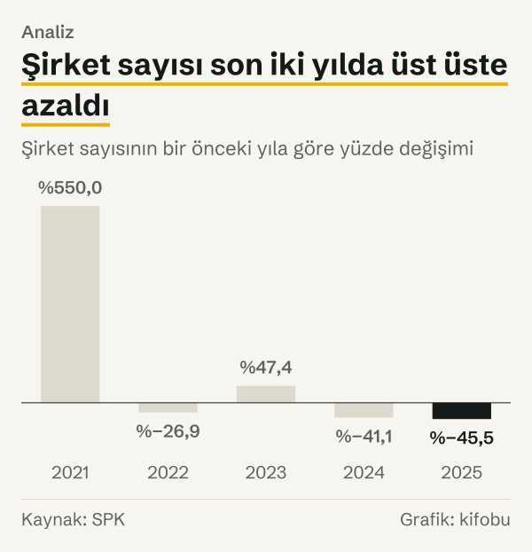
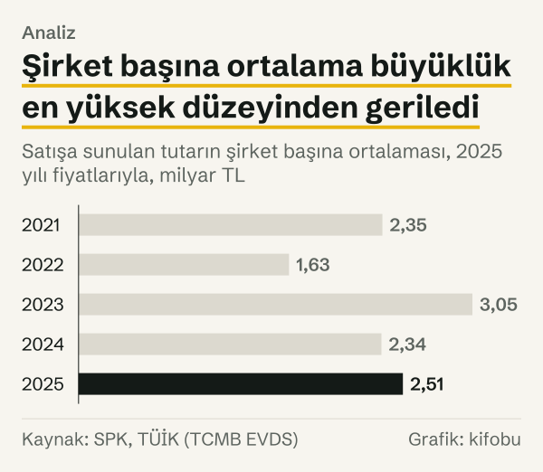
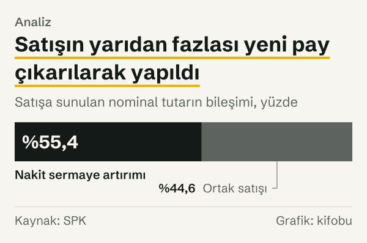

Borsa İstanbul Pay Piyasası'nda ilk kez işlem görmeye başlayan şirketlerin sayısı 2016 yılında 2, 2023 yılında 56 oldu. İki yıl arasındaki fark, halka arzın yıldan yıla ne kadar farklı hacimlerde yaşandığını tek bakışta gösteriyor. 2025'te bu sayı 18'e indi. Aynı tabloyu 2013 yılından 2025 yılına topladığımızda yıllık ortalama 19,0 şirket çıkıyor; 2025 yılı bu ortalamanın altında duruyor.

Yazının sorusu şu: halka arzlar, kendi geçmişlerine göre şu anda hangi konumda? Soruyu bir iniş çıkış benzetmesiyle değil, ölçülebilir üç şeyle yanıtlıyoruz. Yıllık sayı, 2013–2025 arasındaki ortalamanın üstünde mi altında mı? Toplam tutar fiyatlardan arındırılınca hangi düzeyde? Şirket başına büyüklük ve satışın kaynağı nasıl değişti? Veri, Sermaye Piyasası Kurulu'nun (SPK) ihraç verileri sayfasındaki ilk halka arz tablosundan geliyor.

Yazı yalnızca sayıları ve tutarları anlatıyor. Tek bir şirketi, endeks düzeyini ya da herhangi bir halka arzı değerlendirmiyor; hangi şirketin hangi yıl işlem görmeye başladığı buradaki hesabın konusu değil.

*Her yıl Borsa İstanbul Pay Piyasası'nda ilk kez işlem gören şirket sayısı. Kaynak: SPK.*
## 2013–2020: Yılda birkaç şirket

Tablonun ilk sekiz yılı mütevazı bir seri. Şirket sayısı 2013 yılında 9, 2014 yılında 9, 2015 yılında 4, 2016 yılında 2, 2017 yılında 3 oldu. 2018'de sayı yeniden 9 şirkete çıktı; 2019 yılında 6 şirket, 2020 yılında 8 şirket oldu. Sekiz yılın toplamı 50 şirket, yani yılda ortalama 6 şirketten biraz fazla.

Tutar tarafında bu dönem düzgün bir çizgi izlemiyor. Satışa sunulan tutar 2013 yılında 1,31 milyar TL, 2015 yılında 109,6 milyon TL, 2018 yılında 5,42 milyar TL, 2019 yılında 263,8 milyon TL oldu. Sayı küçükken tutarın bu kadar oynaması şaşırtıcı değil: birkaç büyük ya da birkaç küçük halka arz toplamı belirliyor. dokuz şirket 2018'de 5,42 milyar TL'ye ulaştı; dokuz şirket 2013'te 1,31 milyar TL'de kaldı. Bu karşılaştırma enflasyondan arındırılmadığı için tek başına bir şey söylemiyor; konuya aşağıda dönüyoruz.

## 2021–2023: Sayının bir anda yükseldiği yıllar

2020 yılında 8 olan sayı 2021 yılında 52'ye çıktı; bu %550'lik bir artış. 2022 yılında 38'e geriledi, yani %26,9 azaldı. 2023'te yeniden 56'ya yükseldi; bu, bir önceki yıla göre %47,4 artış. Üç yılın toplamı 146 şirket; ilk sekiz yılın toplamının neredeyse üç katı.

Üç yılın arkasında ne olduğuna dair bir açıklama burada yok. SPK'nın tablosu halka arzın sayısını ve büyüklüğünü kaydediyor, nedenini kaydetmiyor; bu yazı bir neden iddia etmiyor.

Nominal tutar da aynı yönde gitti. Satışa sunulan tutar 2020 yılında 1,12 milyar TL iken 2021 yılında 21,56 milyar TL, 2022 yılında 18,80 milyar TL, 2023 yılında 79,79 milyar TL oldu. Bu tutarların TL cinsinden olduğunu unutmamak gerekiyor.

*Satışa sunulan tutar, 2025 yılı fiyatlarıyla, TÜFE yıllık ortalamasıyla. Kaynak: SPK, TÜİK (TCMB EVDS).*
## 2024–2025: Üç yılda 56'dan 18'e

2024 yılında 33 şirket ilk kez işlem gördü; bu %41,1'lik bir azalış. 2025'te sayı 18'e indi, yani bir önceki yıla göre %45,5 azaldı. 2023 yılından 2025 yılına toplam düşüş %67,9.

2025'in 18 şirketi, 2013–2025 ortalaması olan 19,0'ın biraz altında. Ama aynı tablo başka bir sonucu da veriyor: 2021–2025 arasındaki beş yılda toplam 197 şirket ilk kez işlem gördü. Bu, 2013–2025 toplamı olan 247 şirketin %79,8'i. Yani 2025 yılı ortalamanın altında olsa da ortalamayı büyük ölçüde son beş yıl belirliyor. 2013–2020 arasındaki ortalama yılda 6 şirketten biraz fazlaydı; 2025'in sayısı o düzeyin üç katına yakın.

*Yıllık ilk kez işlem gören şirket sayısı. Kaynak: SPK.*
Yıldan yıla değişime bakınca son iki yıl aynı yönde: sayı 2024'te de 2025'te de bir önceki yıla göre azaldı. 2021'de ve 2023'te ise yükselmişti.

*Şirket sayısının bir önceki yıla göre yüzde değişimi. Kaynak: SPK.*
## Sayı ile tutar aynı hızda gitmedi

Tutarları yıllar arasında karşılaştırmak için TL'nin satın alma gücündeki değişimi dışarıda bırakmak gerekiyor. Bunun için her yılın nominal tutarını 2025 yılı fiyatlarına çevirdik. Çevirmede Türkiye İstatistik Kurumu'nun (TÜİK) tüketici fiyat endeksinin (TÜFE) yıllık ortalamasını kullandık.

Sonuç iki ayrı hikâye veriyor. Nominal olarak 2023 yılında 79,79 milyar TL olan tutar, 2025 yılında 45,15 milyar TL oldu; bu %43,4'lük bir azalış. 2025 yılı fiyatlarıyla ise 2023'ün tutarı 170,6 milyar TL, 2025'in tutarı 45,2 milyar TL. Yani fiyatlardan arındırıldığında düşüş %73,5. İki ölçü arasındaki fark, bu iki yıl arasında TÜFE'nin yükselmesinden geliyor.

Yıllık adımlar da aynı çerçevede okunabilir. Fiyatlardan arındırılmış tutar 2022'de %49,4 azaldı, 2023'te %175,8 arttı, 2024'te %54,7 azaldı, 2025'te %41,6 azaldı. Aynı iki yıl arasında sayı %67,9 azaldı; fiyatlardan arındırılmış tutar %73,5 azaldı.

Beş yıllık blokları yan yana koymak da aynı çerçevede anlam taşıyor. Fiyatlardan arındırılmış tutarların 2013–2025 toplamı 580,1 milyar TL; bunun %82,2'si 2021–2025 arasında satışa sunuldu. Yıllık ortalama 2013–2020 arasında 12,9 milyar TL, 2021–2025 arasında 95,4 milyar TL oldu; ikincisi birincinin 7,4 katı. Şirket sayısında aynı karşılaştırma yaklaşık 6,3 katı verir; tutarın ortalaması sayıdan biraz daha fazla yükseldi.

2013 yılı ile 2025 yılını karşılaştırmak da aynı çerçevede anlam kazanıyor. 2013'ün 1,31 milyar TL'si 2025 yılı fiyatlarıyla 18,7 milyar TL ediyor. 2025'in 45,2 milyar TL'si bunun %140,9 üstünde. 2021 yılına göre ise fiyatlardan arındırılmış tutar %63,1 daha düşük: 2021'in 122,2 milyar TL'sine karşılık 2025 yılında 45,2 milyar TL.

## Şirket başına büyüklük

Fiyatlardan arındırılmış toplam tutarı şirket sayısına böldüğümüzde şirket başına ortalama büyüklüğü buluyoruz. 2021'de bu 2,35 milyar TL, 2023 yılında 3,05 milyar TL, 2025 yılında 2,51 milyar TL oldu. Şirket başına büyüklük, 2023 yılından 2025 yılına %17,6 azaldı. Aynı iki yıl arasında şirket sayısı %67,9 azaldı; yani büyüklükteki azalma, sayıdaki azalmanın yanında küçük bir pay.

Başka bir deyişle düşüşün ağırlığı büyüklükten çok sayıdan geliyor. Ama bu sonuç yalnız ortalamaya bakıyor. 2018'de şirket başına ortalama 5,28 milyar TL idi; bu, 2025'in iki katından fazla. 2019'da ise 334,6 milyon TL'ye indi. Ortalama, farklı büyüklükteki halka arzları tek sayıda topluyor; bu yüzden yıllar arasında büyük oynamalar gösteriyor ve tek bir halka arzı anlatmıyor.

*Satışa sunulan tutarın şirket başına ortalaması, 2025 yılı fiyatlarıyla. Kaynak: SPK, TÜİK (TCMB EVDS).*
## Satışın kaynağı: yeni pay mı, ortak satışı mı?

SPK'nın tablosu satışa sunulan nominal tutarı iki parçaya ayırıyor. Nakit sermaye artırımı, şirketin yeni pay çıkararak para topladığı kısım. Ortak satışı ise mevcut ortakların paylarının satıldığı kısım. İki parçanın toplamı satışa sunulan nominal tutarı veriyor.

Nakit sermaye artırımının payı yıllar içinde hayli değişti. 2013'te %82,9 idi; 2016'da %22,6'ya, 2017'de %11,2'ye indi. O yıllarda satışın büyük kısmı ortak satışından geliyordu. 2021'de pay %71,0, 2022'de %64,3, 2023'te %70,8, 2024'te %72,6 oldu. 2025'te ise %55,4'e geriledi; bir önceki yıla göre 17,3 puan azaldı. Aynı yıl ortak satışının payı %44,6 oldu.

Nakit ve ortak ayrımı, sayı ile tutarın neden ayrıştığını anlamak için yararlı. Yeni pay çıkaran şirket kaynak toplayarak büyüyor; ortak satışında para satan ortağa gidiyor. Tablo bunu yalnız tutar olarak veriyor, nedenini ya da kullanımını vermiyor; burada da bir yorum yok.

*Satışa sunulan nominal tutarın bileşimi, yüzde. Kaynak: SPK.*
## Başka nasıl okunabilir?

İlk karşı okuma, 2025 yılı ortalamanın altında olduğu için sayının düşük sayılması yönünde. Ortalamanın hesabında 2021–2023 yılları var; bu yıllar ortalamayı yukarı çekiyor. 2013–2020 ortalaması bu yüzden daha düşük bir referans veriyor. Hangi dönemin ortalamasını referans aldığımız, üstünde ya da altında cümlesini değiştiriyor. Ortalama ayrıca uçlardan etkileniyor: on üç yılın dokuzunda sayı ortalamanın altında kaldı, üstünde kalan yıllar yalnızca 2021–2024 arasındaki dört yıl. Yani ortalamanın altında olmak, bu seride çoğu yılın olağan hâli; ortalamanın üstü ise istisnai yıllara özgü. Biz hesapta tüm 2013–2025 aralığını aldık; başka bir pencereyle başka bir konum çıkar.

İkinci karşı okuma 2026 yılı üzerine. SPK'nın tablosu 23 Ekim 2026 tarihinde 36 şirket gösteriyor; bu, 2025'in tamamından 18 fazla ve 2013–2025 ortalamasının 17 üstünde. Ama 2026 yılı henüz tamamlanmadı. Tablonun sonraki satırları sayıyı değiştirebilir; bu nedenle 2026 yılını tamamlanmış bir yılla yan yana koymak yerine ayrı bir not olarak anıyoruz.

Üçüncü karşı okuma yıl içindeki dağılım. Tablodaki işlem tarihlerine göre 2025'in 18 şirketi ocak, şubat, eylül, kasım ve aralık aylarında işlem görmeye başladı. Yani yılın büyük bölümünde yeni işlem görmeye başlayan şirket yoktu. Yıllık toplam bu düzensizliği saklıyor.

## Tablonun gösterdiği ve göstermediği

Bu hesabın birkaç sınırı var.

İlki tablonun ne ölçtüğü. SPK, satışa sunulan toplam tutarı, satışa sunulan nominal değer ile halka arz fiyatının çarpımı olarak tanımlıyor. Bu, satışa sunulan paylar için hesaplanan değerdir; fiilen satılan tutarın ya da şirketin sonraki piyasa değerinin göstergesi değil.

İkincisi birim. Tutarlar TL cinsinden yazılıyor ve TL'nin değeri yıllar içinde değişti. 2025 yılı fiyatlarına çevirme bu sorunu TÜFE ile çözüyor, ama TÜFE, halka arz edilen payların fiyatlarını değil bir tüketim sepetinin fiyatlarını izliyor. Başka bir deflatör farklı bir sıra verebilir. SPK ayrıca tutarların ABD doları karşılığını da yayımlıyor; 2025 yılında iki şirketin dolar karşılığı tabloda boş olduğundan bu yazıda dolar serisini kullanmadık.

Üçüncüsü kapsam. Tablo yalnız Borsa İstanbul Pay Piyasası'nda ilk kez işlem görmeye başlayan şirketleri kaydediyor. Sermaye artırımı yoluyla yapılan satışlar ya da pay dışındaki ihraçlar başka tablolarda yer alıyor ve bu hesaba girmiyor.

Dördüncüsü tarih. SPK'nın açıklama dokümanına göre bir halka arz tabloya talep toplamanın son gününde alınıyor; dönem sütunu ise borsada işlem görmeye başlama zamanını gösteriyor. İki tarih farklı yıllara düşebilir; bu yazıda işlem görmeye başlama yılı esas alındı.

Beşincisi zamanlama. Fiyatlardan arındırmada yıllık ortalama TÜFE kullanıldı; yıl sonuna yığılan halka arzlar için yıl sonu endeksi daha farklı bir sonuç verirdi. Yüzdeler bir ondalığa yuvarlandı, bu yüzden parçaların toplamı tam yüze eşit olmayabilir.

## Nasıl hesapladık

SPK'nın ihraç verileri sayfasındaki ilk halka arz tablosunu 2013 yılından 2026 yılına kadar her yıl için çektik. Her yılın şirket sayısı o yılın satırlarının sayısıdır; tutar, satışa sunulan toplam tutar (piyasa değeri) sütununun toplamıdır. Fiyatlardan arındırmak için TCMB'nin EVDS sisteminden TÜİK'in tüketici fiyat endeksini yıllık ortalama olarak aldık ve her yılın tutarını 2025 yılı endeksine oranlayarak 2025 yılı fiyatlarına çevirdik. Yıllık değişimi, iki yıl arasındaki farkın ilk yıla oranı olarak hesapladık. Ortalamayı 2013–2025 arasındaki on üç yılın şirket sayısından, şirket başına büyüklüğü fiyatlardan arındırılmış tutarın şirket sayısına bölünmesiyle bulduk. Satışın kaynağında nakit sermaye artırımı ve ortak satışı sütunlarının yıllık toplamlarını kullandık; payları bu ikisinin toplamına oranladık. Hiçbir rakam elle girilmedi; her toplam kaynak tablodaki satırlardan yeniden hesaplanabiliyor.

## Kaynaklar

- [SPK: İhraç Verileri, İlk Halka Arz Verileri](https://spk.gov.tr/ihrac-verileri/ilk-halka-arz-verileri)
- [SPK: İhraç Verileri, tablo açıklama dokümanı](https://spk.gov.tr/ihrac-verileri/aciklama-dokumani)
- [TÜİK (TCMB EVDS): Tüketici fiyat endeksi, genel, arşiv serisi](https://evds3.tcmb.gov.tr/igmevdsms-dis/series=TP.FG.J0)
