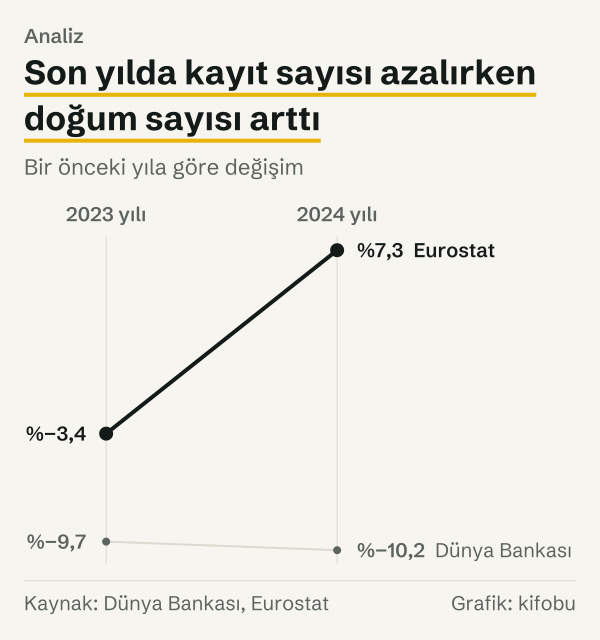
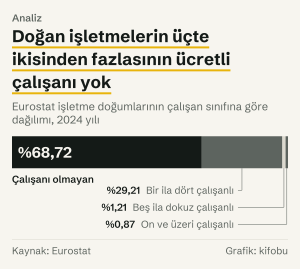
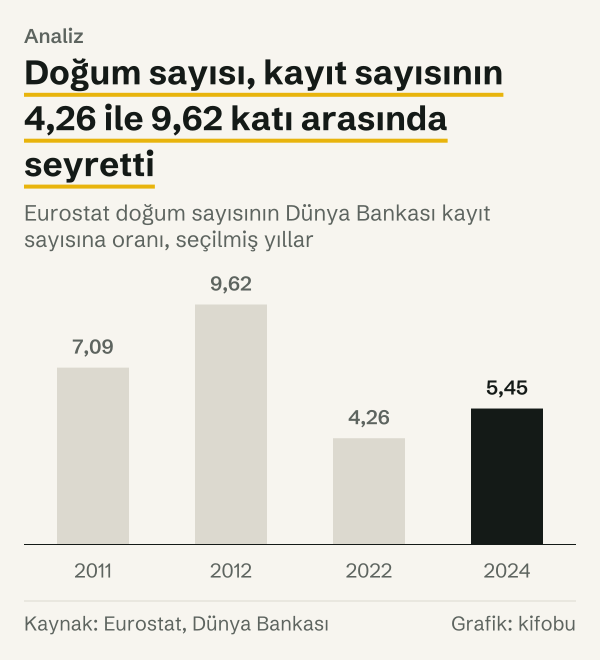

Bir sokaktan geçerken kepenk kapanan, yerine yeni bir tabela asılan dükkânları sayabilirsiniz. Üç ay sonra aynı sokakta bir kafe, bir bilgisayar tamircisi ve bir muhasebe bürosu açılmış olabilir. Hangisi yeni şirket sayılır? Gündelik gözlem bunu tek bir kelimeyle geçiştirir; resmî istatistik ise iki ayrı cevap veriyor.

2024 yılında Dünya Bankası, Türkiye için 115.401 yeni limited şirket kaydı sayıyor. Aynı yıl için Eurostat 628.495 yeni işletme doğumu sayıyor. İkisi de resmî, ikisi de herkese açık, ikisi de aynı soruyu, yani Türkiye'de bir yılda kaç yeni iş kurulduğunu yanıtlıyor gibi görünüyor. Aralarındaki fark 5,45 kat.

Yazı iki ölçüyü karşı karşıya koyuyor. Önce her ölçünün neyi saydığını, sonra aralarındaki farkın büyüklüğünü ve yılın içinde nasıl değiştiğini, en sonda da iki serinin aynı yönde mi hareket ettiğini soruyoruz. Hangisinin doğru olduğunu sormuyoruz: ikisi de kendi tanımına göre doğru. Soru, hangisinin hangi soruyu yanıtladığı.

## Birinci ölçü: Dünya Bankası'nın yeni şirket kaydı

Dünya Bankası'nın göstergesi, takvim yılında yeni kaydedilen sınırlı sorumlu şirketleri sayıyor. Limited şirket, ortaklarının sorumluluğunu koydukları sermaye ile sınırlayan bir şirket türü. Sayılan birim, kayıt: bir şirketin resmen kaydedilmesi.

Karşılaştırma 2011 yılından başlıyor, çünkü Eurostat serisi o yıl başlıyor; Dünya Bankası serisi ise 2006 yılından beri yayımlanıyor. 2011 yılında kayıt sayısı 57.358. 2012 yılında 42.403'e iniyor; bu, bir yıl öncesine göre %26,1 azalış. Sonra ağırlıklı olarak yükseliş var: 2020 yılında 101.482, 2021 yılında 110.909, 2022 yılında 142.220 kayıt. 2022 yılı serinin zirvesi. 2023 yılında 128.456'ya, 2024 yılında 115.401'e iniyor.

2011 yılından 2024 yılına seri %101,2 arttı; yani yaklaşık iki katına çıktı.

## İkinci ölçü: Eurostat'ın işletme doğumu

Eurostat, iş ve ticaret alanında yeni doğan işletmeleri sayıyor. Eurostat'ın tanımına göre doğum, sıfırdan yeni bir faaliyetin başlamasıdır; yeniden faaliyete geçen uyuyan işletmeler, birleşme, bölünme ya da yeniden yapılanmayla ortaya çıkan birimler doğum sayılmıyor. Tanım işletmeyi sayıyor; örnek olarak şirket veriyor, ama sınırlı sorumlu şirketle kısıtlamıyor. Veri, ulusal istatistiksel işletme kayıtlarından geliyor.

Seri 2011 yılında 406.487 doğumla başlıyor. 2012 yılında 408.112'ye çıkıyor, ardından uzun süre dar bir bantta kalıyor: 2013 yılında 400.188, 2014 yılında 392.530. 2020 yılında 494.871'e, 2021 yılında 577.508'e, 2022 yılında 605.907'ye yükseliyor. 2023 yılında 585.467'ye iniyor, 2024 yılında 628.495 ile serinin en yüksek değerine çıkıyor.

2011 yılından 2024 yılına seri %54,6 arttı. Dünya Bankası serisinin artışı %101,2 idi; yani iki ölçü aynı on üç yılda farklı hızlarda büyüdü. Mutlak sayılarda tablo tersine dönüyor: Dünya Bankası serisi 58.043 kayıt eklerken Eurostat serisi 222.008 doğum ekledi; Eurostat'ın mutlak artışı, Dünya Bankası'nınkinin 3,8 katı. Yüzde olarak yavaş büyüyen seri, taban büyük olduğu için daha çok birim ekledi.

![Çizgi grafik: Dünya Bankası serisi daha hızlı yükseldi ve son iki yılda ayrıştı: Dünya Bankası: 2011 yılında 100,0, 2012 yılında 73,9, 2013 yılında 91,5, 2014 yılında 106,1, 2015 yılında 118,2, 2016 yılında 113,1, 2017 yılında 130,6, 2018 yılında 150,3, 2019 yılında 148,9, 2020 yılında 176,9, 2021 yılında 193,4, 2022 yılında 248,0, 2023 yılında 224,0, 2024 yılında 201,2; Eurostat: 2011 yılında 100,0, 2012 yılında 100,4, 2013 yılında 98,5, 2014 yılında 96,6, 2015 yılında 96,7, 2016 yılında 97,7, 2017 yılında 109,6, 2018 yılında 108,4, 2019 yılında 105,1, 2020 yılında 121,7, 2021 yılında 142,1, 2022 yılında 149,1, 2023 yılında 144,0, 2024 yılında 154,6.](./graf-1.svg)
*Endeks, 2011 yılı değeri yüz. Kaynak: Dünya Bankası, Eurostat.*
## Büyüklük farkı: 4,26 ile 9,62 kat arasında

Eurostat doğum sayısı, Dünya Bankası kayıt sayısından her yıl büyük. Oran 2011 yılında 7,09 kat, 2012 yılında 9,62 kat; 2022 yılında 4,26 kat, 2024 yılında 5,45 kat. İki ölçü arasındaki mesafe on üç yıl boyunca sabit kalmadı.

İki ölçü arasındaki mutlak fark da büyüdü: 2011 yılında 349.129, 2024 yılında 513.094 işletme. Bu farkın tamamı sınırlı sorumlu olmayan işletmelerden gelmez, çünkü iki tanım birbirinin içine tam oturmuyor; ama farkın boyutu, iki ölçünün aynı kümeyi saymadığını gösteriyor.

Aynı bilgi ters yönden okunabilir: Dünya Bankası kayıtlarının Eurostat doğumlarına oranı 2011 yılında %14,1, 2012 yılında %10,4, 2022 yılında %23,5, 2024 yılında %18,4. Yani şirket kaydı, doğan işletmelerin 2011 yılında yaklaşık yedide birine, 2022 yılında dörtte birine yakın bir bölümüne, 2024 yılında beşte birinden azına karşılık geliyor.

*Dünya Bankası kayıt sayısının Eurostat doğum sayısındaki payı. Kaynak: Dünya Bankası, Eurostat.*
Burada iki ayrı büyüklük var ve ters yönde okunuyor. Doğum sayısının kayıt sayısına oranı 2012 yılında en yüksek (9,62 kat), 2022 yılında en düşüktü (4,26 kat); kayıtların doğumlardaki payı ise tam tersine 2012 yılında en düşük (%10,4), 2022 yılında en yüksekti (%23,5). Aynı bilgi iki yönden söyleniyor. Sebebi yıllık hareketlerde görünüyor: 2012 yılında kayıt sayısı %26,1 azalırken doğum sayısı yerinde kaldı; 2022 yılında kayıt sayısı %28,2 artarken doğum sayısı %4,9 arttı.

*Bir önceki yıla göre değişim. Kaynak: Dünya Bankası, Eurostat.*
## İki ölçü aynı yönde mi hareket ediyor?

2012 yılından 2024 yılına on üç yıllık değişim var. Bunların yedisinde iki ölçü aynı yönde, altısında zıt yönde hareket etti.

Zıt yönlü yıllar şöyle: 2012 yılında Dünya Bankası kaydı %26,1 azalırken Eurostat doğumu %0,4 arttı. 2013 yılında kayıt %23,8 arttı, doğum %1,9 azaldı. 2014 yılında kayıt %15,8 arttı, doğum %1,9 azaldı. 2016 yılında kayıt %4,3 azaldı, doğum %1,1 arttı. 2018 yılında kayıt %15,0 arttı, doğum %1,1 azaldı. 2024 yılında kayıt %10,2 azaldı, doğum %7,3 arttı.

Zıt yönlü yıllar dışında kalan her yıl iki ölçü aynı yönde hareket etti: 2015 yılı, 2017 yılı ve 2019–2023 arası. 2012–2014 arasındaki üç yılın üçünde ise iki ölçü zıt yönde ilerledi. İlk üç yılın seyri ayrı bir bakışı hak ediyor. Dünya Bankası serisi 2012 yılında 42.403 kayıtla başlayıp 2014 yılında 60.829'a çıktı; aynı iki yılda Eurostat serisi 408.112'den 392.530'a indi. Yani aynı üç yılda bir ölçü düşük bir düzeyden yükselirken öteki yatay seyretti ve hafifçe geriledi. İki ölçüyü yalnızca bu yıllara bakarak okuyan biri, birbirine ters iki hikâye anlatırdı.

Aynı yöndeki yılların bir bölümünde hareket güçlü: 2020 yılında kayıt %18,8, doğum %15,9 arttı. 2022 yılında kayıt %28,2, doğum %4,9 arttı. Yani aynı yönde olmak aynı büyüklükte olmak anlamına gelmiyor.

## Üç dönemde ve son yılda iki seri

Yıllık hareketlerin ötesinde, dönemlere bakınca farkın nerede açıldığı görülüyor. 2011–2019 arasında Dünya Bankası kaydı %48,9 arttı, Eurostat doğumu yalnızca %5,1. Yani ilk sekiz yılda biri neredeyse yarı yarıya büyürken öteki yerinde saydı.

2019 yılından 2022 yılına iki ölçü de yükseldi: kayıt %66,5, doğum %41,9. Bu dönem iki serinin birbirine en yakın hareket ettiği dönem; yine de kayıtlardaki artış doğumlardaki artıştan 24,6 puan büyük.

2022 yılından 2024 yılına ise ayrışma yeniden açıldı: kayıt %18,9 azaldı, doğum %3,7 arttı.

Üç dönemin ortak yanı şu: Dünya Bankası serisi her dönemde Eurostat serisinden daha oynak. Bu, kayıt sayısının doğum sayısından çok daha hassas bir ölçü olduğu anlamına gelmiyor; yalnızca iki serinin farklı kümelerde çalıştığını ve küme küçüldükçe oynamanın büyüdüğünü hatırlatıyor.

En son yıl, ayrışmanın en net olduğu yer. 2023 yılında kayıt %9,7 azaldı, doğum %3,4 azaldı. 2024 yılında kayıt %10,2 azalmaya devam etti, doğum ise %7,3 artış gösterdi.

*Eurostat işletme doğumlarının çalışan sınıfına göre dağılımı, 2024 yılı. Kaynak: Eurostat.*
Yani 2024 yılında iki ölçüden ancak biri yeni iş kurulduğu yönünde işaret veriyor. Hangisinin hangi soruyu yanıtladığını bilmeden, bu yılın yeni iş kurma eğilimi hakkında tek cümle kurmak mümkün değil. Bu yazı da kurmuyor: iki ölçü zıt yönü gösteriyor ve nedeni tablolardan okunamıyor.

## Çalışanı olmayan işletmeler

İki ölçü arasındaki büyüklük farkının bir ipucu Eurostat verisinin kendi içinde. 2024 yılında doğan işletmelerin %68,72'si çalışanı olmayan işletme: 431.882 işletme. Bir ila dört çalışanlı işletmeler %29,21, beş ila dokuz çalışanlı olanlar %1,21, on ve üzeri çalışanlı olanlar %0,87.

*Eurostat doğum sayısının Dünya Bankası kayıt sayısına oranı, seçilmiş yıllar. Kaynak: Eurostat, Dünya Bankası.*
Dağılım, farkın kaynağını kanıtlamıyor. Dünya Bankası'nın saydığı limited şirketlerin hangi çalışan sınıfında yer aldığı ayrı bir tabloda yok; Eurostat'ın çalışanı olmayan doğumlarının ne kadarının limited şirket olduğunu da bilmiyoruz. Yalnızca şunu söyleyebiliyoruz: Eurostat'ın doğum sayısının büyük bölümü ücretli çalışanı olmayan işletmelerden oluşuyor, Dünya Bankası'nın göstergesi ise yalnızca sınırlı sorumlu şirketleri sayıyor. İki tanım aynı kümeyi seçmiyor.

## Karşı okuma: İki ölçü gerçekten ayrı bir şey mi ölçüyor?

Farkın tamamını tanıma bağlamak kolay görünüyor, ama veri bunu doğrulamıyor. On üç değişimin yedisinde iki seri aynı yönde hareket etti ve ikisi de 2011 yılından 2024 yılına arttı.

Ortak bileşenin en görünür olduğu dönem 2019 yılından 2022 yılına: iki seri birlikte güçlü biçimde yükseldi, ama kayıt sayısı doğum sayısından daha hızlı. Yani ortak yön var; ortak büyüklük yok. Öbür yandan altı yılda zıt yönde hareket etmeleri, aralarındaki bağın zayıf olduğunu gösteriyor. İki ölçünün arkasında ortak bir ekonomik hareket olsa bile, her biri kendi tanımının içinde kayıt ya da istatistiksel işlem kurallarına da tabi. Tablolar bu kuralların ne kadarının farkı açıkladığını ayrı göstermiyor.

Bu yüzden iki rakamı birbirine çevirmek, örneğin Dünya Bankası kaydını bir katsayıyla çarpıp işletme doğumuna ulaşmak, veriye uygun düşmüyor: katsayı yıldan yıla 4,26 ile 9,62 arasında oynuyor.

Peki hangi ölçü hangi soruya cevap veriyor? Kaç sınırlı sorumlu şirketin kaydedildiğini soran biri için birinci ölçü, kaç yeni faaliyetin başladığını soran biri için ikinci ölçü doğrudan yanıt. Soru Türkiye'de kaç yeni iş doğduğuysa, ikisi de tek başına eksik bir resim çiziyor. Ölçülerden birini seçmek, hangi tanımın sorulan soruya yaklaştığına bağlı bir karar; bu yazı o kararı vermiyor.

## İki ölçünün de göremediği

Birinci seri kaydı sayıyor; kaydın ardından şirketin faaliyete geçip geçmediğini ölçmüyor. Eurostat serisi ise yeni faaliyetin başlamasını sayıyor; faaliyetin büyüklüğünü ya da kalıcılığını ölçmüyor. İkisi de kapsamlarının dışındaki yeni işleri, örneğin Eurostat iş ve ticaret alanı dışındaki faaliyetleri, görmüyor.

Yön sayımı da kırılgandır. 2012 yılında Eurostat doğumu yalnızca %0,4, 2015 yılında %0,1 değişti; bu neredeyse sıfır değişimlerde işaret, gürültüyü de yön olarak sayar. İki yılı sayımdan çıkarsak aynı yön ve zıt yön sayıları değişir.

Üçüncü bir sınır, zamanlama. Dünya Bankası serisi takvim yılındaki kayıtları, Eurostat serisi o yıl içinde başlayan faaliyetleri sayıyor. Bir şirketin kaydı bir yılda yapılıp faaliyeti ertesi yıl başlıyorsa, iki seri aynı işi farklı yıllara yazabilir.

Son olarak, iki seri ayrı kurumların ayrı yöntemleriyle hazırlanıyor ve yenilenebiliyor. Bu yazıdaki değerler 23 Ekim 2026 tarihinde çekildi.

## Nasıl hesapladık

Dünya Bankası serisi, yeni kaydedilen işletme sayısı göstergesi (IC.BUS.NREG), Türkiye, 2011–2024. Eurostat serisi, bd_size tablosunda doğum sayısı (ENT_BRTH_NR), Türkiye, toplam iş ve ticaret alanı, toplam büyüklük sınıfı, 2011–2024. İki seri yalnızca ortak yıllarda, 2011 yılından itibaren karşılaştırıldı; çünkü Eurostat serisi o yıl başlıyor.

Endeks, bir yılın değerinin 2011 yılı değerine oranının yüz katıdır. Oran, Eurostat sayısının Dünya Bankası sayısına bölümüdür. Pay, tersidir. Yıllık değişim, bir yılın değerinin bir önceki yıla göre yüzde farkıdır. Yön sayımı, iki serinin yıllık değişiminin işaretini yan yana koyarak yapıldı; işaretleri aynı olan yıllar aynı yönde sayıldı.

Yön sayımında on üç yıllık değişimin tamamı kullanıldı; kıyaslanabilen değişim sayısı bu kadar, çünkü Eurostat serisi 2011 yılında başlıyor ve ilk yılın bir önceki yıla göre değişimi yok. Yazıdaki bütün oranlar, paylar ve değişimler kanıt dosyasındaki ham sayılardan yeniden hesaplandı. Hiçbir rakam tahmin ya da düzeltme içermiyor; her biri kaynaktan alınmış ya da yukarıdaki işlemlerle hesaplanmış.

## Kaynaklar

- [Dünya Bankası: Yeni kaydedilen işletmeler, Türkiye](https://data.worldbank.org/indicator/IC.BUS.NREG?locations=TR)
- [Dünya Bankası: Girişimcilik programı](https://www.worldbank.org/en/programs/entrepreneurship)
- [Eurostat: Büyüklük sınıfı ve faaliyete göre işletme demografisi (bd_size)](https://ec.europa.eu/eurostat/databrowser/view/bd_size/default/table)
- [Eurostat: Glossary, enterprise birth](https://ec.europa.eu/eurostat/statistics-explained/index.php?title=Glossary:Enterprise_birth)
