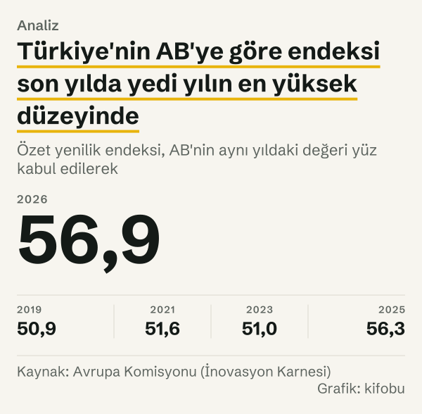
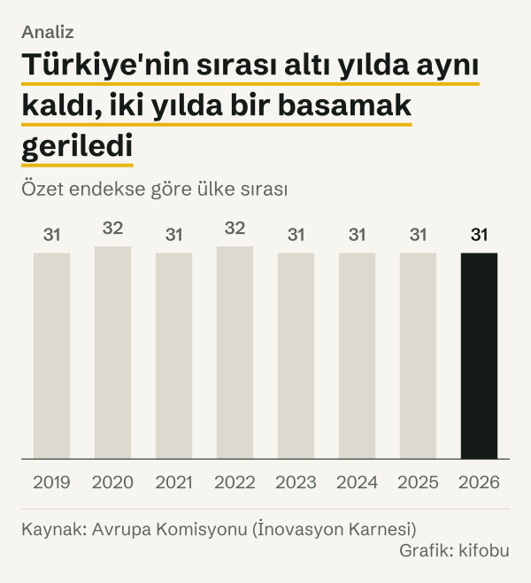
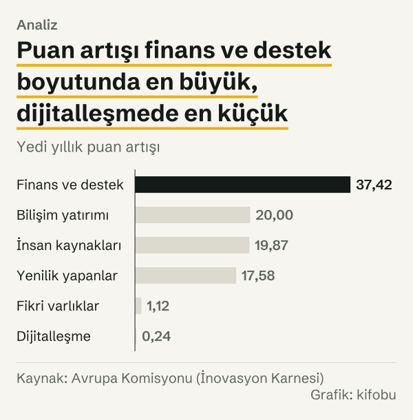

Avrupa Komisyonu'nun 2026 yılı İnovasyon Karnesi tablosunda Türkiye'nin satırı 31. sırada duruyor. Tabloda Avrupa Birliği üyeleri ile komşu ülkelerden oluşan kırk ülke var; Türkiye'nin özet yenilik endeksi, AB'nin aynı yılki değeri 100 puan sayıldığında 56,9 puan. İsviçre 141,3 puanla ilk satırda, Moldova 18,6 puanla son satırda.

Veri tabanında 2019 yılı da yer alıyor ve o yıl Türkiye yine 31. sıradaydı. Yani yedi yıllık aralığın iki ucunda sıra aynı. Puan ise aynı kalmadı: Türkiye'nin AB'ye göre endeksi 2019 yılında 50,9 puan iken 2026 yılında 56,9 puan. Sıra ile puan neden farklı bir hikâye anlatıyor? Çünkü sıra yalnızca Türkiye'nin kendisine değil, kırk ülkenin hepsinin hareketine bağlı.

*Özet yenilik endeksi, AB'nin aynı yıldaki değeri yüz kabul edilerek. Kaynak: Avrupa Komisyonu (İnovasyon Karnesi).*

Yazı sıralamanın ne söylediğini ve ne söylemediğini ayırmaya çalışıyor. Önce karnenin nasıl okunduğuna, sonra Türkiye'nin satırının ve komşu satırların hareketine, en sonda da hangi boyutlarda hareket olduğuna bakıyoruz. Yazı sıralamayı değerlendirmiyor; yalnız Komisyon'un yayımladığı rakamları yan yana koyuyor.

## Karnenin nasıl okunduğu

Karne, Avrupa Komisyonu'nun yayımladığı yıllık bir yenilik ölçümü. Amacı ülkelerin yenilik performansını ortak bir ölçekte karşılaştırmak; bu yüzden yalnızca patent ya da Ar-Ge harcamasına bakmıyor, insan kaynağından dış ticarete kadar geniş bir gösterge kümesini tek bir endekste topluyor. Özet yenilik endeksi, otuz iki göstergenin normalleştirilmiş puanlarının bileşiminden hesaplanıyor; göstergeler dört ana başlıkta toplanıyor: çerçeve koşulları, yatırımlar, yenilik faaliyetleri ve etkiler. Komisyon veri tabanını iki biçimde sunuyor. Birincisinde her yılın puanı o yılın AB değerine göre veriliyor: AB her yıl 100 puan. İkincisinde bütün yıllar AB'nin ilk yıldaki değerine göre veriliyor: AB ilk yılda 100 puan, sonraki yıllarda AB'nin kendi ilerlemesi kadar yükseliyor.

Ayrım önemli, çünkü iki sürüm iki farklı soruya cevap veriyor. Her yılın AB değerine göre puan, Türkiye'nin AB'ye göre konumunu soruyor. İlk yıla göre puan ise Türkiye'nin kendi ilerlemesini soruyor. Sıra ise yalnızca birinci soruyla ilgili: ülkeler aynı yılın değerlerine göre sıralanıyor.

Tablodaki kırk ülkenin yirmi yedisi AB üyesi, on üçü komşu ülke. Komşu ülkeler arasında Avrupa'nın batısından Kafkasya'ya kadar uzanan geniş bir yelpaze var; Türkiye de bu ikinci kümeden bir ülke olarak tabloda yer alıyor ve sıralama AB üyeleriyle birlikte yapılıyor. Bu bileşim, sıra numarasının nasıl okunacağını doğrudan etkiliyor; bunu karşı okuma bölümünde ele alıyoruz.

Komisyon ülkeleri ayrıca dört gruba ayırıyor. Veri tabanındaki gruplamaya göre Türkiye, ilk yıldan son yıla her yıl gelişen yenilikçiler grubunda yer alıyor.

## Türkiye'nin satırı: sekiz yıl, bir basamaklık oynama

Aşağıdaki tablo Türkiye'nin AB'ye göre endeksini ve kırk ülke içindeki sırasını yıl yıl veriyor.

| Yıl | AB'ye göre endeks (puan) | Sıra |
|---|---|---|
| 2019 yılı | 50,9 | 31 |
| 2020 yılı | 51,2 | 32 |
| 2021 yılı | 51,6 | 31 |
| 2022 yılı | 51,3 | 32 |
| 2023 yılı | 51,0 | 31 |
| 2024 yılı | 56,2 | 31 |
| 2025 yılı | 56,3 | 31 |
| 2026 yılı | 56,9 | 31 |

*Endeks, AB'nin aynı yıldaki değeri 100 puan alınarak; sıra, kırk ülke içinde. Kaynak: Avrupa Komisyonu.*

Yedi yıllık toplam artış 6,0 puan. Artışın büyük bölümü tek adımda, 2023–2024 aralığında geldi; ilk dört yılda endeks neredeyse yatay seyretti. Sıra bu seyri izlemedi: sekiz yılın altısında 31., ikisinde 32. sırada. Sıra aralığı yalnızca bir basamak.

Hesabımızda sıra, aynı yılın endeks değerine göre kırk ülkenin büyükten küçüğe sıralanmasından çıkıyor. Komisyon'un 2026 yılı ülke profili Türkiye için aynı sırayı veriyor; öteki yıllardaki sıraları veri tabanından biz hesapladık.

*Özet endekse göre ülke sırası. Kaynak: Avrupa Komisyonu (İnovasyon Karnesi).*

## Komşu satırlar: kim yer değiştirdi

Aynı dönemde çevresindeki ülkelerin puanları da değişti. İlk yılda Türkiye'nin hemen üstünde Polonya (56,5 puan) vardı; Sırbistan (59,4 puan) ve Slovakya (59,6 puan) onun da üstündeydi. Son yılda Polonya 65,2 puana çıkarak 8,7 puan artırdı ve 3 basamak yükseldi: 30. sıradan 27. sıraya. Slovakya 62,3 puana, Sırbistan 60,4 puana çıktı. Letonya ise 61,9 puandan 61,05 puana indi; 27. sıradan 29. sıraya, yani 2 sıra geriledi.

Alt satırlarda hareket farklı. Bulgaristan 50,0 puandan 48,9 puana indi. Karadağ 46,7 puandan 44,7 puana indi. Romanya 38,5 puandan 41,8 puana çıktı ve 35. sıradan 34. sıraya yükseldi. Sırbistan da 29. sıradan 30. sıraya, yani 1 sıra geriledi; böylece son yılda Türkiye'nin hemen üstündeki ülke Sırbistan oldu.

Tablo iki şeyi birlikte gösteriyor. Türkiye 6,0 puan kazandı; iki uç yılda sıra numarası aynı. Türkiye ile bir üstündeki Sırbistan arasında 3,5 puan, bir altındaki Bulgaristan arasında 8,1 puan var; yani Türkiye'nin son yıldaki yerini iki yönde de birkaç puanlık mesafeler belirliyor.

Tablonun tepesinde ve dibinde ölçek daha geniş. Son yılda İsviçre 141,3 puanla, İsveç 139,0 puanla, Danimarka 134,7 puanla ilk üç satırda; son satırdaki Moldova 18,6 puanda. İsviçre ile Türkiye arasında 84,4 puan var. Türkiye'nin etrafındaki satırlar ise birbirine çok yakın: Slovakya ile Türkiye arasındaki fark 5,4 puan.

*Özet yenilik endeksi, AB'nin aynı yıldaki değeri yüz kabul edilerek. Kaynak: Avrupa Komisyonu (İnovasyon Karnesi).*

## Endeks yükseldi, sıra yerinde: iki ölçü

Veriyi AB'nin ilk yıldaki değerine göre okuyunca fark ortaya çıkıyor. Bu ölçekte Türkiye 50,9 puandan 63,5 puana çıktı; artış 12,6 puan. AB aynı sürede 100 puandan 111,6 puana çıktı; artış 11,6 puan. Yani Türkiye'nin kendi ilerlemesi, AB'nin ilerlemesinden 1,0 puan fazla.

Oran da bunu gösteriyor: Türkiye'nin AB'ye oranı ilk yılda AB'nin değerinin %50,9'u, son yılda %56,9'u. Oran 6,0 puan arttı. İki ölçü aynı hikâyeyi başka bir yerden anlatıyor: Türkiye ilerledi, AB de ilerledi, Türkiye ile AB arasındaki fark iki ölçekte farklı büyüklükte daraldı. Sıra ise bu yaklaşmayı hiç göstermiyor, çünkü sıra yalnızca yön ve sıralama bilgisi taşıyor; mesafeyi taşımıyor.

Aşağıdaki tablo Türkiye'nin endeksini AB'nin ilk yıldaki değerine göre yıl yıl veriyor.

| Yıl | AB'nin ilk yıl değerine göre endeks (puan) |
|---|---|
| 2019 yılı | 50,9 |
| 2020 yılı | 51,4 |
| 2021 yılı | 52,7 |
| 2022 yılı | 54,6 |
| 2023 yılı | 54,9 |
| 2024 yılı | 61,5 |
| 2025 yılı | 61,9 |
| 2026 yılı | 63,5 |

*AB'nin ilk yıldaki değeri 100 puan alınarak. Kaynak: Avrupa Komisyonu.*

Bu ölçekte seri her yıl yükseliyor; önceki tablodaki 2022 yılı düşüşü yok. Çünkü bu ölçekte payda sabit: AB'nin ilk yıldaki değeri. Yıllara göre AB değerine bölen ölçekte ise AB'nin kendi yıllık ilerlemesi paydayı büyüttüğü için Türkiye'nin puanı yerinde sayabiliyor ya da düşebiliyor.

*Özet yenilik endeksi. Kaynak: Avrupa Komisyonu (İnovasyon Karnesi).*

## Boyutlar: nerede hareket var

Özet endeksin altında on iki boyut var. Veri tabanında Türkiye'nin boyut puanları AB'nin ilk yıldaki değerine göre yayımlanıyor. Altı boyut yedi yılda farklı büyüklüklerde arttı. Finans ve destek boyutu 55,9 puandan 93,3 puana çıktı; artış 37,4 puan. İnsan kaynakları boyutu 49,1 puandan 69,0 puana çıktı; artış 19,9 puan. Bilişim teknolojilerine yatırım boyutu 21,2 puandan 41,2 puana, yenilik yapanlar boyutu 66,6 puandan 84,2 puana çıktı; artışlar sırasıyla 20,0 ve 17,6 puan.

Fikri varlıklar boyutu 21,3 puandan 22,4 puana, yani yalnızca 1,1 puan, dijitalleşme boyutu 29,3 puandan 29,5 puana, yani 0,2 puan arttı. Bu iki boyutta Türkiye'nin AB'nin ilk yıldaki değerine göre konumu yedi yılda neredeyse hiç kıpırdamadı.

Finans ve destek boyutu içinde iki gösterge ayrı ayrı bakmaya değer. Girişim sermayesi harcamaları göstergesi ilk yılda 0,4 puan iken son yılda 27,4 puan; artış 27,0 puan. İşletmelerin Ar-Ge'sine doğrudan ve dolaylı devlet desteği göstergesi 58,1 puandan 163,4 puana çıktı; artış 105,3 puan. İlki düşük bir tabandan başlıyor; ikincisi AB'nin ilk yıldaki değerinin üstüne çıkmış durumda.

Boyut puanlarını okurken ölçeği hatırlamak gerekiyor: 100 puan, AB'nin ilk yıldaki değeri. Türkiye'nin finans ve destek boyutu son yılda 93,3 puanla bu çıtanın altında, devlet desteği göstergesi 163,4 puanla üstünde. Yani aynı boyutun içinde bir gösterge çıtanın üstünde, bir başkası altında olabiliyor; boyut puanı bu iç farkı gizliyor.

*Yedi yıllık puan artışı. Kaynak: Avrupa Komisyonu (İnovasyon Karnesi).*

## Karşı okuma: sıra, ölçeği saklıyor

Sıranın değişmemesi ilerlemenin olmadığı anlamına gelmiyor. Türkiye'nin AB'ye göre endeksi 6,0 puan arttı.

Öte yandan puanın artması da Türkiye'nin sıralamada yükseleceği anlamına gelmiyor; bu bir tahmin olurdu ve verinin söylediği bir şey değil. Veri yalnızca geçmişe dair şunu söylüyor: Türkiye ile üstündeki ve altındaki ülkeler arasındaki mesafeler son yılda birkaç puan, ve bu mesafeler ilk yıldan bu yana başka bir sıra üretmedi.

Üçüncü bir okuma, ülke kümesiyle ilgili. Tablo AB üyeleri ile komşu ülkeleri birlikte sıralıyor. Türkiye'nin sırası, hangi ülkelerin tabloda olduğuna bağlı; tabloya yeni bir ülke eklense ya da çıkarılsa sıra değişir. Bu yüzden sıra numarası, kırk ülkelik bu kümeye özgü bir bilgi; başka bir kümedeki karşılığı farklı olurdu.

Beşinci okuma, puan ile sıranın ters yönde hareket edebilmesi. Türkiye 2022 yılında 51,3 puanla 32. sıradaydı; 2023 yılında 51,0 puanla 31. sıraya çıktı. Endeks 0,3 puan düştü, sıra bir basamak yükseldi. Bu tür küçük hareketlerde sıranın değişmesi, Türkiye'nin kendisinden çok başka ülkelerin o yıl ne yaptığını yansıtıyor.

Dördüncü bir okuma, mesafe ile sıra arasındaki ilişkiyle ilgili. Türkiye ile Sırbistan arasındaki 3,5 puanlık fark, Türkiye ile Bulgaristan arasındaki 8,1 puanlık farkın yarısından az. Dolayısıyla iki komşudan biriyle arada küçük bir hareket bile sırayı oynatabilir, diğeriyle oynatmaz. Sıra bu asimetriyi göstermiyor; puan gösteriyor.

## Ölçümün sınırları: yeniden hesaplama ve eksik göstergeler

Karnenin veri tabanı her yıl yeniden hesaplanıyor. Yukarıdaki puanlar ve sıralar, 2026 yılı baskısındaki göstergelerle ve yöntemle yeniden hesaplanmış değerler; önceki yıllarda yayımlanmış baskıların sıra ve puanlarıyla birebir aynı olmayabilir. Biz yalnız 2026 yılı veri tabanındaki sekiz yılı kullandık.

İkinci sınır eksik gösterge. Türkiye için iki gösterge yayımlanmıyor: hızlı internet erişimi ve işgücü verimliliği. Özet endeks, bu iki gösterge eksikken hesaplanmış durumda. Türkiye'nin özet puanı bu yüzden diğer ülkelerle tam aynı gösterge kümesine dayanmıyor.

Üçüncü sınır, ölçeklemenin kendisi. Endeksler sıfır ile bir arasına normalleştirilmiş puanlar üzerinden kuruluyor; uç değerler ve çarpıklık düzeltiliyor. Bu yüzden farklı yıllar ya da farklı baskılar arasındaki küçük puan farkları ölçüm gürültüsünden ayırt edilemeyebilir.

## Nasıl hesapladık

Rakamlar Komisyon'un 2026 yılı baskısında yayımladığı AB ve komşu ülkeler veri tabanından alındı. Her ülke için özet endeksi, boyut puanlarını ve iki göstergeyi iki biçimde okuduk: her yılın AB değerine göre ve AB'nin ilk yıldaki değerine göre.

Sırayı, aynı yılın kırk ülkesini özet endeks değerine göre büyükten küçüğe sıralayarak hesapladık; AB toplamı sıralamaya girmedi. Son yıl için Komisyon'un Türkiye profilindeki sıra ile hesabımızın aynı çıktığını kontrol ettik. Farkları ve oranları yuvarlanmamış değerlerden hesaplayıp gösterildikleri basamağa yuvarladık.

## Kaynaklar

- [Avrupa Komisyonu: Avrupa İnovasyon Karnesi sayfası ve veri tabanları](https://research-and-innovation.ec.europa.eu/statistics/performance-indicators/european-innovation-scoreboard_en)
- [Avrupa Komisyonu: Avrupa İnovasyon Karnesi, Türkiye ülke profili](https://ec.europa.eu/assets/rtd/eis/2026/ec_rtd_eis-country-profile-tr.pdf)
