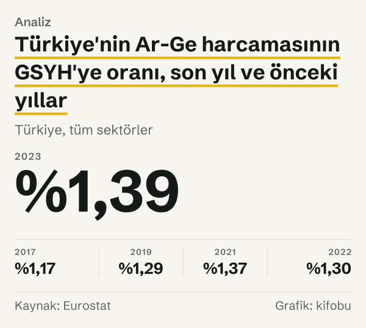
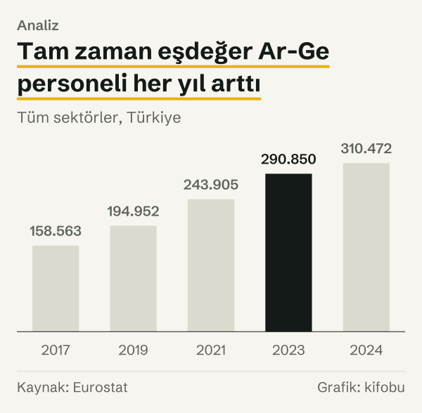
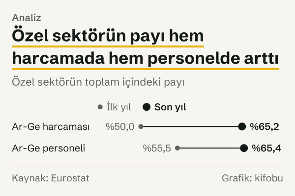
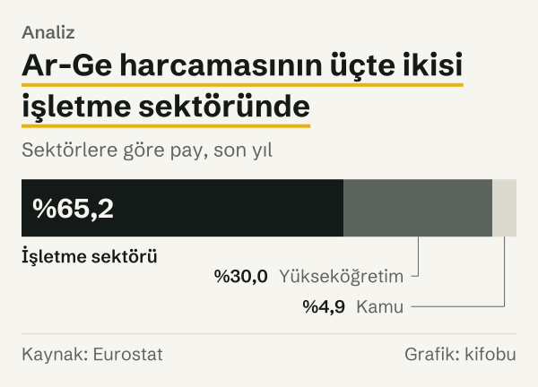

On Birinci Kalkınma Planı, Türkiye Büyük Millet Meclisi Genel Kurulu'nun 18 Temmuz 2019 tarihli kararıyla kabul edildi. Plan, Ar-Ge harcamasının GSYH'ye oranının 2023 yılı için %1,8 olmasını, tam zaman eşdeğer Ar-Ge personelinin 300.000'e ulaşmasını hedef olarak yazdı. Eurostat'ın Türkiye için yayımladığı 2023 yılı değerleri ise %1,39 ve 290.850 kişi. Oran hedefin %77,22'sinde, personel sayısı hedefin %96,95'inde.

İki hedef aynı planın aynı tablosunda yer alıyor ve aralarındaki fark çok farklı büyüklükte. Oranda hedef ile gerçekleşen arasında 0,41 puan var. Personel sayısında 9.150 kişi, yani hedefin yaklaşık yüzde üçü.

*Türkiye, tüm sektörler. Kaynak: Eurostat.*

Yazı hedef ile gerçekleşen arasındaki farkı yalnızca rakam olarak veriyor. Planı ya da planı hazırlayan ve uygulayan kurumları değerlendirmiyor; farkın nedenini plan belgesi kendisi söylemediği için söylemiyor. Yazının işi, dört hedefi tek bir kaynaktan gelen gerçekleşenlerle karşılaştırmak ve her karşılaştırmanın hangi tanıma dayandığını açıkça yazmak.

## Plan ne hedefledi?

Plan belgesinde bilim, teknoloji ve yenilik hedefleri iki ayrı tabloda yer alıyor. Birinci tablo (Bilim, Teknoloji ve Yenilik Hedefleri) üç hedef veriyor: Ar-Ge harcamasının GSYH'ye oranı için %1,8, tam zaman eşdeğer Ar-Ge personeli için 300.000 kişi ve milyon kişi başına doktora ve üstü tam zaman eşdeğer Ar-Ge personeli için 863 kişi. İkinci tablo (Ar-Ge ve Yenilik Alanındaki Hedefler) özel sektörün payına ilişkin iki hedef içeriyor: Ar-Ge harcamalarında özel sektörün payı için %67 ve Ar-Ge personeli içinde özel sektörde istihdam edilenlerin payı için %67. Girişimcilik ve KOBİ hedefleri tablosunda KOBİ'lerin Ar-Ge harcamalarındaki payı için %25 hedefi var.

Belge, hedef yılı sütununun plan tahmini olduğunu açıkça yazıyor. Yani 2023 yılı değerleri planın kendi öngörüsü; plan o yıl için bir gerçekleşme iddia etmiyor. Bu yazıda bu rakamlar hedef olarak okunuyor ve belgede yayımlandıkları tarihle, 18 Temmuz 2019 ile birlikte anılıyor.

Karşılaştırmaya dört hedefi alıyoruz. Milyon kişi başına doktora ve üstü personel hedefini (863 kişi) ve KOBİ payı hedefini (%25) karşılaştırmıyoruz, çünkü Eurostat'ın Türkiye için bu iki ölçüyü plandaki tanımla yayımladığını doğrulayamadık.

## Başlangıç noktasındaki iki farklı rakam

Hedefler bir başlangıç değeriyle birlikte veriliyor. Tablolardaki 2018 yılı sütunu, dipnota göre 2017 yılı verisini taşıyor. Planın 2017 yılı için yazdığı Ar-Ge oranı %0,96, tam zaman eşdeğer personel sayısı 153.552, özel sektörün harcama payı %56,9, personel payı %57,3.

Eurostat'ın bugün yayımladığı 2017 yılı değerleri bunlardan farklı. Ar-Ge oranı %1,17; planın başlangıç değerinden 0,21 puan yüksek. Personel sayısı 158.563; fark 5.011 kişi. Özel sektörün harcama payı %49,96; planın değerinden 6,94 puan düşük. Personel payı %55,45; planın değerinden 1,85 puan düşük.

Kaynaklar aynı yıl için farklı değer yayımlıyor; bu yazı gerçekleşenler için Eurostat'ı kullanıyor. Aşağıdaki karşılaştırmada hedefler planın belgesinden, gerçekleşenler Eurostat'tan geliyor.

## 2019–2023: yıl yıl gerçekleşen

Aşağıdaki tablo Türkiye'nin Ar-Ge harcamasının GSYH'ye oranını, AB ortalamasını ve tam zaman eşdeğer Ar-Ge personelini yıl yıl veriyor.

| Yıl | Türkiye, GSYH'ye oran | AB, GSYH'ye oran | Ar-Ge personeli (kişi) |
|---|---|---|---|
| 2017 yılı | %1,17 | %2,14 | 158.563 |
| 2018 yılı | %1,26 | %2,17 | 178.819 |
| 2019 yılı | %1,29 | %2,21 | 194.952 |
| 2020 yılı | %1,34 | %2,28 | 218.127 |
| 2021 yılı | %1,37 | %2,24 | 243.905 |
| 2022 yılı | %1,30 | %2,22 | 272.638 |
| 2023 yılı | %1,39 | %2,25 | 290.850 |
| 2024 yılı | %1,46 | %2,26 | 310.472 |

*Ar-Ge harcamasının GSYH'ye oranı ve tam zaman eşdeğer Ar-Ge personeli. Kaynak: Eurostat.*

Cari fiyatlarla Ar-Ge harcaması 2017 yılında 36.862 milyon TL iken 2023 yılında 377.542 milyon TL oldu; yani 10,2 kat. Oran ise 2017–2023 aralığında yalnızca 0,22 puan arttı, çünkü payda olan GSYH de cari fiyatlarla büyüdü. Oran yıllar arasında bir kez, 2022 yılında geriledi. Personel sayısı aynı sürede her yıl arttı: 158.563'ten 290.850'ye, yani %83,4. AB'nin oranı aynı dönemde %2,14 ile %2,28 arasında seyretti. Türkiye'nin 2023 yılı oranı AB'nin değerinin %61,78'i; aradaki fark 0,86 puan.

*Ar-Ge harcamasının GSYH'ye oranı. Kaynak: Eurostat.*

## 2023 yılı: hedef ve gerçekleşen yan yana

Hedef yılında dört ölçünün hedefe oranı birbirinden çok farklı. Ar-Ge oranı %1,39 ile hedefin %77,22'sinde; hedefe 0,41 puan var. Tam zaman eşdeğer personel 290.850 ile hedefin %96,95'inde; hedefe 9.150 kişi var.

Özel sektörün Ar-Ge harcamalarındaki payı iki sayının bölümü: işletme sektörünün harcaması, toplam harcamaya bölünüyor. 2023 yılı değeri %65,15; hedef %67; fark 1,85 puan. Özel sektörün Ar-Ge personelindeki payı %65,44; hedef %67; fark 1,56 puan.

Hedeflerin biri bir oran, biri bir sayı, ikisi birer pay. Hedefe uzaklıkları da farklı ölçeklerde: oranda yüzde yirmiden fazla, personelde yüzde dörtten az, iki payda ise iki puandan az. Hedeflerin hepsi aynı planın aynı sayfalarında olsa da, hedefe ne kadar yaklaşıldığı hangi hedefe bakıldığına göre değişiyor.

*Tüm sektörler, Türkiye. Kaynak: Eurostat.*

Özel sektörün payı yalnızca bir oran değil, harcamanın sektörler arasındaki dağılımının bir özeti. 2017 yılında Ar-Ge harcamasının %49,96'sı işletme sektöründe, %42,29'u yükseköğretimde, %7,75'i kamu sektöründe yapılıyordu. 2023 yılında işletme sektörünün payı %65,15, yükseköğretimin payı %30,00, kamu sektörünün payı %4,85. Yani işletme sektörünün payı artarken yükseköğretimin ve kamu sektörünün payları küçüldü.

*Özel sektörün toplam içindeki payı. Kaynak: Eurostat.*

*Sektörlere göre pay, son yıl. Kaynak: Eurostat.*

## Plan sonrası: 2024 yılı verisi

Dönem 2023 yılında bitti, ama Eurostat 2024 yılı değerlerini de yayımlamış durumda. Ar-Ge oranı %1,46; hedefle fark 0,34 puana indi. Personel sayısı 310.472 kişi; planın 300.000'lik hedefinin 10.472 kişi üzerinde. Özel sektörün personel payı %67,07, yani hedeflenen %67'nin üzerinde; harcama payı ise %64,79, bir önceki yıldan biraz düşük.

Dönem dışında kaldıkları için bu değerler hedefin gerçekleşmesi olarak okunamaz; plan 2023 yılı için konmuştu. AB'nin 2024 yılı değeri %2,26; Türkiye'nin oranı bunun %64,6'sı, aradaki fark 0,8 puan. Yine de aynı veri setinin bir sonraki gözlemi olarak, 2023 yılında ölçülen farkın bir yıl sonra ne kadar değiştiğini gösteriyor: oranda 0,07 puan.

## Hızı karşılaştırmak: hedefe göre gereken artış ve gerçekleşen artış

Hızı ayrıca bakmak gerekiyor: planın kendi başlangıç değeri ile hedefi arasında bir yol var. Personel sayısında plan 153.552'den 300.000'e, yani %95,4'lük bir artış öngörüyor. Eurostat'ın verisinde 2017–2023 aralığında artış %83,4. İki rakam aynı yıl aralığını kapsıyor, ama başlangıç noktaları farklı.

Ar-Ge oranında plan, %0,96'dan %1,8'e, yani 0,84 puanlık bir artış öngörüyor. Eurostat'ın verisinde 2017–2023 aralığında artış 0,22 puan. Özel sektörün harcama payında plan %56,9'dan %67'ye, 10,1 puanlık bir artış öngörüyor; Eurostat'ın verisinde 2017–2023 aralığında artış 15,19 puan. Özel sektörün personel payında plan 9,7 puanlık bir artış öngörüyor; Eurostat'ın verisinde artış 10,0 puan.

Başlangıç noktasını Eurostat'ın kendi 2017 yılı değerine çekersek de aynı sıralama çıkıyor. Bu değerden hedefe giden yol oranda 0,63 puan, personelde 141.437 kişi. Gerçekleşen artış oranda 0,22 puan, yani yolun %34,9'u; personelde 132.287 kişi, yani yolun %93,5'i. İki hedef aynı başlangıç ve aynı bitiş yılıyla, çok farklı oranlarda yol almış.

Karşılaştırma farklı şeyler söylüyor: harcama oranında planın öngördüğü artışın yaklaşık dörtte biri görülüyor, personel sayısında planın öngördüğünün yaklaşık sekizde yedisi, özel sektör paylarında ise planın öngördüğü artışa eşit ya da daha fazla. Hepsi tek bir veri setinden, ama planın başlangıç noktası Eurostat'ın bugünkü 2017 yılı değerlerinden farklı.

## Karşı okuma: sayı ile oran aynı şeyi ölçmüyor

Personel sayısı hedefe yakınken harcama oranının uzak kalması bir çelişki olmayabilir. Personel sayısı bir sayım: kaç kişi. Harcama oranı ise bir oran: Ar-Ge harcamasının GSYH'ye bölümü. Oran hem payın hem paydanın hareketine bağlı; yani GSYH'nin ne kadar büyüdüğü de oranı etkiliyor. Sayım hedefi paydadan etkilenmiyor.

İki hedefi karşılaştırırken bir başka dikkat edilecek nokta, Eurostat'ın harcamayı ulusal para birimiyle, cari fiyatlarla yayımlaması. Harcama oranı bu yüzden GSYH'nin cari fiyatlarla büyüklüğüne duyarlı. Plan belgesindeki oran ile Eurostat'taki oran aynı payda tanımına dayanıyorsa karşılaştırma doğrudandır; bunu belgeler üzerinden doğrulayamadık.

Üçüncü bir okuma, hedefin kendisiyle ilgili: plan hedef yılı 2023'ü tek bir gözlem olarak koyuyor. Bu tablolarda yalnızca başlangıç ve hedef yılı sütunları var; Eurostat'ın yıllık serisi ise aradaki yılları gösteriyor. Dolayısıyla hedefe yaklaşma, tek bir yıl yerine bir eğilim olarak da okunabilir: personel her yıl arttı, oran yalnızca 2022 yılında geriledi.

Hedeflerin plan içindeki yeri de okumayı etkiliyor. Ar-Ge harcamasının GSYH'ye oranı bir girdi ölçüsü: ekonominin bilgi üretimine ayırdığı kaynak. Personel sayısı da girdi ölçüsü; ama harcamanın aksine bir parasal değere bağlı değil. Özel sektörün payı ise bir bileşim ölçüsü: aynı toplamın kimde olduğunu söylüyor. Üç ayrı türden ölçü tek bir planda toplanınca, hedefin gerçekleşip gerçekleşmediği sorusu üç farklı soruya bölünüyor. Her birinin cevabı, kendi ölçüsünün doğasına göre farklı bir mesafe veriyor.

Bu yazıda mesafe her hedef için kendi birimiyle yazılıyor: oran için puan, sayı için kişi, pay için puan.

## Ölçümün sınırları: tanım ve revizyon

Ölçümün beş sınırı var. Birincisi, başlangıç noktası: planın 2017 yılı için yazdığı değerler ile Eurostat'ın bugünkü 2017 yılı değerleri farklı; yazı gerçekleşenler için Eurostat'ı kullanıyor. İkincisi, tanım: planda özel sektör, Eurostat'ta işletme sektörü. İki tanımın bire bir aynı olduğunu belgeleyemedik; özel sektörün payında iki kaynağın 2017 yılı değerleri arasında 6,94 puan fark var.

Üçüncüsü, tam zaman eşdeğeri: personelin çalışma süresine göre sayıldığı bir ölçü olduğu için kişi sayısından farklı bir ölçü. Dördüncüsü, AB değerleri: Eurostat bu serideki AB değerlerini 2018–2024 yılları için tahmini olarak işaretliyor. Türkiye değerleri revize edilebilir; bu yazıdaki değerler 23 Ekim 2026'da çekilen sürümdür.

Beşincisi, hedefin niteliği. Plan tablosu hedefi tek bir rakam olarak veriyor; en az mı, yaklaşık mı olduğunu belirtmiyor. Biz rakamı nokta hedef olarak okuduk. Hedefin bir eşik değil bir aralık olarak okunması, özellikle personel sayısında fark yorumunu değiştirirdi: 290.850 ile 300.000 arasındaki 9.150 kişilik fark, hedefin yaklaşık yüzde üçü.

## Nasıl hesapladık

Hedefleri, planın yayımlanmış metninden, ilgili tablonun satırı ve sütunuyla birlikte kaydettik. Gerçekleşenleri Eurostat'ın Ar-Ge harcaması ve Ar-Ge personeli tablolarından aldık. Her değeri API'den çektik ve ayrı bir istekle yeniden çekip karşılaştırdık.

Hedefe oranı gerçekleşenin hedefe bölünmesiyle, mesafeyi hedef ile gerçekleşenin farkıyla hesapladık. Özel sektörün payını işletme sektörünün harcamasının (ya da personelinin) tüm sektörlere bölümü olarak kurduk. Yüzde değişimleri ilk ve son değerden, puan farklarını iki yüzdenin farkından aldık. Hesaplar yuvarlanmamış değerlerden yapıldı ve yazıda gösterildikleri basamağa yuvarlandı.

## Kaynaklar

- [Strateji ve Bütçe Başkanlığı: On Birinci Kalkınma Planı](https://www.sbb.gov.tr/kalkinma-planlari/)
- [Eurostat: Sektöre göre Ar-Ge harcaması](https://ec.europa.eu/eurostat/databrowser/view/rd_e_gerdtot/default/table)
- [Eurostat: Sektöre ve mesleğe göre Ar-Ge personeli](https://ec.europa.eu/eurostat/databrowser/view/rd_p_persocc/default/table)
