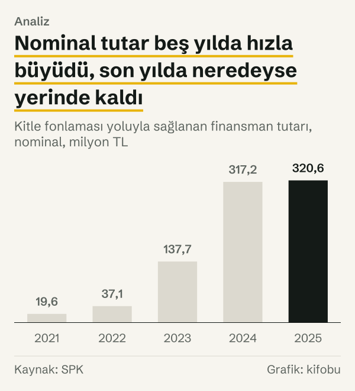
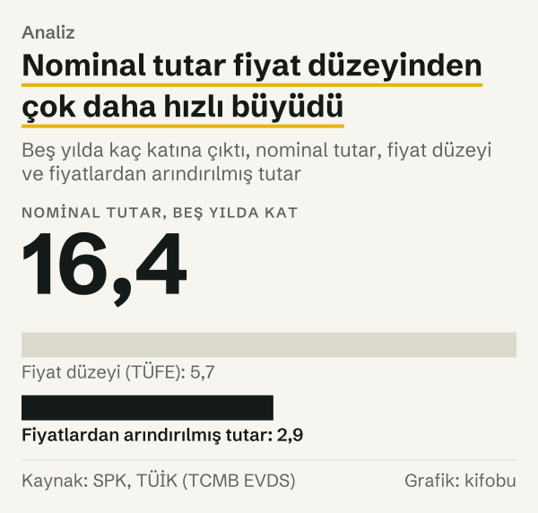
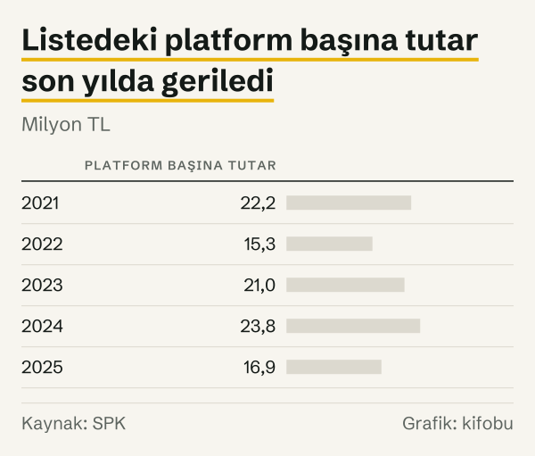

Kitle fonlaması yoluyla sağlanan finansman 2025 yılında bir önceki yıla göre yalnızca %1,07 arttı; 317,2 milyon TL'den 320,6 milyon TL'ye çıktı. Aynı yıl TÜFE'nin yıllık ortalaması %34,9 yükseldiği için, 2025 fiyatlarıyla bakıldığında toplam hacim aslında %25,1 daralmış görünüyor.

Bu fark küçük bir teknik ayrıntı değil. Hangi ölçüyle bakıldığına göre aynı yıl için hem hafif bir artıştan hem de çeyreğe yakın bir gerilemeden söz edilebiliyor. Nominal tutar, o yıl platformlardan geçen parayı cari TL olarak sayar; reel tutar ise TL'nin satın alma gücündeki erimeyi dışarıda bırakıp her yılı aynı fiyat düzeyine taşır. İki seriyi beş yıl boyunca yan yana izlediğimizde tablo netleşiyor.

Kitle fonlaması, çok sayıda kişinin küçük tutarlarla bir girişime platform aracılığıyla kaynak sağlamasına dayanıyor. Paya dayalı modelde yatırımcı girişimin ortağı olurken, borçlanmaya dayalı modelde girişim bir borçlanma aracı çıkarıp parayı vadesinde taksitlerle geri öder. Türkiye'de bu alan Sermaye Piyasası Kurulu'nun (SPK) düzenlemesi ve platform listesi altında işliyor. Bu analiz tekil kampanyaları, girişimleri ya da platformları değil, doğrudan SPK'nın yıllık toplam olarak yayımladığı tutarı inceliyor.

*Kitle fonlaması yoluyla sağlanan finansman tutarı, nominal. Kaynak: SPK.*
## Beş yılın nominal serisi

SPK belgelerine göre yıllık finansman tutarı 2021 yılında 19,6 milyon TL, 2022'de 37,1 milyon TL, 2023'te 137,7 milyon TL, 2024'te 317,2 milyon TL ve 2025'te 320,6 milyon TL olarak gerçekleşti. İlk değer 2022–2026 Stratejik Plan'dan, sonraki dört değer ise SPK faaliyet raporlarının strateji değerlendirme bölümlerinden geliyor.

Yıldan yıla nominal artış hızı son iki yılda belirgin biçimde yavaşladı. 2022'de %89,3, 2023'te %271,2 ve 2024'te %130,4 olan büyüme, 2025 yılında %1,07'ye indi. (SPK'nın 2023 yılı raporu artışı yuvarlayarak %271 veriyor; ondalıklı hesap %271,2 çıkıyor. 2025 raporundaki %1,07 ise birebir örtüşüyor.) Beş yılın tamamında nominal tutar 16,4 katına ulaştı.

Stratejik Plan bu gösterge için 2022'de 25 milyon TL, 2023'te 40 milyon TL, 2024'te 45 milyon TL ve 2025'te 50 milyon TL hedef koymuştu. Gerçekleşen tutarlar bu hedeflerin sırasıyla 1,5; 3,4; 7,0 ve 6,4 katına çıktı. Hem hedefler hem gerçekleşmeler nominal TL cinsinden olduğu için burada hedefleri enflasyondan arındırmadan yalnızca oranları verdik.

Beş yıllık toplam da hangi pencereden bakıldığına göre değişiyor. Nominal toplam 832,2 milyon TL; bunun %76,6'sı (637,8 milyon TL) son iki yılda sağlandı. Fiyatlardan arındırılmış toplam ise 1.276,0 milyon TL ve son iki yılın payı 748,4 milyon TL ile %58,7 düzeyinde. Nominal seri sonraki yılları daha yüksek fiyat düzeyleriyle ölçtüğü için ağırlığın dörtte üçünü son iki yıla yığarken, reel seride bu pay yarıdan biraz fazla kalıyor.

İlk bakışta güçlü bir büyüme izlenimi veren nominal tablo, aynı yıllardaki fiyat artışlarıyla birlikte okunduğunda bambaşka bir şekil alıyor.

## Fiyatlar aynı beş yılda nasıl hareket etti

Fiyat düzeyini Türkiye İstatistik Kurumu'nun (TÜİK) tüketici fiyat endeksiyle (TÜFE) ölçtük. Endeksin yıllık ortalaması 2021 yılında 561,6 iken 2025 yılında 3.183,2 oldu; yani fiyat düzeyi 5,7 katına çıktı. Yıllık adımlar 2022 yılında %72,3, 2023 yılında %53,9, 2024 yılında %58,5 ve 2025 yılında %34,9.

Endeksle her yılın tutarını 2025 yılı fiyatlarına çevirdik. Sonuç: 2021 yılında 111,1 milyon TL, 2022 yılında 122,0 milyon TL, 2023 yılında 294,4 milyon TL, 2024 yılında 427,8 milyon TL ve 2025 yılında 320,6 milyon TL. Fiyatlardan arındırılmış tutar beş yılda 2,9 katına çıktı; nominal tutarın 16,4 katı ile arasında büyük bir fark var. Farkın kaynağı fiyat düzeyinin 5,7 katına çıkması.

*Kitle fonlaması yoluyla sağlanan finansman tutarı, nominal ve 2025 yılı fiyatlarıyla. Kaynak: SPK, TÜİK (TCMB EVDS).*

*Beş yılda kaç katına çıktı, nominal tutar, fiyat düzeyi ve fiyatlardan arındırılmış tutar. Kaynak: SPK, TÜİK (TCMB EVDS).*
## Yıl yıl: nominal ve reel adımlar

*Bir önceki yıla göre yüzde değişim. Kaynak: SPK, TÜİK (TCMB EVDS).*
Yıllık adımları yan yana koymak farkın nerede açıldığını netleştiriyor. 2022 yılında nominal artış %89,3 iken reel artış %9,9 oldu. 2023'te nominal %271,2, reel %141,2; 2024'te ise nominal %130,4, reel %45,3 gerçekleşti. 2025 yılında ise nominal %1,07'lik cılız artışa karşılık reel tutar %25,1 geriledi.

Reel serinin zirvesi 427,8 milyon TL ile 2024 yılı. 2025'te 320,6 milyon TL'ye inilse de bu tutar hâlâ 2023'ün %8,9 üzerinde. Yani reel daralma son yıla özgü bir kırılma; iki yıl öncesine kıyasla hacim hâlâ daha büyük.

2022'de fiyatlar %72,3 yükselirken nominal tutar %89,3 artmıştı; 2025'te ise fiyatlar %34,9 artarken nominal tutar %1,07'de kaldı. İlk üç yılda nominal büyüme enflasyonun çok üstündeydi, son yılda ise fiyat artışının gerisinde kalarak reel seriyi eksiye çevirdi.

Nominal büyümeyi fiyat ve reel değişim çarpanlarına ayırdığımızda oynaklığın kaynağı da ortaya çıkıyor. 2022'de nominal 1,89 katlık büyümenin 1,72 katı fiyat düzeyinden, 1,10 katı reel artıştan geldi. 2023'te nominal 3,71 kat (fiyat 1,54; reel 2,41), 2024'te nominal 2,30 kat (fiyat 1,59; reel 1,45), 2025'te ise nominal 1,01 kat (fiyat 1,35; reel 0,75) oldu. Fiyat çarpanı 1,35 ile 1,72 arasında dar bir bantta gezerken, reel çarpan 2,41'den 0,75'e kadar savruldu. Yıllar arasındaki dalgalanma enflasyondan değil, doğrudan reel hacimdeki değişimden kaynaklanıyor.

## Listedeki platform sayısıyla birlikte okumak

Raporlar tutarla birlikte listeye alınan platform sayısını da yayımlıyor: 2021 yılında 5, 2022 yılında 8, 2023 yılında 14, 2025 yılında 19. 2024 yılı için raporda bir sayı bulamadık; Kurul bültenlerinden hesapladık. O yıl altı platform listeye alındı, ikisi listeden çıkarıldı; böylece yıl sonu sayısı 18 çıkıyor. Aynı yöntemi 2025 yılına uyguladığımızda ikisi eklenen, biri çıkarılan platformla 19'a varıyoruz; bu, SPK'nın raporundaki sayıyla aynı. Beş yılda platform sayısı 3,8 katına çıktı. 2024 yılı ve 2025 yılında listeye alınan platformlar toplam sekiz, listeden çıkarılanlar toplam üç. 2026 yılında bir platform daha listeden çıkarıldı; SPK'nın 4 Mayıs 2026 tarihli listesinde 18 platform yer alıyor. Bu son sayı, bir önceki yıl sonundaki 19'dan bir eksik.

Fiyatlardan arındırılmış tutarı bu sayıya bölünce platform başına bir ortalama çıkıyor: 2021 yılında 22,2 milyon TL, 2022 yılında 15,3 milyon TL, 2023 yılında 21,0 milyon TL, 2024 yılında 23,8 milyon TL, 2025 yılında 16,9 milyon TL. 2021 yılından 2025 yılına bu ortalama %24,1 azaldı; 2025 yılında bir önceki yıla göre %29,0 azaldı. 2023 yılından 2024 yılına ise %13,0 arttı.

*Fiyatlardan arındırılmış tutarın yıl sonu listeli platform sayısına oranı, 2025 yılı fiyatlarıyla. Kaynak: SPK, TÜİK (TCMB EVDS).*
2021–2024 döneminde reel tutar 3,9 katına, listedeki platform sayısı ise 3,6 katına çıkmıştı; 2025 yılında platform sayısı bir artarken reel tutar geriledi. Ancak listede yer almakla aktif kampanya yürütmek aynı şey değil. SPK'nın toplam serisi hangi platformun o yıl kaç kampanya yürüttüğünü göstermediği için, platform başına düşen ortalamayı bir nedensellik kanıtı değil, yalnızca genel bir ölçek göstergesi olarak okumak gerekiyor.

## Karşı okuma: taban küçükken büyüme oranları yanıltır

İlk yılın verisi tam bir takvim yılını kapsamıyor. SPK ilk platformu 1 Nisan 2021'de listeye aldığı için 2021 tutarı en fazla dokuz aylık bir dönemin toplamı. Taban bu kadar küçük olunca sonraki yılların büyüme oranları da doğal olarak yüksek görünüyor. Baz yılı olarak 2022'yi aldığımızda 2022–2025 arasında nominal tutar 8,6 katına, reel tutar 2,6 katına çıkıyor; fiyat düzeyi ise bu üç yılda 3,3 katına yükseliyor. Ölçek küçülse de ana resim değişmiyor: nominal ve reel arasındaki makası fiyat artışı açıyor.

Bir diğer nokta deflatör tercihi. TÜFE bir tüketim sepetini izler; kitle fonlamasına katılan yatırımcının ya da fon toplayan girişimin maliyet yapısını değil. Üretici fiyatları veya döviz kuru gibi başka bir gösterge kullanılsaydı reel serinin eğimi farklı çıkabilirdi; yönün değişip değişmeyeceği ise bu çalışmada test edilmedi.

Son olarak, Stratejik Plan hedeflerinin nominal TL üzerinden belirlendiğini hatırlamak gerek. Gerçekleşmelerin hedeflere oranı da bu nedenle nominal bir karşılaştırma sunuyor.

## Ölçümün sınırları

Seri, SPK'nın raporlarında kitle fonlaması yoluyla sağlanan finansman tutarı adıyla yer alıyor; raporlar hangi tür kampanyaları kapsadığını ve tutarın nasıl hesaplandığını ayrıca tarif etmiyor. SPK'nın listesindeki platformların tamamı paya dayalı kitle fonlaması faaliyeti için listeye alınmış durumda. SPK ise 2025 yılı raporunda borçlanmaya dayalı kitle fonlaması için bilgi formunun yayımlandığını da bildiriyor. Yani tutar ağırlıkla paya dayalı modelden geliyor olabilir, ama raporlar türe göre ayırmıyor.

Paya dayalı kitle fonlamasında girişim başarısız olursa yatırılan sermayenin tamamı kaybedilebilir. Borçlanmaya dayalı kitle fonlamasında borç alan şirket ödeme yapamazsa yatırılan paranın tamamı kaybedilebilir. Yazıdaki tutarlar fonlanan miktarı gösteriyor; girişimlerin sonraki durumu hakkında bir şey söylemiyor.

Toplanan tutar, fonlanan girişimlerin değeri ya da başarısı anlamına da gelmez. Kampanya sayısı, kampanya başına ortalama tutar ve yatırımcı sayısı gibi ayrıntılar bu serinin içinde görünmüyor. Bu yazıda platformların kendi sayfaları kullanılmadı.

Taban yılı da bir tercih. Yıllık ortalama endeksi kullandık, çünkü fon yıl boyunca toplanıyor. Aralık 2025 endeksi 3.513,9; bu, 2025 yılı ortalamasının %10,4 üstünde. Tabanı değiştirmek bütün reel tutarları aynı oranda ölçekler ve yıllar arasındaki oranlar aynı kalır. Her yılın tutarını kendi yıl sonu endeksiyle çevirmek ise ayrı bir seri verirdi; bunu hesaplamadık.

Son olarak kaynak yılları: 2021 yılı değeri Stratejik Plan'daki gerçekleşme sütunundan, 2022 yılı ve 2023 yılı değerleri 2023 yılı raporundan, 2024 yılı ve 2025 yılı değerleri 2025 yılı raporundan alındı. Aynı göstergenin farklı yıl raporlarında revize edilip edilmediğini görmek için 2024 yılı raporuna baktık; o raporda bu gösterge yer almıyor, bu yüzden 2024 yılı değeri yalnız 2025 yılı raporundan geliyor.

## Nasıl hesapladık

Tutarları SPK'nın Stratejik Plan'ından ve faaliyet raporlarından aldık. Fiyat düzeyini TCMB'nin EVDS sisteminden TÜİK'in tüketici fiyat endeksinin yıllık ortalaması olarak çektik. Her yılın nominal tutarını, o yılın endeksine bölüp 2025 yılı endeksiyle çarparak 2025 yılı fiyatlarına çevirdik. Yıllık değişim, iki yıl arasındaki farkın ilk yıla oranıdır. Katlar iki yılın değerinin birbirine oranıdır. Platform sayısını raporlardan aldık; 2024 yılı için Kurul bültenlerinde listeye alınma ve listeden çıkarılma kararlarını saydık. Platform başına tutar, fiyatlardan arındırılmış tutarın yıl sonundaki listeli platform sayısına bölünmesidir. Hiçbir rakam elle girilmedi; her hesap kanıt dosyasındaki kayıtlardan yeniden üretilebiliyor.

## Kaynaklar

- [SPK: 2022–2026 Stratejik Plan](https://spk.gov.tr/data/6371f6d71b41c60e747e608d/2022-2026%20STRATEJ%C4%B0K%20PLAN.pdf)
- [SPK: 2022 Yılı Faaliyet Raporu](https://spk.gov.tr/yayinlar/spk-faaliyet-raporlari)
- [SPK: 2023 Yılı İdare Faaliyet Raporu](https://spk.gov.tr/data/61e48f651b41c60d1404d687/2023%20Y%C4%B1l%C4%B1%20SPK%20%C4%B0dare%20Faaliyet%20Raporu.pdf)
- [SPK: 2025 Yılı Faaliyet Raporu](https://spk.gov.tr/data/61e48f651b41c60d1404d687/2025%20Y%C4%B1l%C4%B1%20Faaliyet%20Raporu.pdf)
- [SPK: Kurul bültenleri, 2024 yılı](https://spk.gov.tr/spk-bultenleri/gecmis-yillara-ait-bultenler/2024-yili-spk-bultenleri)
- [SPK: Kurul bültenleri, 2025 yılı](https://spk.gov.tr/spk-bultenleri/2025-yili-spk-bultenleri)
- [TÜİK (TCMB EVDS): Tüketici fiyat endeksi, genel, arşiv serisi](https://evds3.tcmb.gov.tr/igmevdsms-dis/series=TP.FG.J0)
