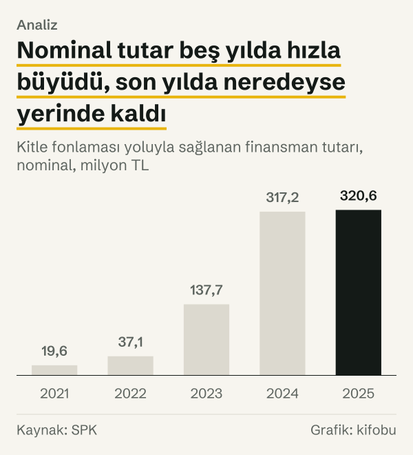
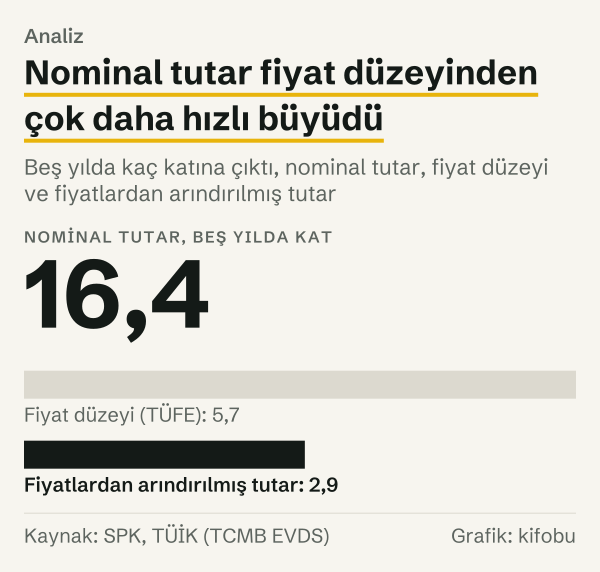
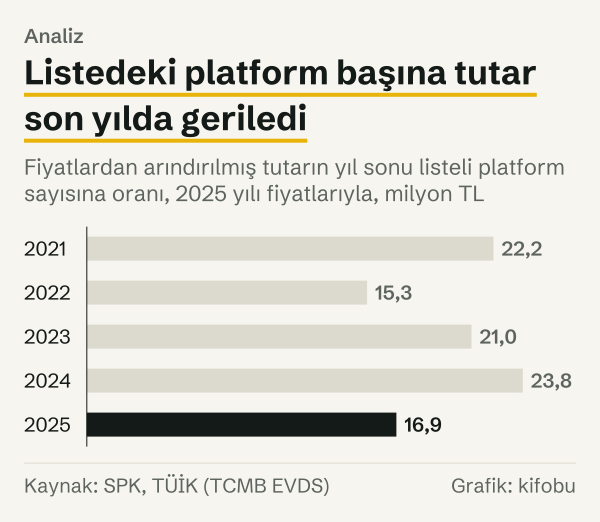

Kitle fonlaması yoluyla sağlanan finansman tutarı 2025 yılında bir önceki yıla göre %1,07 arttı: 317,2 milyon TL'den 320,6 milyon TL'ye. Aynı yıl TÜFE'nin yıllık ortalaması %34,9 yükseldi. İki sayı yan yana konduğunda tutar, 2025 yılı fiyatlarıyla %25,1 azalmış oluyor.

Ayrım küçük bir ayrıntı değil. Hangi ölçüyle bakıldığına göre aynı yıl için hem hafif bir artış hem de çeyreğe yakın bir azalış yazılabiliyor. Nominal tutar, o yıl cebe giren ya da platformdan geçen parayı TL olarak sayar. Reel tutar ise TL'nin satın alma gücündeki değişimi çıkarır ve her yılı aynı fiyat düzeyine taşır. İkisini beş yıl boyunca birlikte izliyoruz.

Konuyu ilk kez duyan için kısa bir not: kitle fonlaması, çok sayıda kişinin küçük tutarlarla bir girişime platform aracılığıyla kaynak sağlamasıdır. Paya dayalı kitle fonlamasında kaynak sağlayan kişi girişimin ortağı olur; borçlanmaya dayalı kitle fonlamasında ise girişim bir borçlanma aracı çıkarır ve parayı vadesinde taksitlerle geri öder. Türkiye'de bu faaliyet Sermaye Piyasası Kurulu'nun (SPK) düzenlemesi ve platform listesi altında yürüyor. Yazı tek bir kitle fonlaması kampanyasını, girişimi ya da platformu değerlendirmiyor; yalnız SPK'nın yıllık toplam olarak yayımladığı tutarı ele alıyor.

*Kitle fonlaması yoluyla sağlanan finansman tutarı, nominal. Kaynak: SPK.*
## Beş yılın nominal serisi

Tutar, kurumun kendi belgelerinde şöyle: 2021 yılında 19,6 milyon TL, 2022 yılında 37,1 milyon TL, 2023 yılında 137,7 milyon TL, 2024 yılında 317,2 milyon TL ve 2025 yılında 320,6 milyon TL. İlk değer 2022–2026 Stratejik Plan'dan, sonraki dört değer SPK'nın faaliyet raporlarının strateji değerlendirme bölümlerinden geliyor.

Yıldan yıla nominal değişim hızla küçüldü. 2022 yılında tutar %89,3 arttı, 2023 yılında %271,2, 2024 yılında %130,4, 2025 yılında ise %1,07. SPK'nın 2023 yılı raporu aynı artışı %271 olarak yazıyor; bizim hesabımız ondalıkla %271,2 çıkıyor. 2025 yılı raporundaki %1,07 ise hesabımızla birebir aynı. Beş yılın bütününde nominal tutar 16,4 katına çıktı.

Stratejik Plan bu gösterge için hedef de koymuştu: 2022 yılı için 25 milyon TL, 2023 yılı için 40 milyon TL, 2024 yılı için 45 milyon TL, 2025 yılı için 50 milyon TL. Gerçekleşen tutar bu hedeflerin sırasıyla 1,5; 3,4; 7,0 ve 6,4 katı. Hedefler de gerçekleşenler de nominal TL cinsinden; bu yazıda hedefleri fiyat artışına göre yeniden hesaplamadık, yalnız oranları verdik.

Beş yılın toplamı da bakış açısına göre değişiyor. Nominal toplam 832,2 milyon TL; bunun %76,6'sı son iki yılda, yani 637,8 milyon TL, sağlandı. Fiyatlardan arındırılmış toplam 1.276,0 milyon TL; son iki yılın payı 748,4 milyon TL ile %58,7. Nominal toplamda son iki yıl ağırlığın dörtte üçünü taşıyor; reel toplamda bu pay yarıdan biraz fazla. Nominal seri, sonraki yılların tutarını olduğundan büyük gösteriyor, çünkü her yıl bir önceki yıldan daha yüksek bir fiyat düzeyiyle ölçülüyor.

Nominal serinin ilk bakışta verdiği izlenim güçlü bir büyüme. Ama fiyatlar aynı yıllarda yükseldi ve bu izlenimi değiştiriyor.

## Fiyatlar aynı beş yılda nasıl hareket etti

Fiyat düzeyini Türkiye İstatistik Kurumu'nun (TÜİK) tüketici fiyat endeksiyle (TÜFE) ölçtük. Endeksin yıllık ortalaması 2021 yılında 561,6 iken 2025 yılında 3.183,2 oldu; yani fiyat düzeyi 5,7 katına çıktı. Yıllık adımlar 2022 yılında %72,3, 2023 yılında %53,9, 2024 yılında %58,5 ve 2025 yılında %34,9.

Endeksle her yılın tutarını 2025 yılı fiyatlarına çevirdik. Sonuç: 2021 yılında 111,1 milyon TL, 2022 yılında 122,0 milyon TL, 2023 yılında 294,4 milyon TL, 2024 yılında 427,8 milyon TL ve 2025 yılında 320,6 milyon TL. Fiyatlardan arındırılmış tutar beş yılda 2,9 katına çıktı; nominal tutarın 16,4 katı ile arasında büyük bir fark var. Farkın kaynağı fiyat düzeyinin 5,7 katına çıkması.

*Kitle fonlaması yoluyla sağlanan finansman tutarı, nominal ve 2025 yılı fiyatlarıyla. Kaynak: SPK, TÜİK (TCMB EVDS).*

*Beş yılda kaç katına çıktı, nominal tutar, fiyat düzeyi ve fiyatlardan arındırılmış tutar. Kaynak: SPK, TÜİK (TCMB EVDS).*
## Yıl yıl: nominal ve reel adımlar

*Bir önceki yıla göre yüzde değişim. Kaynak: SPK, TÜİK (TCMB EVDS).*
Yıllık adımları yan yana koymak farkın nerede açıldığını gösteriyor. 2022 yılında nominal artış %89,3 iken reel artış %9,9 oldu. Bir yıl sonra nominal %271,2, reel %141,2 çıktı. 2024 yılında nominal %130,4, reel %45,3. 2025 yılında nominal artış %1,07 oldu. Reel tutar ise %25,1 azaldı.

Reel serinin en yüksek noktası 2024 yılı: 427,8 milyon TL. 2025 yılında bu 320,6 milyon TL'ye indi. Yine de 2023 yılına göre reel tutar %8,9 daha yüksek. Yani reel gerileme son yıla özgü; iki yıl öncesine göre tutar hâlâ daha yüksek.

Yan yana konduğunda tablo şöyle: 2022 yılında fiyatlar %72,3 yükselirken nominal tutar %89,3 arttı; 2025 yılında fiyatlar %34,9 yükselirken nominal tutar %1,07 arttı. İlk üç yılda nominal artış fiyat artışının çok üstündeydi; son yılda fiyat artışı nominal artışın üstünde kaldı. Reel serinin işaret değiştirdiği yıl bu.

Nominal büyümeyi iki çarpana ayırmak mümkün: fiyat düzeyindeki değişim ve reel değişim. Çarpımları nominal değişimi verir. 2022 yılında nominal tutar 1,89 katına çıktı; bunun 1,72 katı fiyat düzeyinden, 1,10 katı reel büyümeden geldi. 2023 yılında nominal 3,71 kat, fiyat 1,54 kat, reel 2,41 kat oldu. 2024 yılında nominal 2,30 kat, fiyat 1,59 kat, reel 1,45 kat. 2025 yılında nominal 1,01 kat, fiyat 1,35 kat, reel 0,75 kat. Reel çarpan bir yıldan ötekine 2,41'den 0,75'e kadar değişiyor; fiyat çarpanı ise 1,35 ile 1,72 arasında kaldı. Başka bir deyişle yıllar arasındaki oynaklık fiyat tarafından değil reel tarafından geliyor.

## Listedeki platform sayısıyla birlikte okumak

Raporlar tutarla birlikte listeye alınan platform sayısını da yayımlıyor: 2021 yılında 5, 2022 yılında 8, 2023 yılında 14, 2025 yılında 19. 2024 yılı için raporda bir sayı bulamadık; Kurul bültenlerinden hesapladık. O yıl altı platform listeye alındı, ikisi listeden çıkarıldı; böylece yıl sonu sayısı 18 çıkıyor. Aynı yöntemi 2025 yılına uyguladığımızda ikisi eklenen, biri çıkarılan platformla 19'a varıyoruz; bu, SPK'nın raporundaki sayıyla aynı. Beş yılda platform sayısı 3,8 katına çıktı. 2024 yılı ve 2025 yılında listeye alınan platformlar toplam sekiz, listeden çıkarılanlar toplam üç. 2026 yılında bir platform daha listeden çıkarıldı; SPK'nın 4 Mayıs 2026 tarihli listesinde 18 platform yer alıyor. Bu son sayı, bir önceki yıl sonundaki 19'dan bir eksik.

Fiyatlardan arındırılmış tutarı bu sayıya bölünce platform başına bir ortalama çıkıyor: 2021 yılında 22,2 milyon TL, 2022 yılında 15,3 milyon TL, 2023 yılında 21,0 milyon TL, 2024 yılında 23,8 milyon TL, 2025 yılında 16,9 milyon TL. 2021 yılından 2025 yılına bu ortalama %24,1 azaldı; 2025 yılında bir önceki yıla göre %29,0 azaldı. 2023 yılından 2024 yılına ise %13,0 arttı.

*Fiyatlardan arındırılmış tutarın yıl sonu listeli platform sayısına oranı, 2025 yılı fiyatlarıyla. Kaynak: SPK, TÜİK (TCMB EVDS).*
Okunuşu şu: 2021 yılından 2024 yılına reel tutar 3,9 katına, listedeki platform sayısı 3,6 katına çıktı; 2025 yılında platform sayısı bir arttı, reel tutar azaldı. Ama listedeki platform ile etkin platform aynı şey değil. Listeye alınan bir platformun o yıl kaç kitle fonlaması kampanyası yürüttüğünü SPK'nın toplam serisi göstermiyor. Dolayısıyla platform başına ortalama bir ölçü olarak okunmalı, bir nedensellik kanıtı olarak değil.

## Karşı okuma: taban küçükken büyüme oranları yanıltır

İlk yıl, yılın yalnız bir bölümünü kapsıyor olabilir. SPK ilk platformu 1 Nisan 2021'de listeye aldı; yani 2021 yılı tutarı on iki ayın değil, en çok dokuz ayın toplamı. Taban bu kadar küçükken sonraki yılların artış oranları büyük çıkıyor. Bunu dengelemek için 2022 yılını tabanı alabiliriz: 2022 yılından 2025 yılına nominal tutar 8,6 katına, reel tutar 2,6 katına çıktı; fiyat düzeyi bu üç yılda 3,3 katına çıktı. Sonuç değişmiyor, yalnız ölçek küçülüyor: nominal ve reel arasındaki fark fiyat düzeyindeki artıştan geliyor.

İkinci karşı okuma deflatörün tercihiyle ilgili. TÜFE, bir tüketim sepetinin fiyatlarını izliyor; kitle fonlamasına katılan kişinin ya da fon toplayan girişimin maliyet yapısını değil. Başka bir fiyat endeksi, örneğin üretici fiyatları ya da döviz kuru, reel serinin eğimini değiştirir. Yönün aynı kalıp kalmayacağı bu yazıda sınanmadı.

Üçüncüsü hedeflerin okunuşu. Stratejik Plan'daki hedefler nominal TL olarak yazılmış. Gerçekleşenlerin hedefle oranı bu yüzden nominal bir oran; reel karşılığı farklı olurdu.

## Ölçümün sınırları

Seri, SPK'nın raporlarında kitle fonlaması yoluyla sağlanan finansman tutarı adıyla yer alıyor; raporlar hangi tür kampanyaları kapsadığını ve tutarın nasıl hesaplandığını ayrıca tarif etmiyor. SPK'nın listesindeki platformların tamamı paya dayalı kitle fonlaması faaliyeti için listeye alınmış durumda. SPK ise 2025 yılı raporunda borçlanmaya dayalı kitle fonlaması için bilgi formunun yayımlandığını da bildiriyor. Yani tutar ağırlıkla paya dayalı modelden geliyor olabilir, ama raporlar türe göre ayırmıyor.

Paya dayalı kitle fonlamasında girişim başarısız olursa yatırılan sermayenin tamamı kaybedilebilir. Borçlanmaya dayalı kitle fonlamasında borç alan şirket ödeme yapamazsa yatırılan paranın tamamı kaybedilebilir. Yazıdaki tutarlar fonlanan miktarı gösteriyor; girişimlerin sonraki durumu hakkında bir şey söylemiyor.

Toplanan tutar, fonlanan girişimlerin değeri ya da başarısı anlamına da gelmez. Kampanya sayısı, kampanya başına ortalama tutar ve yatırımcı sayısı gibi ayrıntılar bu serinin içinde görünmüyor. Bu yazıda platformların kendi sayfaları kullanılmadı.

Taban yılı da bir tercih. Yıllık ortalama endeksi kullandık, çünkü fon yıl boyunca toplanıyor. Aralık 2025 endeksi 3.513,9; bu, 2025 yılı ortalamasının %10,4 üstünde. Tabanı değiştirmek bütün reel tutarları aynı oranda ölçekler ve yıllar arasındaki oranlar aynı kalır. Her yılın tutarını kendi yıl sonu endeksiyle çevirmek ise ayrı bir seri verirdi; bunu hesaplamadık.

Son olarak kaynak yılları: 2021 yılı değeri Stratejik Plan'daki gerçekleşme sütunundan, 2022 yılı ve 2023 yılı değerleri 2023 yılı raporundan, 2024 yılı ve 2025 yılı değerleri 2025 yılı raporundan alındı. Aynı göstergenin farklı yıl raporlarında revize edilip edilmediğini görmek için 2024 yılı raporuna baktık; o raporda bu gösterge yer almıyor, bu yüzden 2024 yılı değeri yalnız 2025 yılı raporundan geliyor.

## Nasıl hesapladık

Tutarları SPK'nın Stratejik Plan'ından ve faaliyet raporlarından aldık. Fiyat düzeyini TCMB'nin EVDS sisteminden TÜİK'in tüketici fiyat endeksinin yıllık ortalaması olarak çektik. Her yılın nominal tutarını, o yılın endeksine bölüp 2025 yılı endeksiyle çarparak 2025 yılı fiyatlarına çevirdik. Yıllık değişim, iki yıl arasındaki farkın ilk yıla oranıdır. Katlar iki yılın değerinin birbirine oranıdır. Platform sayısını raporlardan aldık; 2024 yılı için Kurul bültenlerinde listeye alınma ve listeden çıkarılma kararlarını saydık. Platform başına tutar, fiyatlardan arındırılmış tutarın yıl sonundaki listeli platform sayısına bölünmesidir. Hiçbir rakam elle girilmedi; her hesap kanıt dosyasındaki kayıtlardan yeniden üretilebiliyor.

## Kaynaklar

- [SPK: 2022–2026 Stratejik Plan](https://spk.gov.tr/data/6371f6d71b41c60e747e608d/2022-2026%20STRATEJ%C4%B0K%20PLAN.pdf)
- [SPK: 2022 Yılı Faaliyet Raporu](https://spk.gov.tr/yayinlar/spk-faaliyet-raporlari)
- [SPK: 2023 Yılı İdare Faaliyet Raporu](https://spk.gov.tr/data/61e48f651b41c60d1404d687/2023%20Y%C4%B1l%C4%B1%20SPK%20%C4%B0dare%20Faaliyet%20Raporu.pdf)
- [SPK: 2025 Yılı Faaliyet Raporu](https://spk.gov.tr/data/61e48f651b41c60d1404d687/2025%20Y%C4%B1l%C4%B1%20Faaliyet%20Raporu.pdf)
- [SPK: Kurul bültenleri, 2024 yılı](https://spk.gov.tr/spk-bultenleri/gecmis-yillara-ait-bultenler/2024-yili-spk-bultenleri)
- [SPK: Kurul bültenleri, 2025 yılı](https://spk.gov.tr/spk-bultenleri/2025-yili-spk-bultenleri)
- [TÜİK (TCMB EVDS): Tüketici fiyat endeksi, genel, arşiv serisi](https://evds3.tcmb.gov.tr/igmevdsms-dis/series=TP.FG.J0)
