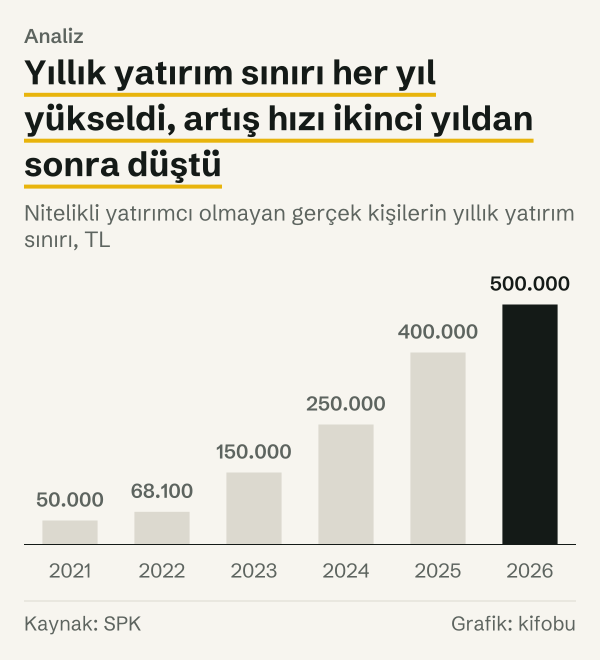
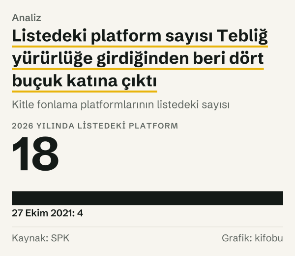

Kitle Fonlaması Tebliği'nin yürürlüğe girdiği 27 Ekim 2021'de nitelikli yatırımcı olmayan bir gerçek kişi, bir takvim yılında kitle fonlamasına en çok 50.000 TL yatırabiliyordu. 2026 yılında bu sınır 500.000 TL. Nominal olarak tutar 10 katına çıktı. Aynı dönemde fiyat düzeyi 7,5 katına çıktı; bu yüzden sınırın fiyatlardan arındırılmış artışı 1,34 kat.

İki rakam arasındaki mesafe, yazının asıl konusu. Tebliğ'deki tutarlar her yıl sonunda Sermaye Piyasası Kurulu'nun (SPK) bülteniyle yeniden değerleniyor. Aynı dönemde tüketici fiyatları da yükseldi; sınırı TÜFE'den arındırdığımızda artış nominaldekinden küçük kalıyor. Hesap aşağıdaki bölümlerde.

Yazı bir düzenleme tartışması değil, bir ölçü karşılaştırması. Kuralın ne dediğini, tutarların iki tarihte ne olduğunu ve bu tutarların fiyatlardan arındırıldığında nasıl göründüğünü yazıyoruz. Kuralın yerinde olup olmadığı, sınırın yüksek ya da düşük olduğu bu yazının konusu değil.

Terimler için kısa bir hatırlatma. Kitle fonlaması, çok sayıda kişinin küçük tutarlarla bir girişime platform aracılığıyla kaynak sağlamasıdır. Paya dayalı kitle fonlamasında kaynak sağlayan kişi girişimin ortağı olur; borçlanmaya dayalı kitle fonlamasında girişim bir borçlanma aracı çıkarır ve parayı vadesinde geri öder. Nitelikli yatırımcı, SPK'nın girişim sermayesi yatırım ortaklıkları düzenlemesinde tanımlanan, belirli koşulları sağlayan yatırımcı grubudur.

*Nitelikli yatırımcı olmayan gerçek kişilerin yıllık yatırım sınırı, TL. Kaynak: SPK.*
## İki tarih, altı tutar

Tebliğ, 27 Ekim 2021 tarihli Resmî Gazete'de yayımlanarak yürürlüğe girdi. Aşağıdaki tablo, SPK'nın yeniden değerleme bültenlerinde yer alan altı tutarı iki tarih için yan yana koyuyor. İlk sütun Tebliğ'deki ilk değer, ikinci sütun 31 Aralık 2025 tarihli bültende 2026 yılı için ilan edilen değer.

| Kural | 27 Ekim 2021 | 2026 yılı | Nominal kat | Reel kat |
|---|---|---|---|---|
| Yıllık yatırım sınırı | ₺50.000 | ₺500.000 | 10,0 | 1,34 |
| Gelir beyanıyla yıllık sınır | ₺200.000 | ₺2.000.000 | 10,0 | 1,34 |
| Borçlanmaya dayalı, proje başına sınır | ₺20.000 | ₺200.000 | 10,0 | 1,34 |
| Nitelikli yatırımcı payının zorunlu olduğu fon talebi | ₺1.000.000 | ₺9.000.000 | 9,0 | 1,20 |
| Platform için asgari sermaye | ₺1.000.000 | ₺15.000.000 | 15,0 | 2,01 |
| On iki aylık fon toplama üst sınırı | ₺10.911.000 | ₺142.500.000 | 13,1 | 1,75 |

*Tutarlar TL. Kaynak: SPK Kurul Bültenleri; reel kat için TÜFE (TÜİK).*

Gelir beyanıyla yıllık sınır şu anlama geliyor: yatırımcı yıllık net gelirini platforma beyan ederse sınır beyan edilen gelirin %10'u olarak uygulanabiliyor, ama bu tutar tablodaki gelir beyanlı üst değeri aşamıyor. Borçlanmaya dayalı kitle fonlamasında ayrıca bir projeye yapılabilecek yatırım için ayrı bir sınır var. Nitelikli yatırımcı payı ise paya dayalı kitle fonlamasında belirli bir fon talebinin üstünde, hedeflenen fonun bir bölümünün nitelikli yatırımcılarca karşılanması zorunluluğunun başladığı eşik; Tebliğ ilk hâlinde bu eşiği 1.000.000 TL olarak yazmıştı.

Düzenleme, bir girişimin on iki ayda toplayabileceği fonu, izahname hazırlama muafiyetine bağlı ve her yıl Kurul Bülteni'yle ilan edilen bir ihraç sınırına bağlıyor. Bültende bu satırda iki değer var; biz üst değeri aldık. 2021 yılı değeri Tebliğ'in yürürlüğe girdiği yıldaki yeniden değerlenmiş tutar, Tebliğ'deki ilk değer değil; çünkü bu muafiyet satırı Tebliğ'den daha eski.

## Her yıl sonunda güncelleme

SPK, yeniden değerlemeye tabi tutarları her yıl aralık ayının sonunda bültenle yeniden ilan ediyor. 2021 yılı sonundan 2025 yılı sonuna kadar beş bülten bu satırları içeriyor. Yıllık yatırım sınırı bu bültenlere göre şöyle ilerledi: 50.000 TL, 2022 yılında 68.100 TL, 2023 yılında 150.000 TL, 2024 yılında 250.000 TL, 2025 yılında 400.000 TL ve 2026 yılında 500.000 TL.

Yıllık artışlar eşit değil. 2022 yılında sınır %36,2 arttı, 2023 yılında %120,3, 2024 yılında %66,7, 2025 yılında %60,0, 2026 yılında %25,0. İlk adım küçük, ikinci adım en büyük; sonrasında artış hızı her yıl azaldı.

Fon toplama üst sınırı da aynı çizgide ilerledi, ama daha dik. 2021 yılında 10.911.000 TL olan sınır 2022 yılında 20.000.000 TL, 2023 yılında 45.000.000 TL, 2024 yılında 75.000.000 TL, 2025 yılında 112.500.000 TL ve 2026 yılında 142.500.000 TL oldu. Beş yılda 13,1 katına çıktı; yıllık yatırım sınırının 10 katından fazla.

## Güncelleme oranı ile sınır artışı

Bültenlerin başlığında her yıl için bir yeniden değerleme oranı yazıyor: 2022 yılı için %36,20, 2023 yılı için %122,93, 2024 yılı için %58,46, 2025 yılı için %43,93, 2026 yılı için %25,49.

Yıllık yatırım sınırının artışını bu oranlarla yan yana koyduk. 2022 yılında artış (%36,2) orana (%36,20) eşit. 2023 yılında sınır %120,3 arttı, oran ise %122,93. 2024 yılında sınır %66,7 arttı, oran %58,46. 2025 yılında sınır %60,0 arttı, oran %43,93. 2026 yılında sınır %25,0 arttı, oran %25,49. Yani üç yılda artış oranın altında ya da eşit kaldı, iki yılda üstüne çıktı.

Bültenin dipnotunda Kurul, oranın uygulanmasının zorunlu tutulmadığı hallerde “ilgili düzenlemelerin Kurulumuza verdiği takdir hakkı kapsamında değerleme yapılmıştır” diyor. Yazı bu takdiri değerlendirmiyor; yalnız sonuçları yan yana koyuyor.

*Bir önceki yıla göre yüzde değişim ve yeniden değerleme oranı. Kaynak: SPK.*
## Nominal on kat, reel bir buçuk kata yakın

Nominal artış tek başına bir şey söylemez, çünkü TL'nin değeri aynı sürede değişti. Fiyatlardan arındırmak için Tebliğ'in yürürlüğe girdiği Ekim 2021 ile veri olarak ulaşabildiğimiz son ay olan Eylül 2026 arasındaki TÜFE değişimini kullandık. TÜİK'in endeksi bu dönemde 7,5 katına çıktı.

Çevirmeyle Ekim 2021'deki 50.000 TL, Eylül 2026 fiyatlarıyla yaklaşık 373.797 TL ediyor. Bugünkü 500.000 TL'lik sınır bunun 1,34 katı. Yani yıllık yatırım sınırı nominal olarak 10 katına, reel olarak 1,34 katına çıktı. Gelir beyanıyla yıllık sınır ve borçlanmaya dayalı proje sınırı da aynı oranlarda büyüdü.

Başka kalemlerde reel artış farklı. Nitelikli yatırımcı payının zorunlu olduğu fon talebi eşiği nominal 9 katına, reel 1,20 katına çıktı. Platform için asgari sermaye nominal 15 katına, reel 2,01 katına çıktı; bu, tabloda reel artışın en büyük olduğu kalem. Fon toplama üst sınırı nominal 13,1 katına, reel 1,75 katına çıktı.

*Altı tutarın 2026 yılı değerinin Tebliğ yürürlüğündeki değerine oranı. Kaynak: SPK.*
![Halter grafik: Altı kalemin hepsinde reel kat, nominal katın altında kaldı: Nominal kat: Yıllık yatırım sınırı: 10,00, Gelir beyanıyla yıllık sınır: 10,00, Borçlanmaya dayalı proje sınırı: 10,00, Nitelikli yatırımcı payı eşiği: 9,00, Platform asgari sermayesi: 15,00, Fon toplama üst sınırı: 13,06; Reel kat: Yıllık yatırım sınırı: 1,34, Gelir beyanıyla yıllık sınır: 1,34, Borçlanmaya dayalı proje sınırı: 1,34, Nitelikli yatırımcı payı eşiği: 1,20, Platform asgari sermayesi: 2,01, Fon toplama üst sınırı: 1,75.](./graf-4.svg)
*Altı tutarın nominal ve fiyatlardan arındırılmış artışı, kat olarak. Kaynak: SPK, TÜİK (TCMB EVDS).*
## Değişmeyen sayılar

Her sayı yeniden değerlenmiyor. Fon toplama süresi hem paya dayalı hem borçlanmaya dayalı kitle fonlamasında 60 günü geçemiyor. On iki aylık dönemde bir girişim ya da girişim şirketi, paya dayalı kitle fonlamasında en çok iki kampanya ile fon toplayabiliyor; borçlanmaya dayalı kitle fonlamasında da aynı en çok iki kampanya sınırı var. Yatırımcının ödeme emrini verdikten sonra cayma hakkını kullanabileceği süre her iki türde 48 saat. Paya dayalı kitle fonlamasında talep edilen fonun en çok %20'sine kadar ek fon toplanabiliyor. Yine paya dayalı kitle fonlamasında, Tebliğ'deki eşiği aşan fon taleplerinde hedeflenen fonun en az %5'inin nitelikli yatırımcılarca karşılanması gerekiyor.

Söz konusu sayılar bültenlerde yeniden değerleme tablosunda yer almıyor. SPK'nın Mevzuat Sistemi'nde yayımlanan güncel Tebliğ metninde bu sayılar 27 Ekim 2021 tarihli metindekilerle aynı: kampanya süresi 60 gün; on iki ayda en çok iki kampanya (paya dayalı ve borçlanmaya dayalı kitle fonlamasında ayrı ayrı); cayma süresi 48 saat; paya dayalı kitle fonlamasında ek fon üst sınırı %20 ve nitelikli yatırımcı payı %5. Güncel metnin başlığında yalnızca 27 Ekim 2021 tarihli Resmî Gazete yayımı yazıyor; metinde değişiklik ibaresi yok.

## Listedeki platform sayısı

27 Ekim 2021'e kadar SPK'nın dört platformu listeye aldığı, Kurul bültenlerinden görülüyor. SPK'nın listesi, 4 Mayıs 2026 tarihli sayfasında 18 platform gösteriyor; sonraki bültenlerde (22 Ekim 2026 tarihli son bülten dahil) yeni bir listeye alınma ya da çıkarma kararı görmedik. Yani listedeki platform sayısı 4'ten 18'e, 4,5 katına çıktı; net artış 14.

Listede yer alan 18 platformun tamamı SPK'nın sayfasında paya dayalı kitle fonlaması faaliyetiyle görünüyor. SPK, 2025 yılı faaliyet raporunda borçlanmaya dayalı kitle fonlaması için bilgi formunun Kurul'un internet sitesinde yayımlandığını yazıyor. Bu iki faaliyetin ayrımı raporlarda bir tutar serisine yansımıyor.

Paya dayalı kitle fonlamasında girişim başarısız olursa yatırılan sermayenin tamamı kaybedilebilir. Borçlanmaya dayalı kitle fonlamasında borç alan şirket ödeme yapamazsa yatırılan paranın tamamı kaybedilebilir.

*Kitle fonlama platformlarının listedeki sayısı. Kaynak: SPK.*
İki tarihteki tutarları yan yana koymak, tutarların birbirine oranının da değiştiğini gösteriyor. Fon toplama üst sınırının yıllık yatırım sınırına oranı 2021 yılında 218,2 iken 2026 yılında 285,0. Yani üst sınır 13,1 kat, yıllık yatırım sınırı 10 kat arttığı için iki tutarın oranı yükseldi.

## Karşı okuma: nominal artış ne ölçüyor?

İlk karşı okuma, reel artışın küçük görünmesine itiraz edebilir: 1,34 kat da bir genişleme. Doğru. Sınırların nominal on katı ile reel 1,34 katı arasındaki fark, aynı dönemde TÜFE'nin 7,5 katına çıkmasıyla örtüşüyor; reel olarak bile sınır büyüdü. Yazıdaki ölçü genişlemeyi yadsımıyor, yalnız boyutunu fiyatlarla birlikte gösteriyor.

İkinci karşı okuma fiyat endeksinin tercihiyle ilgili. TÜFE, bir tüketim sepetinin fiyatlarını izliyor; bir girişimin ya da yatırımcının maliyet yapısını ya da gelirini değil. Başka bir endeks ya da kişisel gelirdeki değişim, reel artışı başka bir yere koyardı. Örneğin sınırın nominal gelirle ilişkisini ölçmek için hanehalkı gelir verisi gerekirdi; bu yazı o ölçüyü kullanmıyor.

Üçüncüsü tarihlerin tercihi. Ekim 2021 ile Eylül 2026 aylık endekslerini kullandık. Yıllık ortalama endekslerle yapılan bir çevirme, iki yılın içindeki aylık oynaklık nedeniyle biraz farklı sonuç verirdi. Eylül 2026 değeri hâlâ yıl içinde olduğundan 2026 yılı bütününü temsil etmez.

## Ölçümün sınırları

Bu yazı Tebliğ'in kendi sayısal kurallarını ve SPK'nın yeniden değerleme bültenlerini kullanıyor; her tutar bir bülten satırına ve sütununa bağlı.

En önemli sınır fon toplama üst sınırı satırının okunuşu. Bültende izahname muafiyeti satırı iki değer taşıyor. İzahname Tebliği bu muafiyet sınırını toplam satış bedeli olarak tanımlıyor; bu, satırdaki iki değerden üst olanına karşılık geliyor ve biz de onu aldık. Bu satır, Tebliğ'in paya ve borçlanmaya dayalı bölümlerinde atıf yapılan muafiyet sınırıyla bağlantılı olduğu için kullanıldı.

İkinci sınır, 2021 yılı değerlerinin hangi tarihe ait olduğu. Altı tutarın beşi Tebliğ'in ilk değeri; üst sınır satırının 2021 yılı değeri ise o yılın yeniden değerlenmiş tutarı. Bu yüzden son satırdaki nominal kat, ilk beş satırla birebir karşılaştırılamaz.

Üçüncüsü kapsam. Tabloda yalnız sayısal sınırlar var; platformların kendi iç kuralları, ücretleri ya da yatırımcıya sundukları ek koşullar bu yazının dışında.

Dördüncüsü Tebliğ metninin kaynağı. Süre ve oran gibi değişmeyen sayıları Resmî Gazete'de yayımlanan ilk metinden aldık ve SPK Mevzuat Sistemi'ndeki güncel metinle karşılaştırdık; sayılar aynı.

## Nasıl hesapladık

Altı tutarı SPK'nın 2021–2025 yıllarının son bültenlerindeki yeniden değerleme tablolarından aldık. Nominal kat, 2026 yılı değerinin 2021 yılı değerine oranıdır. Reel karşılığı için TÜFE'nin Ekim 2021 ve Eylül 2026 değerlerini kullandık; Ekim 2021'in eski temel yıllı serideki değerini, 2025 yılı ortalamasına bölerek yeni temel yıllı seriye taşıdık. 2021 yılı tutarını Eylül 2026 fiyatlarına çevirdik ve 2026 yılı tutarını bu değere böldük. Platform sayısını Kurul bültenlerinden ve SPK'nın liste sayfasından saydık. Hiçbir rakam elle girilmedi; her hesap kanıt dosyasındaki kayıtlardan yeniden üretilebiliyor.

## Kaynaklar

- [SPK: 2025 Yılı Faaliyet Raporu](https://spk.gov.tr/data/61e48f651b41c60d1404d687/2025%20Y%C4%B1l%C4%B1%20Faaliyet%20Raporu.pdf)
- [SPK: Kurul Bülteni, 31 Aralık 2025](https://spk.gov.tr/data/695546ca8f95db281807a9c3/2025-68.pdf)
- [SPK: Kurul Bülteni, 31 Aralık 2024](https://spk.gov.tr/data/6774184f8f95db0cb0251c8b/2024-60.pdf)
- [SPK: Kurul Bülteni, 29 Aralık 2023](https://spk.gov.tr/data/658f25ff8f95db27604610b0/82-2023.pdf)
- [SPK: Kurul Bülteni, 30 Aralık 2022](https://spk.gov.tr/data/63af25758f95db18145fe033/74-2022-SY.pdf)
- [SPK: Kitle Fonlama Platformları, Listeye Alınan Platformlar](https://spk.gov.tr/sirketler/kitle-fonlama-platformlari/listeye-alinan-platformlar)
- [SPK: Kurul Bültenleri, 2021 yılı](https://spk.gov.tr/spk-bultenleri/gecmis-yillara-ait-bultenler/2021-yili-spk-bultenleri)
- [Resmî Gazete: Kitle Fonlaması Tebliği, 27 Ekim 2021](https://resmigazete.gov.tr/eskiler/2021/10/20211027-3.htm)
- [SPK: Mevzuat Sistemi, Kitle Fonlaması Tebliği, güncel metin](https://mevzuat.spk.gov.tr/Mevzuat/Dosya/220)
- [TÜİK (TCMB EVDS): Tüketici fiyat endeksi, genel, arşiv serisi](https://evds3.tcmb.gov.tr/igmevdsms-dis/series=TP.FG.J0)
- [TÜİK (TCMB EVDS): Tüketici fiyat endeksi, genel, yeni temel yıllı seri](https://evds3.tcmb.gov.tr/igmevdsms-dis/series=TP.TUKFIY2025.GENEL)
