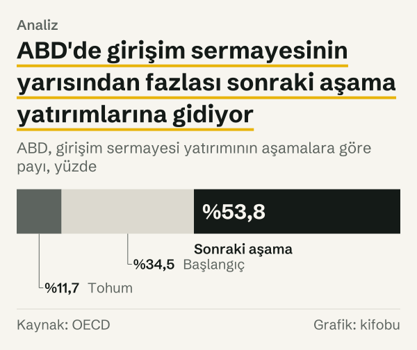
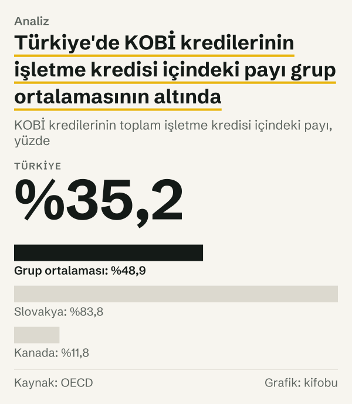

OECD'nin KOBİ finansmanı tablosunda Türkiye'nin 2024 yılı satırı şöyle: KOBİ kredileri, toplam işletme kredilerinin %35,2'si. Aynı kuruluşun girişim sermayesi tablosunda ise Türkiye'nin satırı hiç yok. Bir ülkenin girişim ekosistemi konuşulurken ilk akla gelen soru sıralamadaki yeridir; burada önce sıralamanın kendisine bakmak, sonra Türkiye'nin neden aynı sıralamada bulunmadığını açıkça yazmak gerekiyor.

İki ayrı OECD tablosunu yan yana koyuyoruz. Birincisi, girişim sermayesi yatırımlarının yıllık tutarını ülkenin gayrisafi yurt içi hasılasına (GSYH) bölen piyasa istatistikleri. İkincisi, OECD'nin *Financing SMEs and Entrepreneurs* (KOBİ ve Girişimcilerin Finansmanı) karnesi; bu karnede Türkiye'nin kendi bölümü var. Girişim sermayesi, henüz küçük ve hızlı büyüme hedefi taşıyan şirketlere hisse karşılığı verilen fondur. KOBİ kredisi ise küçük ve orta ölçekli işletmelere verilen borçtur. İkisi girişim finansmanının farklı kapılarıdır ve OECD bunları ayrı tablolarda izliyor.

Karşılaştırma grubunu baştan tanımlıyoruz: Avrupa'daki OECD üyeleri (Türkiye dahil), ABD ve Kanada. Aşağıdaki sıralamalar, ortalamalar ve sayımlar bu gruba aittir; OECD'nin tamamı için bir iddia taşımıyor. Sonuç iki parçalı. 2024 yılı için girişim sermayesi tablosunda bu gruptan 27 ülke var ve Türkiye bunların arasında değil. Türkiye'nin göründüğü KOBİ kredisi tablosunda ise Türkiye'nin değeri, grubun ortalamasının altında. Bu iki cümle Türkiye'nin girişim finansmanı hakkında bir hüküm vermiyor; yalnızca iki ölçünün ne söylediğini ve neyi söyleyemediğini ayırıyor.

## Tablonun ilk satırları

Girişim sermayesi tarafında OECD'nin *Venture capital investments (market statistics)* veri seti, yatırımları ülke ve yıl bazında yayımlıyor. 2024 yılı sütununda grubun 27 ülkesi için GSYH'ye oranlı değer var.

Grubun başında ABD var: girişim sermayesi yatırımı GSYH'nin %0,53'üne denk geliyor. Estonya ve Kanada ikisi de %0,20 düzeyinde, Birleşik Krallık %0,18. Danimarka %0,14, İsviçre %0,13, Hollanda %0,12. Listenin ilk on satırı, ABD'nin hemen ardından hızla düşen bir basamak gibi.

*Girişim sermayesi yatırımı, GSYH'ye oranı, yüzde, grubun ilk on ülkesi. Kaynak: OECD.*
27 ülkenin oranlarının sade ortalaması %0,086. Ortalamanın üstünde kalan ülkeler Fransa'ya (%0,089) kadar uzanıyor; Belçika (%0,084), Almanya (%0,067), İspanya (%0,059) ve İrlanda (%0,058) ortalamanın altında. Tablonun alt ucunda Slovenya (%0,008), Çekya (%0,007) ve Letonya (%0,005) duruyor. Ortalama listenin tepesindeki ABD'ye duyarlı olduğundan, çoğu ülke ortalamanın altında kalıyor; tipik bir ülkenin nerede durduğunu ortalamadan çok tablonun orta satırları anlatıyor.

## Oranın bir yılda ve on yedi yılda değişimi

Bir ülkenin oranının bir yılda ne kadar oynayabildiğini Lüksemburg örneği gösteriyor. Lüksemburg'un oranı 2022 yılında GSYH'nin %0,278'i idi; 2023'te %0,040'a indi, 2024'te %0,020 oldu. Aynı ülkenin ardışık üç yılı arasındaki bu fark, tek bir yılın sıralamasının ülkenin kalıcı konumunu anlatmayabileceğini düşündürüyor.

Oranın oynaklığı hesabın yapısından geliyor. Pay, yıl içinde yapılan yatırımların toplamı; payda, ekonominin büyüklüğü. Girişim sermayesi işlemleri az sayıda ve büyük tutarlı olabildiğinden, yılın toplamı birkaç işlemin zamanlamasından etkilenebilir. Bu yazı bunun her ülke için geçerli olduğunu söylemiyor; yalnızca Lüksemburg'un üç yıllık serisinin böyle bir dalgalanma gösterdiğini aktarıyor.

Aynı veri seti 2007 yılında başlıyor. Hem 2007 yılında hem 2024 yılında değeri bulunan ülke sayısı 27. 2007 yılında ABD %0,26 ile yine başta, Kanada %0,12 ve İsveç %0,12 ile onu izliyordu. Norveç %0,088 ile dördüncü, Portekiz %0,064 ile dokuzuncu sıralardaydı. Estonya ise %0,010'luk oranla listenin alt yarısındaydı.

2024 yılında tablo değişmiş. ABD'nin oranı %0,53'e çıkmış. İsveç'in oranı %0,11 ile neredeyse aynı kalmış; Norveç'in oranı %0,047'ye, Portekiz'in oranı %0,026'ya inmiş. Estonya'nın oranı ise %0,20'ye yükselerek ilk beşe girmiş. Yani sıralamanın tepesi sabit kalırken orta ve alt bölümünde ülkeler yer değiştirmiş. Bu yer değiştirmelerin sebebini veri söylemiyor; yalnızca bir ülkenin 2024 yılında aldığı satırın, on yedi yıl önceki satırından çıkarılamayacağını gösteriyor.

## Toplamın içinde: yatırımın aşamaları

Veri seti toplamı üç aşamaya ayırıyor: tohum, başlangıç ve sonraki aşama. Toplam sıralaması bu aşamaların ağırlığını gizliyor. ABD'de 2024 yılında toplamın %11,7'si tohum, %34,5'i başlangıç, %53,8'i sonraki aşama yatırımlarından oluşuyor.

*ABD, girişim sermayesi yatırımının aşamalara göre payı, yüzde. Kaynak: OECD.*
Aşama payları ülkeler arasında ayrışıyor. Sonraki aşamanın payı Fransa'da %60,8, Birleşik Krallık'ta %55,3, Almanya'da %50,8. Estonya'da %40,3, Kanada'da %35,9, İsveç'te %25,5. Tohum aşamasının payı Kanada'da %12,5, ABD'de %11,7, İsveç'te %11,3, Fransa'da %9,1, Birleşik Krallık'ta ve Estonya'da %8,1, Almanya'da %6,7. Yani tohum aşamasının payı bu yedi ülkede %6,7 ile %12,5 arasında kalıyor; sonraki aşamanın payı ise %25,5 ile %60,8 arasında geniş bir aralığa yayılıyor. Aynı toplam oranın arkasında farklı bir bileşim durabiliyor. Bu veri bileşimin nedenini söylemiyor; yalnızca iki ülkenin aynı toplam oranına farklı yollarla ulaşabileceğini gösteriyor.

## Türkiye bu tabloda nerede

Türkiye, 2024 yılı sütununda GSYH oranı verilen 27 ülke arasında değil. Bu yazının eriştiği açıklamalarda bunun nedeni belirtilmiyor ve biz de bir neden tahmin etmiyoruz.

Eksikliğin ne anlama geldiği önemli. Türkiye'nin değeri düşük olduğu için listenin altında kalmıyor; değeri bu tabloda yayımlanmadığı için listede hiç görünmüyor. İkisi farklı şeyler. Bir ülkenin sıralamada olmaması, o ülkenin sıralamanın altında olduğu anlamına gelmez.

Karnenin Türkiye bölümünde girişim ve özel sermaye yatırımları için liralık tutarlara dayanan ayrı bir anlatım var. Karnenin veri setinde de Türkiye için girişim sermayesi liralık tutar ve büyüme oranı olarak yer alıyor; GSYH oranı olarak yer almıyor. Bu yüzden o tutarlar yukarıdaki sıralamaya eklenemiyor. Bu yazı da onları sıralamaya sokmuyor: kapsamı ve ölçüsü ayrı iki seri aynı çubuğa konulursa birbirine uymayan iki ölçü karıştırılmış olur.

## Türkiye'nin göründüğü ölçü: KOBİ kredisi payı

Karne, ülkelerin KOBİ'lere verilen kredilerin toplam işletme kredileri içindeki payını yayımlıyor. Türkiye'de bu pay 2023 yılında %35,7, 2024 yılında %35,2 olarak kayıtlı; yıllık fark 0,5 puan. 2024 yılı sütununda bu ölçü grubun 22 ülkesi için var ve sade ortalaması %48,9. Türkiye'nin değeri bu ortalamanın 13,7 puan altında.

Sıralamanın bu ölçüsünde Türkiye'nin çevresindeki ülkeler şöyle: İrlanda %47,3, İspanya %45,3, Avusturya %44,8, Fransa %39,4, Norveç %38,9; Türkiye'nin ardından Birleşik Krallık %33,3, Hollanda %32,0, Lüksemburg %29,0, Estonya %17,1 ve İtalya %15,4. Slovakya %83,8 ile listenin başında, Kanada %11,8 ile sonunda. Aradaki açıklık geniş; ortalama bu iki uç arasında bir yerde duruyor ve Türkiye'nin değeri aralığın alt yarısında.

*KOBİ kredilerinin toplam işletme kredisi içindeki payı, yüzde, Türkiye'nin çevresindeki on bir ülke. Kaynak: OECD.*

*KOBİ kredilerinin toplam işletme kredisi içindeki payı, yüzde. Kaynak: OECD.*
Türkiye bölümü aynı karneden iki olguyu daha aktarıyor. Birincisi, 2023–2024 döneminde yeni KOBİ kredilerinin %33,6 artması. İkincisi, 2024 yılında KOBİ kredi stokunun GSYH içindeki payında −2,2 puanlık değişimle Türkiye'nin pay düşüşünün en büyük olduğu ülkeler arasında anılması. OECD bu ikinci sıralamada Türkiye'nin yanında Peru ve Portekiz'i anıyor. İki olgu aynı bölümde yan yana duruyor; bu yazı aralarında bir bağ kurmuyor. Profil ayrıca Nisan 2025 itibarıyla KOBİ kredi stokunun bir önceki yılın aynı dönemine göre %33,2 artarak 4.917,1 milyar TL'ye ulaştığını, bu stokun %80,7'sinin liralı kredilerden, %57,5'inin orta ve uzun vadeli kredilerden oluştuğunu yazıyor. Bunlar da OECD'nin aktardığı değerler; biz yeniden hesaplamadık ve enflasyonla arındırmadık.

## İki ölçüyü yan yana koymak

Oranı yüksek ülkelerin KOBİ kredisi payına bakınca tek yönlü bir ilişki görünmüyor. Girişim sermayesi tablosunun ilk on satırındaki ülkelerden KOBİ kredisi payı bulunan altısına bakıyoruz: Estonya'da pay %17,1, Kanada'da %11,8, Hollanda'da %32,0, Birleşik Krallık'ta %33,3, Fransa'da %39,4, İsviçre'de %77,5. Üst sıralara girmiş bu altı ülke arasında hem çok düşük hem çok yüksek KOBİ kredisi payları var.

Bu sıralama bir ilişki kurmuyor. Yalnızca, girişim sermayesinin öne çıktığı ülkelerde KOBİ kredisinin payının düşük ya da yüksek olabildiğini gösteriyor. Dolayısıyla girişim sermayesi güçlü olan ülkenin KOBİ kredisine daha az yaslandığı ya da ikisinin birlikte arttığı türünden bir okumayı bu veri taşımıyor. Kredi payı ayrıca KOBİ'lerin toplam krediden ne kadar pay aldığını söylüyor; girişimcilerin bu kredilere ne kadar eriştiğini ya da ne kadar başvurduğunu söylemiyor.

## Bir yıl sonra: 2025 yılı sütunu

2025 yılı için girişim sermayesi oranı grubun 27 ülkesinde de yayımlanmış. Sekiz ülkeye bakıldığında dördünde oran bir önceki yıla göre artmış, dördünde azalmış. ABD'nin oranı %0,53'ten %0,62'ye, Estonya'nın oranı %0,20'den %0,34'e çıkmış. Kanada'da oran %0,20'den %0,18'e, Almanya'da %0,067'den %0,055'e inmiş.

*Girişim sermayesi yatırımı, GSYH'ye oranı, yüzde. Kaynak: OECD.*
Tablonun yıldan yıla kapsamının değişebilmesi, sıralamanın eksik satırlarla yorumlanması gerektiğini hatırlatıyor. 2025 yılı sütununda da Türkiye yok.

## Sıralamanın okunamayan yanları

Birincisi, kapsam. İki tabloda ülke sayısı farklı; 2024 yılında girişim sermayesinde 27, KOBİ kredisi payında 22 ülke var. Aynı ülkeler iki tabloda aynı sırayla bulunmuyor, bu yüzden iki sıralama arasında ülke bazında doğrudan eşleştirme yapılamıyor.

İkincisi, tanım. Karne, KOBİ faiz oranlarının ülkeler arasında farklı hesaplandığını kendisi belirtiyor; benzer bir dikkat KOBİ tanımı için de geçerli. Türkiye bölümünde KOBİ ölçütlerinin Resmî Gazete'de yayımlanan bir yönetmelikle güncellendiği yazıyor. Tanım değiştiğinde payın ne ölçtüğü de değişebilir.

Üçüncüsü, payda. İki tablonun ortak paydası yok: biri GSYH'ye, öteki toplam işletme kredisine oranlıyor. Bu yüzden iki ölçüyü tek bir finansman düzeyi göstergesine çevirmek mümkün değil.

Dördüncüsü, grubun sınırı. Grup, Avrupa'daki OECD üyeleri, ABD ve Kanada'dan oluşuyor. Avustralya, Japonya, Güney Kore ve Yeni Zelanda gibi başka OECD üyeleri ile üye olmayan ülkeler bu karşılaştırmanın dışında. Bu yüzden sıralamalar bu gruba aittir; OECD'nin tamamı için ya da dünya için bir sıra söylemiyor.

Beşincisi, bu yazının kapsamı. Girişim sermayesi tablosunda Türkiye'nin bulunmayışı bir veri boşluğudur; bu boşluğu tahminle ya da başka bir kaynaktan türetilmiş bir rakamla doldurmuyoruz. Türkiye'nin yerini bu ölçüde söyleyemiyoruz.

## Nasıl hesapladık

Karşılaştırma grubunu baştan, adıyla tanımladık: Avrupa'daki OECD üyeleri (Türkiye dahil), ABD ve Kanada. OECD'nin *Venture capital investments (market statistics)* veri setinden bu gruptaki ülkelerin toplam girişim sermayesi yatırımının GSYH'ye oranını (2024 yılında ve 2025 yılında) çektik; aşama dağılımı için aynı veri setinin tohum, başlangıç ve sonraki aşama satırlarını kullandık. Ortalama, 2024 yılı için değeri bulunan 27 ülkenin sade aritmetik ortalamasıdır; ülkeler büyüklüklerine göre ağırlıklandırılmadı. Aşama payları, aşama tutarının aynı ülkenin toplam oranına bölünmesidir.

KOBİ kredisi payı için OECD'nin *Financing SMEs and Entrepreneurs* karnesinin veri setinden, aynı gruptaki ülkelerin KOBİ kredi stokunun toplam işletme kredisi stokuna oranını 2023 yılı ve 2024 yılı için aldık. Ortalama yine sade ortalamadır ve 2024 yılı için değeri bulunan 22 ülkeye dayanır; Türkiye'nin farkı bu ortalamadan çıkarılmıştır. Türkiye'nin yeni kredilerdeki artışı ve kredi stokunun GSYH payındaki değişimi OECD karnesinin metninden aktarılmıştır; bunları biz hesaplamadık. Bütün değerler 23 Ekim 2026'da kaynak veri setlerinden çekildi.

## Kaynaklar

- [OECD: Venture capital investments (market statistics)](https://data-explorer.oecd.org/?df[ds]=dsDisseminateFinalDMZ&df[id]=DSD_VC%40DF_VC_INV&df[ag]=OECD.SDD.TPS)
- [OECD: Financing SMEs and Entrepreneurs, 2026 yılı baskısı (OECD Scoreboard)](https://www.oecd.org/en/publications/financing-smes-and-entrepreneurs-2026_075d8058-en.html)
