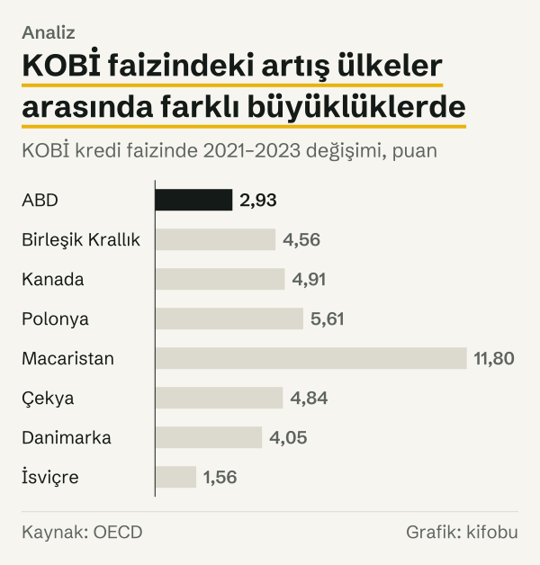
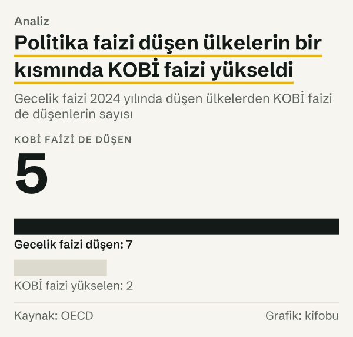

Bir atölye sahibi yeni bir makine için kredi teklifi aldığında önce faiz oranına bakar. Aynı oran bir yıl önceki teklifte farklıysa, aradaki farkın nereden geldiğini merak eder. OECD'nin karnesindeki bir ülke grubunda bu soruya veriyle bakılabiliyor: Avrupa'daki OECD üyeleri, ABD ve Kanada'dan 25 ülkenin ortalama KOBİ kredi faizi 2021 yılında %2,84 iken 2023 yılında %6,48 oldu. Yani ortalama 3,6 puan yükseldi; 25 ülkenin hepsinde artış var.

Peki aynı yıllarda öteki büyüklükler ne yaptı? OECD'nin 2026 yılı karnesi politika faizini iki yerde başka büyüklüklerle birlikte anıyor; bunları aşağıda kısa alıntılarla aktarıyoruz. Bu yazı karnede adı geçen büyüklüklerin her birinin aynı yıllardaki rakamına bakıyor ve soruyu bir dedektif gibi sırayla soruyor: hangi büyüklük hangi yönde hareket etmiş, hareketler ne kadar benzemiş ve nerede ayrışmış?

Önemli bir ayrım: nedensellik OECD'nin belgesine ait. Biz yalnızca OECD'nin ne yazdığını aktarıyor ve aynı OECD veri setlerindeki rakamları yan yana koyuyoruz. Hangi büyüklüğün ötekini ne kadar etkilediğini kendi başımıza söylemiyoruz. Karşılaştırma grubunu baştan tanımlıyoruz: Avrupa'daki OECD üyeleri (Türkiye dahil), ABD ve Kanada.

## OECD'nin anlattığı bağlar

KOBİ kredisi bölümünde karne, politika faizlerindeki düşüşün KOBİ kredisinin maliyetine yansımasını anlatıyor. Bölüm başlığında düşüşün “helped reduce the cost of credit to SMEs” dediği, ancak “rates remain higher compared to before the pandemic” yazdığı görülüyor. Aynı bölümde KOBİ borçlanma maliyetlerinin düştüğünü ve bunun “the easing of monetary policy has begun to trickle down to SMEs” anlamına gelebileceğini düşündürdüğünü belirtiyor. Yeni KOBİ kredisi için karne, 2024 yılında görülen artışı “In the context of declining policy interest rates and overall corporate credit growth” diye başlayan bir cümleyle veriyor.

Girişim sermayesi bölümü ise 2022 yılı için şunu söylüyor: karne bu yılın “marked a reversal of this trend” dediği bir dönüş yılı olduğunu, enflasyon baskısı ve ardından gelen küresel faiz artışlarının yatırımcıları “redirected investors back into fixed-return assets” ifadesiyle sabit getirili varlıklara yönlendirdiğini ve piyasada “reduced liquidity in VC markets” sonucunu doğurduğunu yazıyor. Bunlar OECD'nin kendi cümleleri; biz bu anlatımı doğrulamıyor ve kendi sözümüzle yinelemiyoruz. Aşağıdaki dört adımda büyüklüklerin her birine bakıyoruz. Ölçüler farklı: birincisi yıllık ortalama gecelik faiz, ikincisi KOBİ'lere verilen kredilerin yıllık ortalama faizi, üçüncüsü yeni KOBİ kredisinin yıllık tutarı, dördüncüsü girişim sermayesi yatırımının GSYH'ye oranı. Dört ölçü de OECD veri setlerinden, yıllık sıklıkta alındı; bu yüzden yıl içindeki zamanlama farkları görünmüyor.

## Birinci adım: politika faizi

Gruptan euro bölgesi dışında kalan ve gecelik faizi ile KOBİ kredi faizi OECD verisinde bulunan sekiz ülkeyi ele aldık; euro bölgesi üyelerinin gecelik faizi ortak olduğu için onlara aşağıda ayrıca bakıyoruz. 2021 yılından 2023 yılına gecelik faiz hepsinde yükseldi. ABD'de %0,08'den %5,33'e, Birleşik Krallık'ta %0,11'den %5,19'a, Kanada'da %0,16'dan %5,02'ye çıktı. Macaristan'da %2,56'dan %11,22'ye çıkış, listenin en büyük hareketi.

| Ülke | Gecelik faiz, 2021 yılı | Gecelik faiz, 2023 yılı | KOBİ faizi, 2021 yılı | KOBİ faizi, 2023 yılı |
|---|---|---|---|---|
| ABD | %0,08 | %5,33 | %3,13 | %6,06 |
| Birleşik Krallık | %0,11 | %5,19 | %2,45 | %7,01 |
| Kanada | %0,16 | %5,02 | %4,09 | %9,00 |
| Polonya | %1,39 | %5,54 | %2,65 | %8,26 |
| Macaristan | %2,56 | %11,22 | %3,53 | %15,33 |
| Çekya | %3,02 | %6,95 | %3,23 | %8,07 |
| Danimarka | %−0,41 | %3,71 | %4,92 | %8,97 |
| İsviçre | %−0,90 | %1,60 | %1,74 | %3,30 |

*Yıllık ortalama gecelik faiz ve KOBİ kredi faizi, yüzde. Kaynak: OECD.*

Tablodaki sekiz ülkenin hepsinde politika faizi aynı iki yılda yükseldi. Aşağıdaki adımlar bu iki yılı başlangıç alıyor.

*Gecelik faiz ve KOBİ kredi faizi, yüzde, 2021 yılı ve 2023 yılı karşılaştırması. Kaynak: OECD.*
## İkinci adım: KOBİ kredi faizi

KOBİ kredi faizi de aynı iki yılda yükseldi. Gecelik faiz ile KOBİ faizi arasındaki artışları karşılaştırınca, ABD'de gecelik faiz 5,25 puan arttı, KOBİ faizi 2,93 puan arttı. Birleşik Krallık'ta gecelik faiz 5,08 puan, KOBİ faizi 4,56 puan arttı. Kanada'da 4,86 puana karşı 4,91 puan. Macaristan'da 8,66 puana karşı 11,80 puan arttı.

Sekiz ülkeden 4'ünde KOBİ faizindeki artış gecelik faizdeki artıştan küçük kaldı; dördünde (Kanada, Polonya, Macaristan ve Çekya) büyük oldu. Yani iki faizin artışı bire bir örtüşmedi; fark ülkeden ülkeye değişti.

Aynı politika faizini paylaşan ülkelere bakmak da öğretici. Euro bölgesinin 16 üyesi için ECB'nin mevduat kolaylığı faizi aynı: 27 Temmuz 2022'de %0 idi, 20 Eylül 2023'te %4,00 oldu; yani 4 puan arttı. Aynı iki yılda bu 16 ülkenin KOBİ faizi İrlanda'da 1,56 puan, İtalya'da 4,20 puan arttı. Politika faizi ortak olduğu hâlde KOBİ faizindeki artış 1,56 puan ile 4,20 puan arasında dağıldı. Bu farkın nedenini bu veri söylemiyor ve biz tahmin etmiyoruz.

*KOBİ kredi faizinde 2021–2023 değişimi, puan. Kaynak: OECD.*
Tüm gruba bakınca resim şöyle: 25 ülkenin ortalama KOBİ faizi 2021 yılında %2,84, 2023 yılında %6,48; fark 3,6 puan. 2019 yılı ile 2024 yılı arasında değeri bulunan 23 ülkede ortalama %3,13'ten %5,91'e çıktı, yani 2,8 puan; 23 ülkenin hepsinde 2024 yılı faizi 2019 yılı faizinin üzerinde. Karne kendi ülke kümesiyle aynı karşılaştırma için 2,6 puan veriyor ve 39 ülkenin 34'ünde KOBİ faizinin pandemi öncesindeki düzeyinin üzerinde olduğunu yazıyor. Küçük fark, ülke kümelerinin farkından geliyor.

*KOBİ kredi faizi, yüzde, 2021 yılı ve 2023 yılı. Kaynak: OECD.*
## Üçüncü adım: yeni KOBİ kredisi

Faiz yükselirken yeni KOBİ kredisi ne yaptı? OECD veri setindeki yeni KOBİ kredisi tutarlarına, ülkelerin kendi para biriminde ve cari fiyatla baktık. 2022–2024 yıllarının üçünde de değeri bulunan 20 ülkeden 12'sinde yeni kredi 2023 yılında bir önceki yıla göre azaldı, 8'inde arttı.

Karne kendi ülke kümesi için Scoreboard medyanını 2023 yılında %−9, 2024 yılında %5,7 olarak veriyor. Bizim grubumuzda 2024 yılında 20 ülkenin 13'ünde yeni kredi bir önceki yıla göre arttı. Toparlanma geniş ama eşit değil; karneye göre 2024 yılında kredi hacmi 2022 yılı düzeyinin hâlâ altında.

Bu adım, ilk ikisi kadar tek yönlü değil: 20 ülkenin 8'inde yeni kredi 2023 yılında arttı. Rakamlar nominal ve ulusal para cinsinden olduğundan, enflasyon yüksek olan ülkelerde nominal artış gerçek kredi artışı anlamına gelmeyebilir.

## Dördüncü adım: girişim sermayesi

Girişim sermayesi OECD'nin piyasa istatistiklerinde görünüyor. ABD'de girişim sermayesi yatırımı GSYH'nin %1,13'ünden %0,47'sine, yani %58 geriledi. 2021–2023 yıllarında değeri bulunan 27 ülkenin 23'ünde oran düştü.

Bu ölçünün 2022 yılında görülen hareketini OECD yukarıda alıntıladığımız cümlelerle anlatıyor; biz yalnızca oranı gösteriyoruz. Sonraki yıllarda tablo yeniden değişti: ABD'de oran 2024 yılında %0,53'e, 2025 yılında %0,62'ye çıktı. Karne, 2024 yılında 30 Scoreboard ülkesinin 18'inde girişim sermayesi yatırımının GSYH'ye oranının arttığını yazıyor. Yani girişim sermayesi tarafında da bir toparlanma var, ama yine eşit değil.

Dördüncü ölçünün doğrudan KOBİ kredisiyle ilgisi yok; ayrı bir finansman kanalı ve ayrı bir veri seti. OECD, KOBİ ve girişimci finansmanını aynı karnede ele alıyor.

## Faizler inerken

Sekiz ülkenin 7'sinde gecelik faiz 2024 yılında 2023 yılına göre düştü; yalnızca Polonya'da arttı. Düşen yedi ülkenin 5'inde KOBİ faizi de düştü; 2'sinde (ABD ve Birleşik Krallık) gecelik faiz düşerken KOBİ faizi yükseldi.

ABD'de gecelik faiz %5,33'ten %4,33'e indi, KOBİ faizi ise %6,06'dan %6,77'ye çıktı. Birleşik Krallık'ta gecelik faiz %5,19'dan %4,70'e indi, KOBİ faizi %7,01'den %7,42'ye çıktı. Danimarka'da ise gecelik faiz düşerken KOBİ faizi %8,97'den %4,91'e, yani çok daha büyük bir miktarda indi.

Gecelik faizin ve KOBİ faizinin birlikte indiği ülkelerde hareketin büyüklüğü de değişiyor. Çekya'da gecelik faiz 2,95 puan düştü, KOBİ faizi 1,48 puan düştü. Macaristan'da gecelik faiz 4,73 puan düştü, KOBİ faizi 5,09 puan düştü. Yani bazı ülkelerde KOBİ faizi politika faizinden daha az, bazılarında daha çok düştü.

Daha geniş grupta, 2023–2024 yıllarında KOBİ faizi bulunan 25 ülkenin 15'inde faiz düştü. Karne aynı karşılaştırma için 26 ülke diyor; ülke kümesi farkı bu iki sayının ayrılmasını açıklıyor. Yani 2024 yılında KOBİ faizinin hareketi de ülkeden ülkeye farklı oldu. Bunun neden böyle olduğunu veri söylemiyor; OECD belgesi de bu farkı ayrıca açıklamıyor.

*Gecelik faizi 2024 yılında düşen ülkelerden KOBİ faizi de düşenlerin sayısı. Kaynak: OECD.*
## Türkiye için iki rakam

Türkiye için bu veri setinde adımların hepsi görünmüyor. Türkiye'nin KOBİ kredi faizi, bu yazının kullandığı veri setinde bulunmuyor. Türkiye bölümü iki rakam veriyor: politika faizi %8,5'ten %50'ye çıktı ve yeni KOBİ kredisi 2023–2024 döneminde %33,6 arttı. Karne bu iki rakamı aynı bölümde veriyor; biz aralarında bir bağ kurmuyoruz.

OECD metni, yeni kredi artışının nominal mi gerçek mi olduğunu belirtmiyor ve bu yazı artışı enflasyondan arındırmadı. Bu yüzden iki rakamdan Türkiye hakkında bir hüküm çıkarmıyoruz.

## Rakamların göstermediği şeyler

Faiz karşılaştırmasında bir sınır var: karne, KOBİ faiz oranlarının ülkeler arasında farklı hesaplandığını kendisi belirtiyor; ücretlerin faize dahil edilip edilmediği ülkeden ülkeye değişiyor. Ülkeler arası faiz karşılaştırması bu yüzden sıralamadan çok genel yön için anlamlı.

İkincisi, bu yazıdaki ölçüler yıllık ortalamalar. Politika faizi de KOBİ faizi de yıl içinde değişir; yıllık ortalama yıl içindeki zamanlamayı göstermiyor.

Üçüncüsü, bu yazının ölçtüğü şey. Bu yazı yalnızca faiz oranlarını, yeni KOBİ kredisi tutarını ve girişim sermayesi oranını ölçüyor; kredi talebi ya da teminat koşulları gibi başka büyüklükler ölçülmedi. Karne, 17 ülkenin 10'unda teminat isteyen KOBİ payının arttığını yazıyor; bu bilgi, kredi koşullarının faiz dışındaki bir boyutunu gösteriyor. Biz bu büyüklüklerin hareketlerini bir nedene bağlamıyoruz.

Dördüncüsü, grubun sınırı. Karşılaştırma grubu Avrupa'daki OECD üyeleri, ABD ve Kanada. Başka OECD üyeleri ile üye olmayan ülkeler bu karşılaştırmanın dışında; sayımlar ve ortalamalar bu gruba aittir, OECD'nin tamamı için bir şey söylemez.

## Nasıl hesapladık

Karşılaştırma grubunu baştan, adıyla tanımladık: Avrupa'daki OECD üyeleri (Türkiye dahil), ABD ve Kanada. OECD'nin Financing SMEs and Entrepreneurs veri setinden bu gruptaki ülkelerin KOBİ kredi faizini (yıllık ortalama) ve yeni KOBİ kredisini, OECD'nin gecelik faiz serisinden yıllık ortalama gecelik faizleri çektik. Ülke ortalamaları sade ortalamadır. Faiz artışları, iki yılın yıllık ortalama değerleri arasındaki puan farkıdır. Sayımlar (kaç ülkede arttı, kaç ülkede azaldı) kanıt dosyasındaki ülke değerlerinin karşılaştırmasıdır.

OECD'nin anlatımı, karnenin KOBİ kredisi ve girişim sermayesi bölümlerinden alıntıyla aktarılmıştır; biz kurmadık. Türkiye'nin politika faizi ve yeni kredi artışı da karne metninden alındı. Gecelik faiz değerleri kaynakta çok basamaklı; tabloda iki ondalığa yuvarladık ve puan farklarını bu yuvarlanmış değerler üzerinden hesapladık. Euro bölgesi için ECB'nin mevduat kolaylığı faizi iki tarihte (27 Temmuz 2022 ve 20 Eylül 2023) Avrupa Merkez Bankası veri portalından okundu. Yeni KOBİ kredisi karşılaştırmasında ülkelerin kendi para biriminde, cari fiyatlı tutarları kullandık; tutarlar ülkeler arasında toplanmadı, yalnızca her ülkenin kendi iki yılı karşılaştırıldı. Hiçbir değer tahmin değildir. Bütün değerler 23 Ekim 2026'da çekildi.

## Kaynaklar

- [OECD: Financing SMEs and Entrepreneurs, 2026 yılı baskısı (OECD Scoreboard)](https://www.oecd.org/en/publications/financing-smes-and-entrepreneurs-2026_075d8058-en.html)
- [OECD: Key short-term economic indicators, financial market](https://data-explorer.oecd.org/?df[ds]=dsDisseminateFinalDMZ&df[id]=DSD_STES%40DF_FINMARK&df[ag]=OECD.SDD.STES)
- [OECD: Venture capital investments (market statistics)](https://data-explorer.oecd.org/?df[ds]=dsDisseminateFinalDMZ&df[id]=DSD_VC%40DF_VC_INV&df[ag]=OECD.SDD.TPS)
