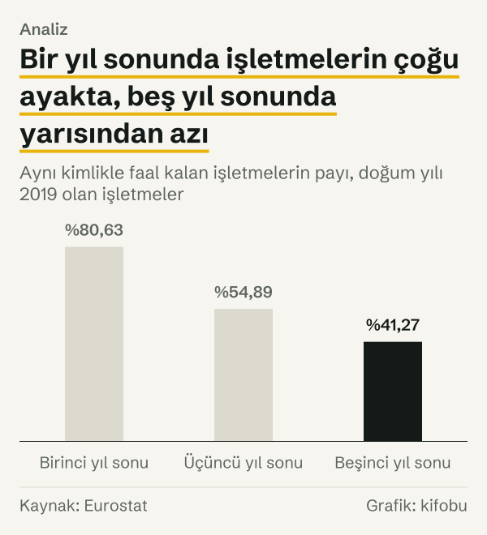
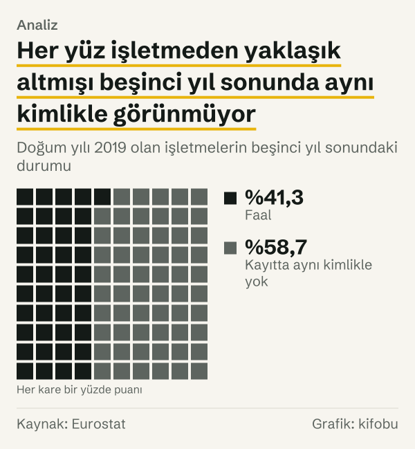

Yeni kurulan işletmelerin çoğu gerçekten ilk yıllarda kapanıyor mu? Resmî veri iki ayrı cevap veriyor. 2019 yılında Türkiye'de doğan işletmelerin %80,63'ü bir yıl sonra aynı kimlikle faaldi; yani ilk yılı geçemeyen beşte bir civarında. Üç yıl sonra bu oran %54,89'a, beş yıl sonra %41,27'ye indi.

Kanının iki yarısı var: ilk yılda çoğunluk ayakta kalıyor, beş yıllık ufukta ise çoğunluk eksilmiş oluyor. Cevap, sorunun kaç yıllık bir ufuk için sorulduğuna bağlı. Bu yazı o ayrımı rakamla gösteriyor, ardından ilk ipucunun ötesine bakıyor: bu oranlar kuşaktan kuşağa değişiyor mu, Avrupa Birliği'nde nasıl, hangi tür işletmelerde farklılaşıyor?

Bir kuşak, aynı takvim yılında doğan işletmelerin tümüdür. Eurostat her kuşağı doğum yılından sonraki beş yıl boyunca izler ve her yıl sonunda kaçının aynı kimlikle faal olduğunu sayar. Kuşak yöntemi, tek bir yılın kapanma sayısına bakmaktan farklıdır: hangi doğum yılının işletmelerinin ne kadar dayandığını doğrudan gösterir.

Veri, Eurostat'ın işletme demografisi tablosundan (bd_size). Tablo, her doğum yılındaki işletmeleri beş yıl boyunca izliyor ve aynı kimlikle faal kalanların payını veriyor. Bu pay, kapanmayla tam olarak aynı şey değil; bu ayrım yazının sonunda ayrı bir bölümde.

## Soruyu ikiye bölmek: İlk yıl ve ilk yıllar

2019 yılında doğan işletmeler en geniş izleme penceresine sahip son kuşak: hem birinci, hem üçüncü, hem beşinci yıl değerleri var. Birinci yıl sonunda %80,63, üçüncü yıl sonunda %54,89, beşinci yıl sonunda %41,27 faaldi.

İlk yılın kaybı yaklaşık beşte bir; sonraki iki yılda daha büyük bir kayıp geliyor. %80,63'ten %54,89'a düşüş, ikinci ve üçüncü yılda toplam 25,74 puanlık bir eksilme demek. Beşinci yıla kadar 13,62 puan daha eksiliyor. Eksilme erken yıllara yığılmış, ama ilk yıla değil.

Koşullu bir bakış da var. İlk yılı geçen işletmelerin %51,18'i beşinci yılı da geçti; üç yılı geçenlerin %75,19'u beşinci yıla ulaştı. Aynı iki yıllık sürelere bakınca eksilme yavaşlıyor: ilk yılı geçenlerin %68,08'i üçüncü yıla ulaştı; üçüncü yılı geçenlerin %75,19'u beşinci yıla ulaştı.

*Aynı kimlikle faal kalan işletmelerin payı, doğum yılı 2019 olan işletmeler. Kaynak: Eurostat.*
Sayılara çevirince tablo daha somut. 2019 yılında doğan işletmelerden 176.243'ü beşinci yılın sonunda hâlâ faaldi; 250.852'si aynı kimlikle görünmüyordu. Bu, kuşağın %41,27'si ile %58,73'ü. Her yüz işletmeden yaklaşık altmışı beş yıl sonunda tabloda yok.

*Doğum yılı 2019 olan işletmelerin beşinci yıl sonundaki durumu. Kaynak: Eurostat.*
## İkinci ipucu: Oranlar kuşaktan kuşağa dar bir aralıkta kalıyor

Tek bir kuşağa bakarak genel bir sonuca varmak yanıltıcı olabilir; bu yüzden 2011 yılından 2019 yılına dokuz kuşağı yan yana koyuyoruz. Sonuç dar bir aralıkta: birinci yıl oranı %80,58 ile %81,79 arasında, üçüncü yıl oranı %53,22 ile %54,89 arasında, beşinci yıl oranı %39,32 ile %41,27 arasında kaldı. Dokuz kuşağın ortalamaları sırasıyla %80,95, %53,82 ve %40,25.

Dokuz kuşak içindeki oynama dar: birinci yılda en yüksek ile en düşük değer arasındaki fark 1,21 puan, üçüncü yılda 1,67 puan, beşinci yılda 1,95 puan. 2019 yılı kuşağı bu aralığın üst ucunda: üçüncü yıl (%54,89) ve beşinci yıl (%41,27) değerleri dokuz kuşağın en yükseği. Oranlar dar bir aralıkta kalıyor; bu, rakamların tek bir kuşağa özgü olmadığını gösteriyor.

![Çizgi grafik: Dokuz kuşakta hayatta kalma oranları dar bir aralıkta kaldı: Birinci yıl: 2011 yılında %80,90, 2012 yılında %80,70, 2013 yılında %81,21, 2014 yılında %81,39, 2015 yılında %80,69, 2016 yılında %81,79, 2017 yılında %80,58, 2018 yılında %80,67, 2019 yılında %80,63; Üçüncü yıl: 2011 yılında %53,81, 2012 yılında %53,68, 2013 yılında %53,70, 2014 yılında %53,63, 2015 yılında %53,22, 2016 yılında %54,30, 2017 yılında %53,87, 2018 yılında %53,30, 2019 yılında %54,89; Beşinci yıl: 2011 yılında %40,87, 2012 yılında %39,72, 2013 yılında %39,78, 2014 yılında %39,63, 2015 yılında %39,32, 2016 yılında %39,97, 2017 yılında %40,76, 2018 yılında %40,90, 2019 yılında %41,27.](./graf-3.svg)
*Doğum yılına göre hayatta kalma oranı, 2011–2019 kuşakları. Kaynak: Eurostat.*
## 2020 yılından sonra doğan kuşaklar

Bu dar aralık 2020 yılından sonra bozuluyor. 2020 yılında doğanlarda birinci yıl oranı %78,31, 2021 yılında doğanlarda %75,25, 2022 yılında doğanlarda %75,23 oldu; 2023 yılında doğanlarda %78,30'a çıktı. 2022 yılı kuşağının birinci yıl oranı, önceki dokuz kuşağın en düşüğünün (%80,58) 5,35 puan altında. Düşüşün büyüklüğü dikkat çekici: 5,35 puan, dokuz kuşağın birinci yıldaki bütün oynama aralığından (1,21 puan) çok daha büyük. Yani bu, olağan yıllık dalgalanmaya sığmıyor; ayrı bir hareket olarak okunmalı, ama sebebi bu tablodan okunmuyor. Üçüncü yılda da aynı yön var: 2021 yılında doğanlarda %49,25, önceki dokuz kuşağın en düşüğünün (%53,22) 3,97 puan altında.

Son kuşakta toparlanma var, ama tam değil: 2023 yılında doğanlarda birinci yıl oranı, dokuz kuşağın ortalamasının (%80,95) 2,65 puan altında. Bu kuşaklar aynı zamanda daha kalabalıktı: 2021 yılı kuşağındaki işletme sayısı, 2019 yılı kuşağındakinden %35,2 fazlaydı. Veri iki hareketin ilişkisini kurmuyor; kuşak büyüklüğünün oranı etkileyip etkilemediğini ya da başka bir şeyin ikisini birden etkileyip etkilemediğini bu tablodan söyleyemeyiz. Elimizde yalnızca aynı dönemde olan iki şey var.

Dikkat edilecek bir nokta: 2019 yılından sonra doğanlar için beşinci yıl değeri henüz yok. Üçüncü yıl oranı 2021 yılı kuşağı için, beşinci yıl oranı ise 2019 yılı kuşağı için son gözlem.

## Avrupa Birliği ile yan yana

Avrupa Birliği düzeyinde aynı gösterge yalnızca 2021 yılında doğan kuşaktan itibaren yayımlanıyor: birinci yıl için 2021 yılında, 2022 yılında ve 2023 yılında doğanlar, üçüncü yıl için yalnızca 2021 yılında doğanlar. 2021 yılında doğanlarda birinci yıl oranı Avrupa Birliği'nde %81,17, Türkiye'de %75,25; fark 5,92 puan. 2022 yılında doğanlarda %81,04 ve %75,23 (5,81 puan), 2023 yılında doğanlarda %80,52 ve %78,30 (2,22 puan). Üçüncü yıl oranı 2021 yılında doğanlarda %57,18 ile %49,25; fark 7,93 puan.

Avrupa Birliği değeri yirmi yedi ülkenin birleşik göstergesi; arkasında ülkeler arasında geniş bir aralık var. 2021 yılında doğanlarda birinci yıl oranı Danimarka'da %65,48, Hollanda'da %96,58. Üçüncü yıl oranı Litvanya'da %43,47, Hollanda'da %78,11. Türkiye bu aralığın içinde.

*Hayatta kalma oranı: Avrupa Birliği ve Türkiye, doğum yılına göre. Kaynak: Eurostat.*
Karşılaştırma sınırlı; bir de bileşim farkı var. Bu yazıda yalnızca toplam sınıf karşılaştırıldı, çalışan sınıfına göre Avrupa Birliği karşılaştırması yapılmadı. İşletme bileşimi iki bölgede farklıysa, fark rakamının bir kısmı bileşimden gelebilir. Bunun yanında: Avrupa Birliği serisi üç kuşak, Türkiye serisi on üç kuşak. Bu yüzden iki seriyi yan yana okurken ortak dönemle yetiniyoruz.

## Çalışan sayısına göre ayrışma

Aynı beş yıllık oran, işletmenin doğduğu yıldaki çalışan sayısına göre ciddi biçimde ayrışıyor. Dokuz kuşağın ortalaması çalışanı olmayan işletmelerde %36,32, bir ila dört çalışanlı işletmelerde %47,49, beş ila dokuz çalışanlı işletmelerde %52,61, on ve daha çok çalışanlı işletmelerde %49,13. Çalışanı olmayanlarla on ve üzeri çalışanlılar arasındaki fark 12,80 puan.

Birinci yıl oranı da aynı biçimde ayrışıyor. 2019 yılında doğan çalışanı olmayan işletmelerde %76,11, bir ila dört çalışanlılarda %88,66, beş ila dokuz çalışanlılarda %93,73, on ve üzeri çalışanlılarda %92,16. İlk yılda eksilen işletme payı çalışanı olmayan sınıfta dörtte bire yakın, bir ila dört çalışanlı sınıfta onda birin biraz üzerinde, daha büyük iki sınıfta ise onda birin altında; yani ilk yılın kaybı en çok çalışanı olmayan sınıfta toplanıyor.

Dikkat çeken ayrıntı, beş ila dokuz çalışanlı sınıfın on ve üzeri sınıftan yüksek çıkması. Çalışan sayısı arttıkça oran düzgün biçimde yükselmiyor. Çalışanı olmayanların her kuşakta en düşük oranda kalması ise tabloda sabit bir özellik.

![Küçük çoklu grafik: Çalışanı olmayan işletmelerde beşinci yıl oranı her kuşakta en düşük: Çalışansız: 2011 yılında %37,63, 2012 yılında %37,10, 2013 yılında %36,11, 2014 yılında %35,88, 2015 yılında %35,31, 2016 yılında %35,74, 2017 yılında %36,40, 2018 yılında %36,75, 2019 yılında %36,00; Bir ila dört çalışanlı: 2011 yılında %48,20, 2012 yılında %45,37, 2013 yılında %46,44, 2014 yılında %46,43, 2015 yılında %46,66, 2016 yılında %47,36, 2017 yılında %49,30, 2018 yılında %47,33, 2019 yılında %50,33; Beş ila dokuz çalışanlı: 2011 yılında %51,98, 2012 yılında %48,83, 2013 yılında %52,60, 2014 yılında %51,90, 2015 yılında %49,88, 2016 yılında %51,51, 2017 yılında %51,94, 2018 yılında %54,86, 2019 yılında %60,03; On ve üzeri çalışanlı: 2011 yılında %48,21, 2012 yılında %43,33, 2013 yılında %50,34, 2014 yılında %47,35, 2015 yılında %43,94, 2016 yılında %47,37, 2017 yılında %47,71, 2018 yılında %55,61, 2019 yılında %58,30.](./graf-5.svg)
*Beşinci yıl hayatta kalma oranı, işletmenin doğum yılındaki çalışan sınıfına göre, 2011–2019 kuşakları. Kaynak: Eurostat.*
Çalışanı olmayan işletmeler kuşağın büyük çoğunluğu: 2019 yılında doğanların %64,9'u bu sınıfta. Bu ağırlık, genel beşinci yıl oranını (%41,27) çalışanı olmayan sınıfın oranına (%36,00) doğru çekiyor; çalışan sınıfını ayrı görmeden bütün işletmeler için tek bir oran söylemek, bu farkı gizler.

## Ayakta kalanlar nasıl büyüyor?

Hayatta kalma oranı yalnızca kaç işletmenin kaldığını söylüyor; kalanların ne yaptığını başka bir gösterge veriyor. 2019 yılında doğan ve beşinci yıl sonunda hâlâ faal olan işletmelerde çalışan sayısı, doğum yılındaki çalışan sayısına göre %144,04 arttı. Birinci yıl sonunda bu artış %54,02, üçüncü yıl sonunda %95,95 idi.

Mutlak sayılarla: bu işletmelerde beşinci yıl sonunda 816.246 kişi çalışıyordu; aynı işletmelerde doğum yılında 334.477 kişi çalışıyordu. Çalışan sayısına işletme sahipleri de dahil. Bu rakam kalan işletmelerin ortalamada büyüdüğünü gösteriyor, ama eksilen işletmelerin çalışanlarını hesaba katmıyor. Kuşağın tümünün istihdam seyrini bu üç rakamdan çıkaramayız.

## Karşı okuma: Kanı tamamen yanlış mı?

Rakamlar kanıyı ikiye bölse de bir kısmını doğruluyor. Beşinci yılın sonunda her yüz işletmeden yaklaşık altmışı aynı kimlikle görünmüyorsa, çoğu ilk yıllarda eksilir cümlesi beş yıllık ufukta tutuyor. Yalnızca ilk yıl için söylenen cümle tutmuyor: ilk yılda eksilen beşte bir.

Başka bir karşı okuma, oranın düşüklüğünü kötü bir işaret saymanın doğru olup olmadığı. Eksilen işletmelerin tamamı iflas etmiş ya da zarar etmiş olmayabilir; bazıları isteyerek kapatılmış, başka bir işletmeye devredilmiş olabilir. Veri bunu ayırmıyor. Bu yüzden yazı, oranı başarısızlık değil, aynı kimlikle faal kalma olarak adlandırıyor.

Dedektif özetiyle: ilk yıl cümlesi tutmuyor, beş yıl cümlesi tutuyor; oranlar dokuz kuşak boyunca dar bir aralıkta kalmış, 2020 yılından sonraki kuşaklarda birinci yıl değeri daha düşük çıkmış; Avrupa Birliği ortalaması Türkiye'nin üzerinde, ama ülkeler arasındaki aralığın içinde; çalışanı olmayan işletmeler ise oranı aşağı çeken sınıf. Bunların hiçbiri hayatta kalmanın nedenini söylemiyor; yalnız nerede, hangi kuşakta ve hangi büyüklükte eksildiğini gösteriyor.

## Hayatta kalmama neyi ölçmüyor?

Eurostat'ın tanımına göre bir işletme, doğum yılından sonra da aynı kayıt numarasıyla görünüyorsa hayatta kalmış sayılıyor; faaliyeti, büyüklüğü, sahibi ya da yeri değişmiş olsa bile. Numara sürmüyorsa, örneğin işletme başka bir işletmeyle birleşmişse, hayatta kalmış sayılmıyor, ama aynı zamanda kapanmış da sayılmıyor: Eurostat'ın ölüm tanımı birleşme ve devralma kaynaklı çıkışları ölüm saymıyor.

Dolayısıyla hayatta kalmama oranı, kapanma oranından yüksek ya da ona eşit olabilir. Aradaki farkı bu tablodan çıkaramıyoruz.

İkinci sınır, kapsam. Tablo, iş ve ticaret alanındaki bütün yeni işletmeleri sayıyor; yatırım alan yeni kurulan girişimlerle ilgili ayrı bir kırılım içermiyor. Kanının sıkça girişimler için dile getirildiği düşünülürse, bu resmî seri o dar kümeyi ölçmüyor; hepsini birden ölçüyor.

Üçüncü sınır, ufuk. Veri beş yıl izliyor. Beşinci yıldan sonra ne olduğu bu tablodan bilinmiyor.

## Nasıl hesapladık

Kaynak, Eurostat bd_size tablosu, Türkiye ve Avrupa Birliği, yıllık. Hayatta kalma oranları (ENT_SRVLR_BRTH_CHB_PC) bir doğum yılındaki işletmelerin, birkaç yıl sonra hâlâ faal olanlarının payıdır. Çalışan sınıfı, işletmenin doğum yılındaki çalışan sayısına göre belirlenir. Değerler 23 Ekim 2026 tarihinde çekildi.

Kuşak ortalamaları, 2011–2019 kuşaklarının oranlarının düz aritmetik ortalamasıdır. Puan farkları iki oranın farkıdır. 2019 yılı kuşağı için hayatta kalanların sayısı ile doğan işletme sayısı ayrıca çekilip yüzdeye çevrildi; sonuç, oranın kendisiyle aynı çıktı. Çalışan büyümesi, Eurostat'ın hayatta kalan işletmeler için yayımladığı hazır göstergedir.

Her oran, Eurostat tablosundaki doğum yılı satırından olduğu gibi alındı; yazıda yeniden tahmin ya da düzeltme yapılmadı. Yazıdaki her rakam kanıt dosyasındaki bir kayda bağlıdır. Ortalamalarda 2020 yılından sonraki kuşakları kullanmadık, çünkü beşinci yıl değerleri henüz yok ve kuşaklar eşit sayıda yıl izlenmedi.

## Kaynaklar

- [Eurostat: Büyüklük sınıfı ve faaliyete göre işletme demografisi (bd_size)](https://ec.europa.eu/eurostat/databrowser/view/bd_size/default/table)
- [Eurostat: Business demography statistics](https://ec.europa.eu/eurostat/statistics-explained/index.php?title=Business_demography_statistics)
- [Eurostat: Glossary, enterprise survival](https://ec.europa.eu/eurostat/statistics-explained/index.php?title=Glossary:Enterprise_survival)
- [Eurostat: Glossary, enterprise death](https://ec.europa.eu/eurostat/statistics-explained/index.php?title=Glossary:Enterprise_death)
