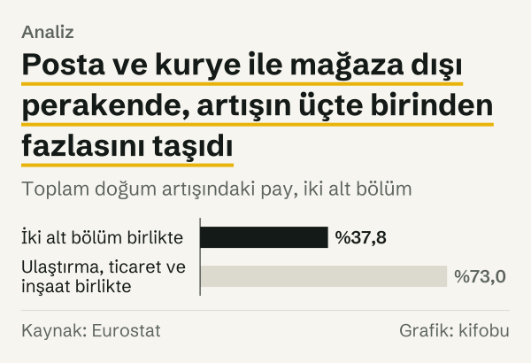
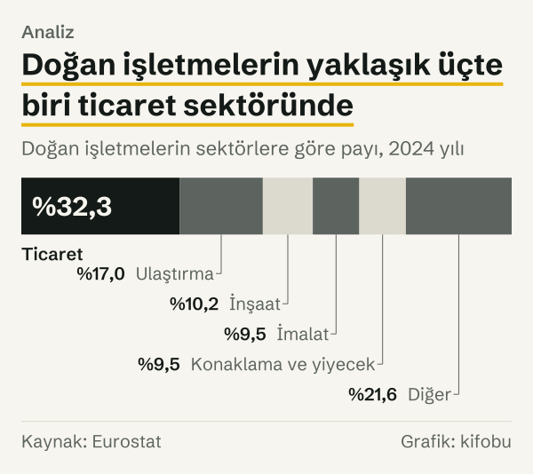
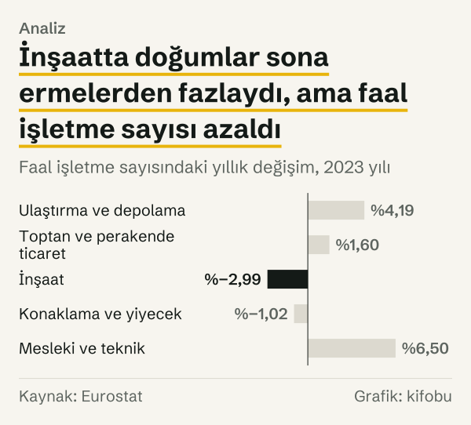

2019 yılında Türkiye'de posta ve kurye faaliyetlerinde 1.349 işletme doğdu; 2024 yılında 50.905. Aynı beş yılda yiyecek ve içecek hizmetlerinde doğan işletme sayısı 53.550'den 51.350'ye geriledi. Birinde 37,7 kat artış, ötekinde %4,1 azalış var.

İki rakam aynı ekonomide, aynı beş yılda ve aynı istatistik tablosunda yan yana duruyor. Soru şu: toplam doğum sayısındaki artış nereden geldi, ve hangi sektörler bu artışa hiç katılmadı? Cevabı, toplamı bileşenlerine ayırarak ve her ipucunu bir öncekiyle sınayarak arıyoruz.

Kullandığımız veri Eurostat'ın işletme demografisi tablosu (bd_size). Tablo, Türkiye için 2011 yılından itibaren yıllık doğum, faal işletme ve doğum oranı sayılarını sektör bölümlerine ve alt bölümlere göre veriyor. Eurostat'a göre doğum, sıfırdan yeni bir faaliyetin başlamasıdır; birleşme, bölünme ya da yeniden yapılanmayla ortaya çıkan tüzel kişilikler ve iki yıl içinde yeniden faaliyete geçen uyuyan işletmeler doğum sayılmaz. Sayılar sektörlerin yalnızca iş ve ticaret alanını kapsıyor; tarım ve kamu yönetimi dışarıda.

## İlk ipucu: Artış sektörlere nasıl dağılıyor?

Doğan işletme sayısı 2019 yılından 2024 yılına 201.400 arttı. On sekiz sektör bölümünün katkılarını topladığımızda bu rakam tam olarak tutuyor: parçalar toplamı eksiksiz açıklıyor.

Katkıların dağılımı eşit değil. Ulaştırma ve depolama 61.374, toptan ve perakende ticaret 45.427, inşaat 40.212 işletmelik artış getirdi. Üçünün toplamı 147.013; bu, toplam artışın %73'ü. Geriye mesleki ve teknik faaliyetler (11.140), imalat (10.682) ve öteki on üç bölümün toplamı (32.565) kalıyor.

*Doğan işletme sayısındaki değişim, sektörlere göre, 2019 yılından 2024 yılına. Kaynak: Eurostat.*
Üç sektörün ortak noktası bu aşamada yok; yalnızca onların toplamın dörtte üçüne yakınını taşıdığını biliyoruz. Bir sonraki adım, bu üç bölümün içine bakmak.

## İkinci ipucu: Üç sektörün içinde iki alt bölüm

Ulaştırma ve depolamadaki 61.374'lük artışın 49.556'sı tek bir alt bölümden, posta ve kurye faaliyetlerinden geliyor; bu, bölümün artışının %80,7'si. Toptan ve perakende ticarette de benzer bir yığılma var: 45.427'lik artışın 26.662'si, mağaza, tezgâh ve pazar dışındaki perakendeden. Mağaza dışı perakendenin ticaret bölümünün artışındaki payı %58,7. Eurostat'ın kullandığı NACE sınıflamasına göre bu grup posta siparişi ve internet üzerinden yapılan perakende satışı da kapsıyor.

Birlikte bakınca iki alt bölüm 76.218'lik bir artış getirdi; toplam artışın %37,8'i. Yani 201.400'lük artışın %37,8'i, tablodaki onlarca alt bölümün arasından yalnızca ikisinde toplanıyor.

*Toplam doğum artışındaki pay, iki alt bölüm. Kaynak: Eurostat.*
Büyüme oranları da bunu doğruluyor. Posta ve kurye faaliyetlerinde doğum sayısı 37,7 katına, mağaza dışı perakendede 4,7 katına çıktı. Üçüncü büyük katkı sahibi inşaatta artış 2,7 kat; ama bu rakam başlangıç yılına duyarlı. 2019 yılı inşaat doğumlarının görece düşük kaldığı bir yıldı; 2018 yılında 33.034 işletme doğmuştu ve 2024 yılında görülen sayı bu değere göre 1,9 katta kalıyor.

*Posta ve kurye faaliyetlerinde doğan işletme sayısı. Kaynak: Eurostat.*
Seri, yükselişin ne zaman olduğunu gösteriyor. 2011–2018 yılları arasında bu alt bölümde yılda 550 ile 696 işletme doğdu. 2019 yılında sayı 1.349'a çıktı, 2020 yılında 10.072'ye, 2021 yılında 45.735'e. Sonraki üç yıl 42.442, 48.986 ve 50.905 oldu. Yani yükseliş iki yılda yaşandı, ardından seri yeni bir düzeyde kaldı.

Eurostat verisi bu yükselişin sebebini söylemiyor. Kaynakta bir neden açıklaması yok; biz de bir neden kurmuyoruz.

## Üçüncü ipucu: Doğanların ücretli çalışanı yok

İşletmelerin büyüklük sınıfına bakınca tablo daha net. 2024 yılında posta ve kurye faaliyetlerinde doğan 50.905 işletmenin 49.326'sı, yani %96,9'u ücretli çalışanı olmayan işletme. Mağaza dışı perakendede bu oran %91,3: 33.945 doğumun 30.991'i.

Ücretli çalışanın olmaması, işletmede kimsenin çalışmadığı anlamına gelmiyor; sahibi ya da ortakları çalışıyor olabilir. Veri bunu da göstermiyor, yalnızca ücretli çalışan sayısının sıfır olduğunu söylüyor. Yine de iki alt bölümdeki artışın neredeyse bütünü böyle işletmelerden oluşuyor: 2019 yılından 2024 yılına posta ve kurye alt bölümünde doğum artışının %97,6'sı, mağaza dışı perakendede %93,5'i ücretli çalışanı olmayan işletmelerden geldi.

Üçüncü ipucunun öğrettiği şu: iki alt bölümdeki doğum sayısını işletme sayısı olarak okumak gerektiğini, istihdam ya da faaliyet hacmi olarak okumanın veriden çıkmadığını gösteriyor.

## Doğum oranı: Pay mı büyüdü, payda mı?

Bir sektörün doğum oranı, doğan işletmelerin faal işletmelere oranıdır. Sayılar büyürken oran sabit kalıyorsa sektör kendi büyüklüğüyle birlikte genişlemiş demektir; oran yükseliyorsa yeni doğumlar mevcut stoktan daha hızlı artmıştır.

İnşaatta doğum oranı 2019 yılında %10,42, 2024 yılında %20,81; artış 10,39 puan. Ulaştırma ve depolamada %9,72'den %17,71'e, yani 7,99 puan. Gayrimenkulde %14,78'den %19,88'e (5,10 puan), bilgi ve iletişimde %16,64'ten %19,55'e (2,91 puan) çıktı. Tüm sektörlerin birleşik doğum oranı ise %13,03'ten %15,84'e yükseldi.

*Doğum oranı: yeni doğan işletmelerin faal işletmelere oranı. Kaynak: Eurostat.*
Payın ve paydanın ayrı ayrı hareketine de bakılabilir. İnşaatta doğum sayısı %168,9 artarken faal işletme sayısı %34,7 arttı; yani oranın yaklaşık iki katına çıkmasının nedeni, doğumların stoktan çok daha hızlı büyümesi. Ulaştırma ve depolamada bu iki artış sırasıyla %135,6 ve %29,3, ticarette %28,8 ve %17,6, konaklama ve yiyecek hizmetlerinde %3,6 ve %1,7. Konaklama ve yiyecekte iki artış da küçük kaldığı için oran yerinde kaldı.

Posta ve kurye alt bölümünde doğum oranı %26,63'ten %39,18'e çıkarken faal işletme sayısı 5.066'dan 129.917'ye, yani 25,6 katına yükseldi. Başka bir deyişle oran yükselirken payda da hızla büyüdü; alt bölüm hem çok daha fazla işletme barındırıyor hem de doğum oranı hâlâ çok yüksek.

## Yerinde duranlar

Her sektör bu hareketin içinde değil. Konaklama ve yiyecek hizmetlerinde doğan işletme sayısı yalnızca 2.085 arttı ve doğum oranı %18,71'den %19,07'ye, 0,36 puan çıktı. Bölümün büyük kalemi olan yiyecek ve içecek hizmetlerinde doğum sayısı 53.550'den 51.350'ye indi ve doğum oranı %18,90'dan %18,63'e geriledi. Yani beş yıl önceki seviyeyle neredeyse aynı tempoda yenileniyor. İmalatta oran %12,00'den %12,44'e (0,44 puan), ticarette %13,38'den %14,66'ya (1,28 puan) çıktı; mesleki ve teknik faaliyetlerde %12,59'dan %12,72'ye. Finans ve sigortada oran hem 2019 yılında hem 2024 yılında en düşük sınıftaydı: %5,73 ve %7,04.

Yani bu sektörlerde doğum sayıları da arttı, ama faal işletme sayısıyla birlikte arttı; oran yerinde kaldı.

Toplamdan hızlı artan küçük alanlar da var: toplam doğum sayısı 1,5 katına çıkarken bilgi ve iletişim bölümündeki bilgisayar programlama ve danışmanlık faaliyetlerinde doğum sayısı 3.958'den 8.713'e, yani 2,2 katına; insan sağlığı faaliyetlerinde 6.969'dan 11.857'ye, yani 1,7 katına çıktı. Bu artışlar, 4.755 ve 4.888 işletmeyle, 201.400'lük toplam artışın yanında küçük kalıyor ve ilk iki ipucunun anlattığı yığılmayı değiştirmiyor.

Bileşimin değişimi de aynı hikâyeyi anlatıyor. Ulaştırma ve depolamanın doğumlar içindeki payı 2019 yılında %10,6'ydı, 2024 yılında %17,0. İnşaatın payı %5,6'dan %10,2'ye çıktı. Ticaretin payı ise %36,9'dan %32,3'e indi; ticarette doğum sayısı arttı, ama artış öteki iki sektörden daha yavaş kaldı.

*Doğan işletmelerin sektörlere göre payı, 2024 yılı. Kaynak: Eurostat.*
## Doğum eksi sona erme: Net tablo

Yalnızca girişi gösteren bir sayı, resmin yarısıdır. Çıkışı görmek için 2023 yılına bakıyoruz; 2024 yılına ait sona erme verisi tabloda henüz yok. Ulaştırma ve depolamada 2023 yılında 105.442 işletme doğdu, 75.752 işletme sona erdi; faal işletme sayısı %4,19 arttı. Mesleki ve teknik faaliyetlerde 40.870 doğuma 22.704 sona erme karşılık geldi ve faal sayı %6,50 arttı. Ticarette 197.243 doğum ve 177.402 sona erme var; faal sayı %1,60 arttı.

İnşaatta ve konaklama ile yiyecek hizmetlerinde tablo farklı. İnşaatta 44.333 doğuma 28.896 sona erme düştü; yine de faal işletme sayısı azaldı. Konaklama ve yiyecekte 49.925 doğuma 48.249 sona erme karşılık geldi ve faal sayı yine azaldı. Azalışların büyüklüğü aşağıdaki grafikte görülüyor.

*Faal işletme sayısındaki yıllık değişim, 2023 yılı. Kaynak: Eurostat.*
İnşaatın tablosu ilk bakışta çelişkili görünüyor: doğumlar sona ermelerden fazla, ama faal sayı azalmış. Eurostat'ın tanımı böyle bir farka izin veriyor: faaliyetini değiştirerek bir sektöre giren ya da sektörden çıkan işletme ne doğum ne de sona erme sayılıyor, ama o sektörün faal sayısını değiştiriyor. Tablo bu geçişlerin büyüklüğünü ayrı göstermiyor; çelişkinin ne kadarının bu tanımdan geldiğini ayıramıyoruz.

## Karşı okuma: Doğum sayısı büyüme midir?

Artışın bu kadar yoğunlaştığı alt bölümlerde sayının ne anlama geldiği tartışmalı olabilir. Doğum sayısı, istatistiksel kayıtta yeni bir birimin ortaya çıkışını sayar; o işletmenin ciro, çalışan sayısı ya da faaliyet süresiyle ilgili hiçbir şey söylemez.

Posta ve kurye alt bölümünde 2023 yılı bunu gösteriyor. O yıl 48.986 işletme doğdu, 28.953 işletme sona erdi. Net artış 20.033; bu, doğumların %40,9'u. Sona erenler o yıl doğanlar olmak zorunda değil, her yaştan işletmeyi kapsıyor; yine de sona erme sayısı doğum sayısından küçük kaldı. Faal işletme sayısındaki 25,6 katlık artış ise tersini söylüyor: kalan işletme sayısı da büyük ölçüde arttı.

Bu iki okuma birbiriyle çelişmiyor; ama aynı şeyi de söylemiyor. Doğumlar çok, sona erenler de çok, ve net artış hâlâ pozitif. Veri bu devirin sektör için normal mi yoksa geçici mi olduğunu söylemiyor.

## Bu veri neyi kapsamıyor?

Analiz, Eurostat'ın iş ve ticaret alanı tanımıyla sınırlı. Tarım, ormancılık ve balıkçılık ile kamu yönetimi kapsam dışında. Sektör bölümleri işletmenin ana faaliyetine göre belirleniyor; bir işletme birden çok işte çalışıyorsa tek bir bölümde sayılıyor.

Faaliyetin büyüklüğü, doğum sayısının ölçtüğü şey değil. Bir işletme tek kişilik bir kurye işletmesi, öbürü yüz kişilik bir fabrika olabilir; ikisi de tabloda bir doğum olarak yer alır. Bu yüzden 37,7 katlık artış, alt bölümün ekonomik büyüklüğünün 37,7 katına çıktığını göstermiyor.

Doğum oranı faal işletme stokuna bölündüğü için, stok hızla büyüyen alt bölümlerde oranı yorumlamak zorlaşıyor. Son olarak, alt bölüm sayıları tek tek bölümlere göre daha küçük sayılara dayanıyor; küçük sayılarda yıllık oynama büyük görünebilir. Bu yazıdaki alt bölüm rakamları görece büyük (on binlerce), ama 2011–2018 yıllarındaki alt bölüm rakamları yüzlerle ifade ediliyordu.

Ayrıntı arttıkça tabloda boş hücreler de çoğalıyor. Eurostat bazı alt bölümlerin değerlerini gizlilik gerekçesiyle yayımlamıyor; örneğin finansal hizmetler gibi bazı gruplarda 2024 yılı değeri yok. Bu yüzden yazıda alt bölüm düzeyine yalnızca değerlerin eksiksiz yayımlandığı iki grupta (posta ve kurye ile mağaza dışı perakende) ve birkaç karşılaştırmada inildi. Türkiye için doğum verisi 2011 yılında başlıyor; öncesi için bu tablodan bir şey söylenemez.

## Nasıl hesapladık

Kaynak, Eurostat'ın bd_size tablosu, Türkiye, yıllık, toplam yaş sınıfı. Doğum sayıları (ENT_BRTH_NR), faal işletme sayıları (ENT_NR), sona erme sayıları (ENT_DTH_NR) ve doğum oranları (ENT_BRTHR_PC) 23 Ekim 2026 tarihinde çekildi.

Sektör katkıları, her bölümün 2019 yılında ve 2024 yılında görülen doğum sayılarının farkıdır. On sekiz bölümün farkları toplamla karşılaştırıldı ve tutuyor. Şelale grafiğindeki altı parçadan beşi tek tek bölümlerin farkı, altıncısı öteki on üç bölümün farklarının toplamı. Paylar, farkların toplam farka oranı; doğum oranlarındaki değişim yüzde puan farkıdır.

Dönemi 2019–2024 olarak biz seçtik: pandemi öncesinin son yılı ile elimizdeki son yıl. Başka bir başlangıç yılı farklı katkı oranları verir.

## Kaynaklar

- [Eurostat: Büyüklük sınıfı ve faaliyete göre işletme demografisi (bd_size)](https://ec.europa.eu/eurostat/databrowser/view/bd_size/default/table)
- [Eurostat: Business demography statistics](https://ec.europa.eu/eurostat/statistics-explained/index.php?title=Business_demography_statistics)
- [Eurostat: Glossary, enterprise birth](https://ec.europa.eu/eurostat/statistics-explained/index.php?title=Glossary:Enterprise_birth)
- [Eurostat: NACE faaliyet sınıflaması el kitabı](https://ec.europa.eu/eurostat/web/products-manuals-and-guidelines/-/ks-ra-07-015)
