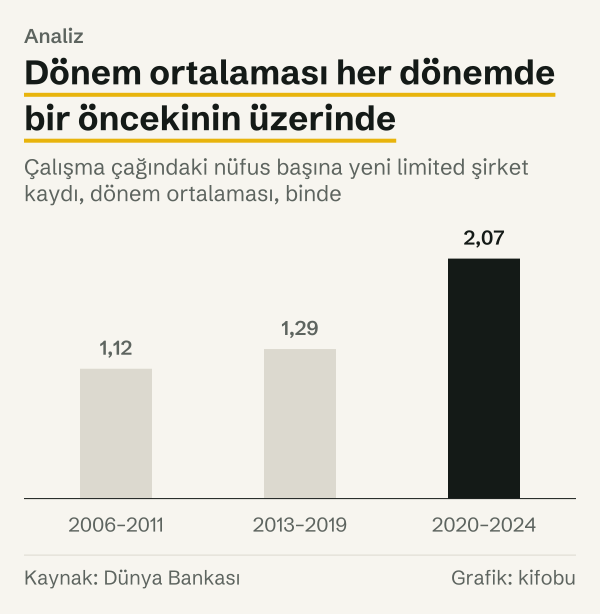
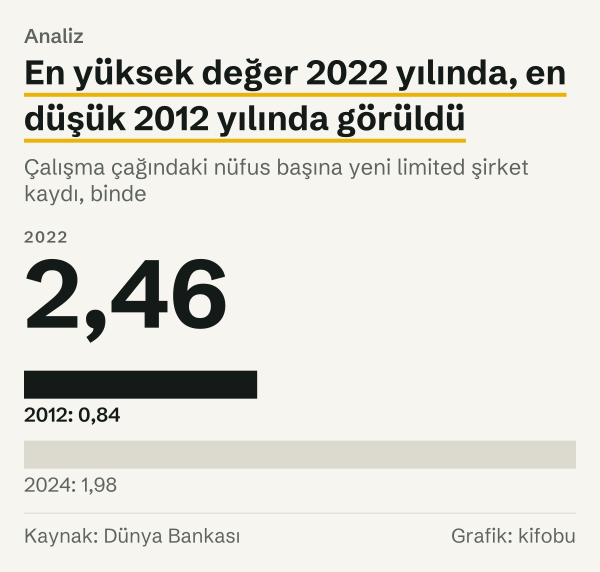

Dünya Bankası'nın girişimcilik veri tabanında Türkiye'nin en düşük değeri 2012 yılına ait: çalışma çağındaki (on beş ile altmış dört yaş arasındaki) her bin kişiye 0,84 yeni limited şirket kaydı düşüyor. Bir yıl önce, 2011 yılında bu değer 1,15'ti; yıllık düşüş %27,35. Serinin öbür ucu 2022 yılında: bin kişiye 2,46 yeni kayıt, yani 2012 yılında görülen değerin 2,94 katı.

İki uç arasında 2006–2024 aralığında on dokuz yıl var ve seri bu süre boyunca düz bir çizgi izlemiyor. Yazı çizginin nerede büküldüğünü soruyor, cevabı da zamanda ileri doğru yürüyerek arıyor: önce 2006–2011'in dar bandına, sonra 2012 yılında yaşanan düşüşe, ardından 2013–2019'daki tırmanışa, en son 2020'den bu yana oluşan yeni düzeye bakıyoruz.

Baştan söyleyelim: seri bir neden anlatmıyor. Kaynak yalnızca neyin sayıldığını tarif ediyor, hangi yılda neden değiştiğini söylemiyor. Biz de yalnızca aynı dönemde neyin yaşandığını yazabiliyoruz.

Yoğunluk, yeni kayıtların sayısını çalışma çağındaki nüfusa böler. Limited şirket, ortaklarının sorumluluğunu koydukları sermaye ile sınırlayan şirket türüdür. Nüfusa oranlamanın sebebi şu: nüfus büyürken ham kayıt sayısı da kendiliğinden artabilir; oran bu etkiyi ayıklar ve yıllar arasında daha adil bir karşılaştırma sunar.

*Çalışma çağındaki nüfus başına yeni limited şirket kaydı, binde. Kaynak: Dünya Bankası.*
## 2006–2011: Dar bir bantta seyir

Altı yıllık ilk dönem 2006'da 1,17 ile başlıyor. 2007'de 1,23'e çıkıyor ve dönemin en yüksek değerini orada veriyor. Sonraki iki yıl düşüş getiriyor: 2008'de 1,09 (%11,77 azalış), 2009'da 0,97 (%10,76 azalış). 2007 yılından 2009 yılına toplam düşüş %21,3.

Bu iki yıl, küresel finans krizinin (2008) yaşandığı dönemle aynı takvime denk geliyor. Zamandaşlık bundan ibaret; seri düşüşün sebebini göstermiyor ve biz de bir sebep kurmuyoruz.

Toparlanma hızlı oldu. 2010'da yoğunluk 1,10'a (%13,94 artış), 2011'de 1,15'e (%4,12 artış) çıktı. Altı yılın hiçbirinde değer 0,97'nin altına inmedi, 1,23'ün üzerine de çıkmadı. Dönemin aritmetik ortalaması 1,12. Yıllar arasında oynama olsa da 2006–2011, yoğunluğun bir düzey etrafında dolaştığı bir dönem olarak okunabiliyor.

## 2012 yılı: Tek yılda dörtte birden fazla düşüş

2012 yılında değer 0,84'e indi. Bir önceki yıla göre azalış %27,35; bu, serinin en büyük yıllık düşüşü. Dikkat çeken bir simetri var: serinin en büyük yıllık artışı, yani 2022'deki %27,01, bu düşüşle neredeyse aynı büyüklükte. İki uç hareket, mutlak değer olarak birbirine çok yakın.

Yine de 2012 yılını kalıcı bir basamak saymak için gerekçe yok. 2013'te yoğunluk %21,69 artarak 1,02'ye çıktı. 2014'te 1,16'ya ulaştı; bu, 2011'deki 1,15'in 0,01 üzerinde. Yani 2012 yılında yaşanan düşüş iki yıl içinde telafi edildi. Bu yüzden 2012 yılını kalıcı bir kırılma yerine tek yıllık bir sapma olarak okumak veriye daha uygun düşüyor.

Aynı karşılaştırmayı 2009 yılında yaşanan düşüşe yaparsak tablo değişiyor. 2007 yılında görülen 1,23, ancak 2015'te, 1,26 ile aşıldı; yani o düşüşün telafisi altı yıl, 2007 yılında görülen tepeden sayarsak sekiz yıl aldı. İki düşüş ilk bakışta benzer görünse de telafi süreleri çok farklı.

*Yoğunluğun bir önceki yıla göre değişimi. Kaynak: Dünya Bankası.*
## 2013–2019: Basamaklı bir tırmanış

2013–2019 arasında seri 1,02'den 1,51'e yükseldi. Yol düz değil. 2015'te 1,26'ya çıkan yoğunluk 2016'da 1,19'a indi (%5,79 azalış); 2017'de 1,36'ya (%13,93 artış) ve 2018'de 1,54'e (%13,54 artış) çıktı; 2019'da 1,51'e, yani %2,06 azalışla yeniden hafif geriledi.

Yedi yılın ortalaması 1,29. Bu, 2006–2011 ortalamasının %15,5 üzerinde. Dönemi 2013 yılından başlatmamızın sebebi, 2012 yılını yukarıda gördüğümüz gibi ayrı bir sapma olarak ele almamız; bu bir hesap tercihi ve aşağıda Nasıl hesapladık bölümünde açıkça yazıyoruz.

2012 yılında görülen 0,84'ten 2019 yılında görülen 1,51'e uzanan yedi yılda yoğunluk toplam %80,8 arttı. Bu, yıllık bileşik %8,8'lik bir hıza denk geliyor. Artış tek yönlü olmadı; ama düşüşler küçük kaldı ve her seferinde bir sonraki yıl önceki düzeyin üzerine çıkıldı.

## 2020–2022: Yeni düzeye çıkış

2020'de seri 1,78'e çıktı; 2019 yılına göre artış %18,1. 2021'de 1,94'e ulaştı (%8,55 artış), 2022'de 2,46'ya (%27,01 artış). Pandemi dönemi (2020–2021) boyunca seri düşmedi, yükseldi. Bu da zamandaşlıktan öteye geçmiyor; seri yükselişin sebebini açıklamıyor.

2019 yılından 2022 yılına üç yılda artış %62,8, yıllık bileşik hız %17,6. Önceki yedi yılın birikmiş artışı %80,8'di; bu kez benzer büyüklükte bir hareket üç yılda geldi. 2022'deki 2,46, seride daha önce hiçbir yılda görülmeyen bir düzey. 2020–2024 ortalaması 2,07; bu, 2013–2019 ortalamasının %60,5, 2006–2011 ortalamasının %85,4 üzerinde.

*Çalışma çağındaki nüfus başına yeni limited şirket kaydı, dönem ortalaması, binde. Kaynak: Dünya Bankası.*
## İki geçişin büyüklüğü

Dönem ortalamaları iki geçişi aynı ölçüde göstermiyor. İlk geçişte, yani 2006–2011'den 2013–2019'a, ortalama %15,5 arttı; ikincisinde, 2013–2019'dan 2020–2024'e %60,5. Ortalamaların yanında aralıklara da bakmak gerekiyor.

İlk iki dönem birbirinin içine giriyor. 2006–2011'in aralığı 0,97 ile 1,23 arasında; 2013–2019'da ise 2013'te 1,02, 2014'te 1,16 ve 2016'da 1,19 değerleri birinci dönemin bandının içinde kalıyor; 2015'teki 1,26 ise bandın üst ucunu (1,23) aşıyor. Yani ilk geçiş bir basamaktan çok bir eğim: seri, aynı bandın içinden çıkarak yukarı doğru kayıyor.

İkinci geçişte durum farklı. 2020–2024 döneminin en düşük değeri, 2020'deki 1,78; 2013–2019 döneminin en yüksek değeri ise 2018'deki 1,54. İkisi arasında 0,24'lük bir boşluk var; yani yeni dönemin hiçbir yılı eski dönemin bandıyla kesişmiyor. Seride gerçek bir düzey değişikliği varsa, bu ikinci geçişte.

Yıllık hareketlerin dağılımına da bakmak gerekiyor. On sekiz yıllık değişimin on biri artış, yedisi azalış. Artış yıllarının ortalaması %13,58; on sekiz değişimin tamamının düz ortalaması ise %3,95. Bu ortalama, 2006–2024 arasındaki yıllık bileşik hızdan, yani %2,97'den yüksek. İki ölçü arasındaki fark, yılların birbirini kısmen götürdüğü dalgalanmanın büyüklüğünü gösteriyor.

## 2023–2024: İki yıl üst üste düşüş

Tepe noktasından sonra seri iki yıl üst üste geriledi: 2023'te 2,21 (%10,13 azalış), 2024'te 1,98 (%10,51 azalış). 2022 yılından 2024 yılına toplam azalış %19,6.

Ama bu iniş serinin başladığı yere dönüşü anlatmıyor. 2024'teki 1,98, 2019'daki 1,51'in %30,9 üzerinde ve 2006'daki 1,17'nin %69,2 üzerinde. Yeni düzeyin ilk yılıyla kıyaslarsak, 2024'teki 1,98 2020'deki 1,78'in %10,9 üzerinde; yani yoğunluk iki yıllık inişe rağmen 2020 yılı düzeyinin altına inmedi. Bu da yeni düzeyin en azından ilk yılının henüz kaybedilmediği anlamına geliyor. Seride 2025 yılına ait değer henüz yok; bu yüzden inişin bundan sonra ne yaptığını bu veriyle söylemek mümkün değil, tahmin de yürütmüyoruz.

*Çalışma çağındaki nüfus başına yeni limited şirket kaydı, binde. Kaynak: Dünya Bankası.*
Seride benzer bir düşüş daha var. İki yıl üst üste azalış, bu seride ilk kez 2023–2024 arasında görülmüyor. 2008–2009 arasında da yoğunluk iki yıl üst üste geriledi ve toplam düşüş %21,3'tü; 2022 yılından 2024 yılına düşüş ise %19,6. İki düşüşün büyüklüğü arasındaki fark 1,7 puan.

Benzerlik büyüklükle sınırlı. İlk düşüş 1,23'ten 0,97'ye, ikincisi 2,46'dan 1,98'e oldu; yani aynı yüzdeler çok farklı düzeylerde gerçekleşti. Seride yalnızca bir olgu var: ilk düşüşün ardından, 2010 yılında ve 2011 yılında art arda artış görüldü. İkinci düşüşün ardından ne geleceğini veri söylemiyor; ilk düşüşün sonrası bir tahmin dayanağı da değil. İki olay arasındaki ortak payda yalnızca sayısal büyüklük.

## Karşı okuma: Kırılma mı, dalgalanma mı?

Buraya kadar anlattığımız dönem bölünmesi tek olası okuma değil. On dokuz gözlemlik bir seride resmî bir kırılma testi yapmak için yeterli veri yok; biz de test uygulamadık. Verinin söylediği şu: yıllık değişimin mutlak değerce yüzde yirmiyi aşan yılları üç tane. Bunlar 2012'deki %27,35 azalış, 2013'teki %21,69 artış ve 2022'deki %27,01 artış. İlk ikisi art arda geliyor ve zıt yönlü.

Aynı mantığı 2022 yılına da uygularsak başka bir okuma çıkıyor: 2022 yılı da 2012 yılı gibi tek yıllık bir sapma olabilir. Bu okumaya göre 2020 yılında başlayan basamak, 2021 yılında görülen 1,94'e yerleşmiş; 2022 yılı ise bu düzeyin üzerinde geçici bir tepe. 2024'teki 1,98'in 2021'deki 1,94'ün yalnızca 0,04 üzerinde olması bu okumayla uyumlu. Öbür okuma 2022 yılını basamağın parçası sayıyor ve 2023–2024'ü o basamaktan inişin başlangıcı olarak görüyor.

İki okumayı ayıran şey, şu an elimizde olmayan sonraki yılların değerleri. O nedenle yazı tek bir okuma benimsemiyor. Veriden okunabilen, 2012 yılı için tek yıllık bir sapma olduğu ve 2020–2022'nin daha yüksek bir düzeye işaret ettiği; bu düzeyin kalıcı olup olmadığı ise veriden anlaşılmıyor.

## Serinin göremediği şirketler

Serinin neyi saydığı önemli. Dünya Bankası'nın tanımı, takvim yılında yeni kaydedilen sınırlı sorumlu şirketleri sayıyor ve çalışma çağındaki nüfusa oranlıyor. Bu tanım gereği sınırlı sorumlu olmayan işletmeler (şahıs işletmeleri gibi) seride yer almıyor.

Kayıt sayılıyor; kaydın ardından şirketin faaliyete geçip geçmediği ya da ne kadar süre faaliyette kaldığı ölçülmüyor. Payda da çalışma çağındaki nüfus: nüfus tahminleri yenilenirse geçmiş yılların değerleri de değişebilir. Bu yazıdaki değerler 23 Ekim 2026 tarihinde çekildi; sonraki güncellemelerde farklılaşabilirler.

Seri bin kişi başına 1,98 diyor; yani 2024 yılında çalışma çağındaki her bin kişiye yaklaşık iki yeni kayıt düşüyor. Bu ulusal bir ortalama. Dünya Bankası'nın bu göstergesi il ya da sektör kırılımı vermiyor; kayıtların ülkenin hangi bölgelerinde ve hangi işlerde yoğunlaştığını buradan okumak mümkün değil.

Seri kısa: Türkiye için 2005 yılı ve öncesine ait değer yok. Bu yüzden 2012 yılında yaşanan düşüşü ya da 2020 yılından sonraki basamağı daha uzun bir geçmişle kıyaslayamıyoruz; kırılma tespitleri on dokuz gözlemin sınırları içinde kalıyor.

Bu sınırlar, Türkiye'de kaç yeni işletmenin doğduğu sorusunun bu seriyle yanıtlanamayacağını gösteriyor. İşletme doğumlarını farklı bir tanımla sayan ayrı bir resmî ölçü var; iki ölçünün neden farklı yanıt verdiği başka bir yazının konusu.

## Nasıl hesapladık

Dünya Bankası'nın yeni işletme yoğunluğu göstergesi (IC.BUS.NDNS.ZS), Türkiye için, 2006–2024. 2005 yılı ve öncesi için, ayrıca 2025 yılı için değer yok. Değerler 23 Ekim 2026 tarihinde çekildi.

Yıllık değişim, bir yılın değerinin bir önceki yıla göre yüzde farkıdır. Dönem ortalamaları, ilgili yılların yoğunluk değerlerinin düz aritmetik ortalamasıdır. Yıllık bileşik hız, iki yıl arasındaki toplam değişimin yıl sayısına bölünmüş geometrik karşılığıdır. Dönemleri biz belirledik: 2006–2011, 2013–2019 ve 2020–2024. 2012 yılı bilinçli olarak dışarıda: tek yıllık sapma olduğu için ayrı ele alındı. Başka bir bölme farklı ortalamalar verir. Yazıdaki her değer, kanıt dosyasındaki bir kayda bağlıdır ve grafikler yalnızca bu kayıtlardan çizilmiştir.

Kırılma aramak için tek bir ölçüt kullandık: yıllık değişimin mutlak değeri yüzde yirmiyi aşan yıllar. Bu ölçüt bizim tercihimizdir; resmî bir tanım ya da istatistiksel test değildir.

## Kaynaklar

- [Dünya Bankası: Yeni işletme yoğunluğu, Türkiye](https://data.worldbank.org/indicator/IC.BUS.NDNS.ZS?locations=TR)
- [Dünya Bankası: Girişimcilik programı](https://www.worldbank.org/en/programs/entrepreneurship)
