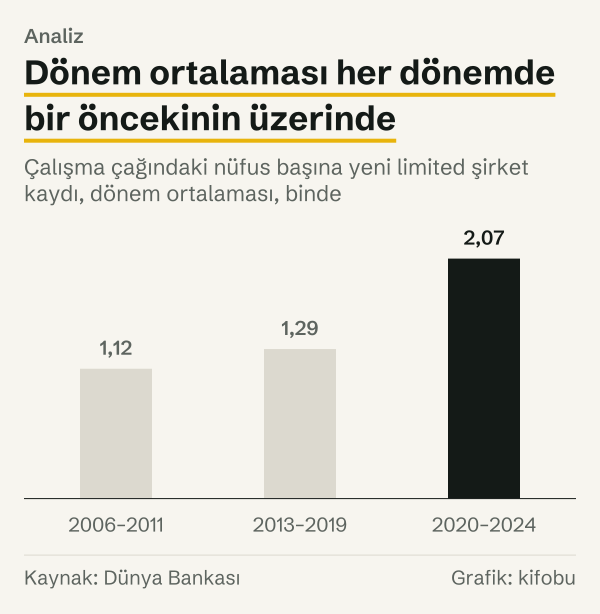
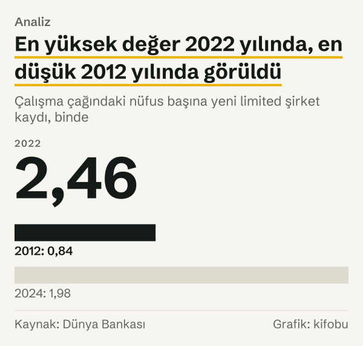

Dünya Bankası'nın girişimcilik veri tabanında Türkiye'nin gördüğü en düşük değer 2012 yılına ait: çalışma çağındaki (15–64 yaş) her bin kişiye yalnızca 0,84 yeni limited şirket kaydı düşüyor. Bir önceki yıl, 2011'de 1,15 olan bu oran tek yılda %27,35 geriledi. Serinin zirvesi ise tam on yıl sonra, 2022'de geldi: bin kişiye 2,46 yeni kayıt, yani 2012'deki dibin 2,94 katı.

2006–2024 arasını kapsayan bu 19 yıllık seri düz bir çizgi izlemiyor. Önce 2006–2011'in dar bandı, ardından 2012'deki sert düşüş, sonra 2013–2019 arasındaki kademeli tırmanış ve nihayet 2020'den bu yana oluşan yeni düzey birbirini izliyor. Elbette bu seri tek başına bir nedensellik kurmuyor; kaynak yalnızca neyin sayıldığını tanımlıyor, değişimlerin arkasındaki gerekçeleri açıklamıyor. Biz de aynı dönemde verinin ne gösterdiğine odaklanıyoruz.

Yoğunluk göstergesi, yeni kayıtları çalışma çağındaki nüfusa bölerek hesaplanıyor. Limited şirket, ortaklarının sorumluluğunu koydukları sermaye ile sınırlayan şirket türü. Nüfusa oranlama ise önemli bir düzeltme sağlıyor: nüfus büyürken ham kayıt sayısı da kendiliğinden artabileceği için bu etkiyi arındırıp yıllar arasında daha sağlıklı bir karşılaştırma yapmayı mümkün kılıyor.

*Çalışma çağındaki nüfus başına yeni limited şirket kaydı, binde. Kaynak: Dünya Bankası.*

## 2006–2011: Dar bir bantta seyir

İlk altı yıllık dönem 2006'da 1,17 ile başlıyor, 2007'de 1,23 ile dönemin zirvesine çıkıyor. Ardından iki yıl üst üste düşüş geliyor: 2008'de 1,09 (%11,77 azalış) ve 2009'da 0,97 (%10,76 azalış). 2007'den 2009'a toplam gerileme %21,3. Bu iki yıl, küresel finans krizinin (2008) takvimine denk düşse de seri bu eşzamanlılığın ötesinde bir neden sunmuyor.

Toparlanma ise gecikmedi. Yoğunluk 2010'da %13,94 artışla 1,10'a, 2011'de %4,12 artışla 1,15'e yükseldi. Altı yıl boyunca değer ne 0,97'nin altına indi ne de 1,23'ün üzerine çıktı. Dönemin aritmetik ortalaması 1,12. Yıllık dalgalanmalara karşın 2006–2011, yoğunluğun belirli bir bant etrafında dolaştığı bir dönem olarak öne çıkıyor.

## 2012: Tek yılda dörtte birden fazla düşüş

2012'de değer 0,84'e indi. Bir önceki yıla göre %27,35'lik bu gerileme, serinin en sert yıllık düşüşü. İlginç bir simetri de var: serinin en büyük yıllık artışı olan 2022'deki %27,01'lik sıçrama, bu düşüşle neredeyse aynı büyüklükte.

Yine de 2012'yi kalıcı bir basamak olarak okumak güç. Yoğunluk 2013'te %21,69 artarak 1,02'ye, 2014'te ise 1,16'ya çıktı ve 2011'deki 1,15'in üzerine yerleşti. Kaybın iki yıl içinde telafi edilmesi, 2012'yi kalıcı bir kırılmadan ziyade tek yıllık bir sapma olarak değerlendirmeyi daha tutarlı kılıyor.

Oysa 2009'daki düşüşte tablo farklıydı. 2007'de görülen 1,23 seviyesi ancak 2015'te 1,26 ile aşılabildi; yani o düşüşün telafisi altı yıl, tepeden itibaren sayıldığında ise sekiz yıl sürdü. İlk bakışta benzer görünen iki gerilemenin toparlanma süreleri birbirinden oldukça farklı.

*Yoğunluğun bir önceki yıla göre değişimi. Kaynak: Dünya Bankası.*

## 2013–2019: Basamaklı bir tırmanış

2013–2019 arasında seri 1,02'den 1,51'e tırmandı. Bu yükseliş kesintisiz değildi: 2015'te 1,26'ya çıkan yoğunluk 2016'da %5,79 azalışla 1,19'a indi; ardından 2017'de 1,36'ya (%13,93 artış) ve 2018'de 1,54'e (%13,54 artış) yükseldi, 2019'da ise %2,06'lık hafif bir geri çekilmeyle 1,51 oldu.

Yedi yılın ortalaması 1,29; yani 2006–2011 ortalamasının %15,5 üzerinde. 2012'yi tek yıllık bir sapma kabul edip bu dönemi 2013'ten başlatmak bir hesap tercihi. 2012'deki 0,84'ten 2019'daki 1,51'e uzanan yedi yılda toplam artış %80,8'e, yıllık bileşik büyüme hızı ise %8,8'e ulaştı. Aradaki düşüşler sınırlı kaldı ve seri her seferinde bir önceki düzeyin üzerine çıktı.

## 2020–2022: Yeni düzeye çıkış

2020'de seri %18,1 artışla 1,78'e sıçradı. 2021'de %8,55 artarak 1,94'e, 2022'de ise %27,01 artarak 2,46'ya ulaştı. Pandemi yıllarında (2020–2021) gerilemek yerine yükselen bu seyir, yine yalnızca takvim çakışması olarak okunabiliyor; veri yükselişin nedenini açıklamıyor.

2019'dan 2022'ye üç yılda yaşanan %62,8'lik artış, yıllık bileşik %17,6'lık bir hıza karşılık geliyor. Önceki yedi yılda biriken %80,8'lik artışa yakın bir hareket bu kez üç yıla sığdı. 2022'deki 2,46 değeri serinin tüm zamanlar zirvesi. 2020–2024 döneminin 2,07'lik ortalaması ise 2013–2019 ortalamasının %60,5, 2006–2011 ortalamasının %85,4 üzerinde.

*Çalışma çağındaki nüfus başına yeni limited şirket kaydı, dönem ortalaması, binde. Kaynak: Dünya Bankası.*

## İki geçişin büyüklüğü

Dönem ortalamaları iki sıçramayı aynı ölçekte yansıtmıyor. İlk geçişte (2006–2011'den 2013–2019'a) ortalama %15,5 artarken, ikinci geçişte (2013–2019'dan 2020–2024'e) %60,5 yükseldi. Üstelik aralıklara bakıldığında fark daha da belirginleşiyor.

İlk iki dönem birbiriyle örtüşüyor: 2006–2011 bandı 0,97 ile 1,23 arasındayken, 2013–2019 döneminde 2013 (1,02), 2014 (1,16) ve 2016 (1,19) değerleri ilk bandın içinde kalıyor; seri ancak 2015'teki 1,26 ile üst sınırı aşıyor. Yani ilk geçiş sert bir basamaktan çok kademeli bir eğim.

İkinci geçişte ise tablo tamamen farklı. 2020–2024 döneminin en düşük değeri olan 2020'deki 1,78 ile 2013–2019'un en yüksek değeri olan 2018'deki 1,54 arasında 0,24'lük bir boşluk var. Yeni dönemin hiçbir yılı eski bandın içine girmiyor. Seride gerçek bir düzey değişikliği varsa, o da bu ikinci geçişte yaşanıyor.

Yıllık hareketlerin dağılımı da dalgalanmanın boyutunu gösteriyor. 18 yıllık değişimin 11'i artış, 7'si azalış yönünde. Artış yıllarının ortalaması %13,58, tüm değişimlerin düz ortalaması ise %3,95. Bu ortalamanın 2006–2024 arası yıllık bileşik hızdan (%2,97) yüksek olması, yıllar arasındaki iniş çıkışların birbirini kısmen dengelediğini ortaya koyuyor.

## 2023–2024: İki yıl üst üste düşüş

Zirvenin ardından seri iki yıl arka arkaya geriledi: 2023'te 2,21 (%10,13 azalış) ve 2024'te 1,98 (%10,51 azalış). 2022'den 2024'e toplam düşüş %19,6.

Ancak bu geri çekilme başlangıç noktasına dönüş anlamına gelmiyor. 2024'teki 1,98 değeri, 2019'daki 1,51'in %30,9, 2006'daki 1,17'nin ise %69,2 üzerinde. Yeni düzeyin ilk yılı olan 2020'deki 1,78 ile kıyaslandığında da %10,9 daha yüksek; yani iki yıllık inişe rağmen seri 2020 seviyesinin altına inmedi. 2025 verisi henüz bulunmadığı için bu inişin devam edip etmediğini söylemek ya da tahminde bulunmak mümkün değil.

*Çalışma çağındaki nüfus başına yeni limited şirket kaydı, binde. Kaynak: Dünya Bankası.*

İki yıl üst üste düşüş seride ilk kez yaşanmıyor. 2008–2009 döneminde de yoğunluk iki yıl art arda gerilemiş ve toplamda %21,3 düşmüştü; 2022–2024 arasındaki %19,6'lık düşüşle aradaki fark yalnızca 1,7 puan. Ancak benzerlik sadece yüzde büyüklüğüyle sınırlı: ilk düşüş 1,23'ten 0,97'ye, ikincisi 2,46'dan 1,98'e indi. İlk düşüşün ardından 2010 ve 2011'de peş peşe artışlar gelmişti, fakat ikinci düşüşün sonrasını bugünkü veriyle öngörmek mümkün değil.

## Kırılma mı, dalgalanma mı?

Buradaki dönem bölünmesi tek olası okuma değil. 19 gözlemlik bir seride resmî bir kırılma testi yapmak için yeterli veri bulunmadığından böyle bir test uygulanmadı. Veride yıllık değişimin mutlak değerce %20'yi aştığı yalnızca üç yıl var: 2012'deki %27,35 azalış, 2013'teki %21,69 artış ve 2022'deki %27,01 artış. İlk ikisi art arda ve zıt yönlü.

Aynı mantık 2022'ye uygulandığında farklı bir okuma ortaya çıkıyor: 2022 de tıpkı 2012 gibi tek yıllık bir sapma olabilir. Bu açıdan bakıldığında, 2020'de başlayan basamak 2021'deki 1,94 seviyesine oturmuş, 2022 ise geçici bir tepe olarak kalmış görünüyor. 2024'teki 1,98'in 2021'deki 1,94'ün yalnızca 0,04 üzerinde olması da bu okumayı destekliyor. Diğer okuma ise 2022'yi basamağın parçası sayıp 2023–2024'ü o basamaktan inişin başlangıcı olarak görüyor. İki yorumu kesin olarak ayıracak olan, henüz elimizde olmayan sonraki yılların verileri.

## Serinin göremediği şirketler

Dünya Bankası'nın tanımı, takvim yılında yeni kaydedilen sınırlı sorumlu şirketleri sayıp çalışma çağındaki nüfusa oranlıyor. Dolayısıyla şahıs işletmeleri gibi sınırlı sorumlu olmayan işletmeler bu seride yer almıyor.

Ayrıca ölçülen şey yalnızca kayıt; şirketin kayıttan sonra faaliyete geçip geçmediği ya da ne kadar süre ayakta kaldığı izlenmiyor. Paydadaki çalışma çağındaki nüfus tahminleri güncellendikçe geçmiş yılların oranları da değişebiliyor. Bu yazıdaki veriler 23 Ekim 2026 tarihinde çekildi; sonraki güncellemelerde farklılaşabilir.

Bin kişi başına 1,98, 2024 yılında çalışma çağındaki her bin kişiye yaklaşık iki yeni kayıt düştüğü anlamına geliyor. Ancak bu ulusal bir ortalama; il ya da sektör kırılımı vermediği için kayıtların hangi bölgelerde veya iş kollarında yoğunlaştığı buradan okunamıyor.

Seri 2006'dan başladığı için 2005 ve öncesine ait veri yok. Bu nedenle 2012'deki düşüşü ya da 2020 sonrası basamağı daha uzun bir geçmişle kıyaslamak mümkün değil. Türkiye'de toplam kaç yeni işletmenin doğduğu sorusu da bu seriyle yanıtlanamıyor; işletme doğumlarını farklı bir tanımla sayan ayrı resmî ölçüler bulunuyor.

## Nasıl hesapladık

Veriler Dünya Bankası'nın yeni işletme yoğunluğu göstergesinden (IC.BUS.NDNS.ZS), Türkiye için 2006–2024 dönemini kapsayacak şekilde 23 Ekim 2026 tarihinde çekildi. 2005 öncesi ve 2025 yılı için veri bulunmuyor.

Yıllık değişim, bir yılın değerinin bir önceki yıla göre yüzde farkını; dönem ortalamaları, ilgili yılların düz aritmetik ortalamasını; yıllık bileşik hız ise iki yıl arasındaki toplam değişimin geometrik karşılığını ifade ediyor. Dönemler (2006–2011, 2013–2019 ve 2020–2024) tarafımızdan belirlendi; 2012 yılı tek yıllık sapma olarak ayrıldığı için ortalamaların dışında tutuldu. Kırılma arayışında resmî bir istatistiksel test yerine, yıllık değişimin mutlak değerce %20'yi aşması ölçütü tercih edildi. Yazıdaki tüm değerler ve grafikler kanıt dosyasındaki kayıtlara dayanmaktadır.

## Kaynaklar

- [Dünya Bankası: Yeni işletme yoğunluğu, Türkiye](https://data.worldbank.org/indicator/IC.BUS.NDNS.ZS?locations=TR)
- [Dünya Bankası: Girişimcilik programı](https://www.worldbank.org/en/programs/entrepreneurship)
