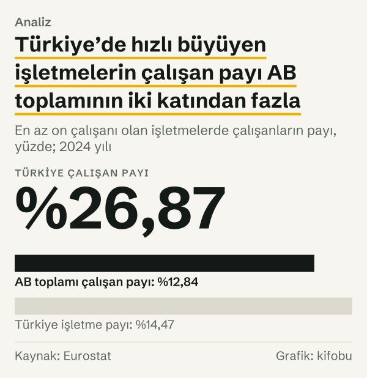
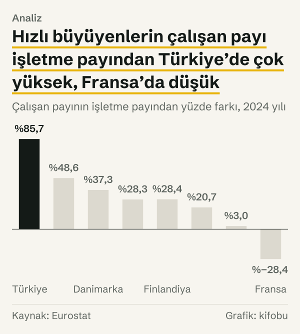

Türkiye’de 2024 yılında 3.451.887 çalışan, son üç yılda her yıl ortalama %10’dan fazla büyüyen işletmelerin bünyesinde yer alıyordu. En az 10 çalışanı olan işletmelerin yalnızca %14,47’sini oluşturan bu şirketler, aynı kümedeki toplam istihdamın %26,87’sini tek başına taşıyor. İşletme sayısı ile istihdam payı arasındaki bu belirgin makas, Türkiye’deki büyüme dinamiklerinin ilk ipucu.

Avrupa Birliği genelinde ise aynı ölçüte göre işletmelerin %10,01’i hızlı büyüyor ve toplam çalışanların %12,84’ü bu işletmelerde bulunuyor. Türkiye’deki %26,87’lik çalışan payı AB’dekinden %109,27 daha yüksek; yani iki katını aşıyor.

Ortalamalar uçları gizlediği için büyümenin tabana mı yayıldığını yoksa belirli bir kesimde mi toplandığını görmek adına dağılımın ucuna bakmak gerekiyor. Eurostat’ın işletme demografisi tablosundan Türkiye ve Avrupa ülkeleri için çektiğimiz iki ayrı payı yan yana koyduğumuzda, bu farkın nereden kaynaklandığı daha net görünüyor.

*En az on çalışanı olan işletmelerde çalışanların payı, yüzde; 2024 yılı. Kaynak: Eurostat.*

## Hangi işletmeye yüksek büyüme deniyor?

Eurostat, yüksek büyüme gösteren işletmeyi üç yıllık bir dönemde çalışan sayısı yıllık ortalama %10’dan fazla artan ve dönemin başında en az 10 çalışanı bulunan işletme olarak tanımlıyor. Dönemin başlangıç yılında kurulan yeni işletmeler bu sınıfa girmiyor; yani tanım yeni doğanları değil, dönem başında hâlihazırda var olup büyüyenleri kapsıyor.

Bu tanım iki önemli sınır çiziyor. Ölçüt ciroya değil çalışan sayısına dayanıyor ve paydada yalnızca en az 10 çalışanı olan aktif işletmeler yer alıyor. Daha küçük işletmeler hesabın dışında kaldığı için %26,87 oranı ekonomideki tüm çalışanların değil, 10 ve üzeri çalışanlı işletmelerdeki istihdamın payını ifade ediyor. Eurostat’ın yayımladığı işletme sayısı payı ile çalışan payı aynı kümeyi farklı biçimlerde tartıyor; aralarındaki ayrışma da asıl resmi veriyor.

## Sayı payı ile çalışan payı neden ayrışıyor?

Türkiye’de 2024 yılında hızlı büyüyen işletme sayısı 33.168’di. Bu işletmelerde çalışan 3.451.887 kişiyi işletme sayısına böldüğümüzde, Eurostat’ın da doğrudan yayımladığı üzere, işletme başına ortalama 104,07 çalışan düşüyor.

Türkiye’de çalışan payının işletme payından %85,69 daha yüksek olması, hızlı büyüyen işletmelerin ortalama ölçeğinin, en az 10 çalışanı olan tüm işletmelerin ortalamasından çok daha büyük olduğunu gösteriyor. AB’de ise bu fark yalnızca %28,27.

İşletme sayısı payında Türkiye ile AB arasında 4,46 puanlık bir fark varken, çalışan payında bu makas 14,03 puana çıkıyor. Sayıdan istihdama geçerken açılan bu fark, ülkeler arasında da keskin biçimde değişiyor. Çalışan payı işletme payından Almanya’da %48,56, Danimarka’da %37,26, Finlandiya’da %28,43, İtalya’da %20,73 ve İspanya’da %2,97 yüksek. Fransa’da ise tablo tersine dönüyor: çalışan payı işletme payından %28,41 daha düşük. Yani aynı tanım Türkiye’de ortalamadan büyük işletmeleri öne çıkarırken, Fransa’da ortalamadan küçük işletmeleri yakalıyor.

*Çalışan payının işletme payından yüzde farkı, 2024 yılı. Kaynak: Eurostat.*

## Ülkeler arasında sıra

Çalışan payı verisi bulunan ülkeler arasında Türkiye, 2024 yılında Malta’nın (%31,87) ardından %26,87 ile ikinci sırada yer alıyor. Yunanistan %26,37 ile hemen arkada; onu Portekiz (%21,73), Norveç (%20,43), Danimarka (%20,26), Finlandiya (%18,79) ve İsveç (%17,73) izliyor. AB ortalaması %12,84 düzeyinde kalırken Almanya %12,39, İtalya %11,59, İspanya %11,09 ve Fransa %5,67’de.

İrlanda’nın 2024 yılı çalışan payı tabloda yer almıyor. 2023’te İrlanda, Eurostat’ta tahmin işaretiyle yayımlanan %29,99’luk oranla Türkiye’nin (%29,13) 0,86 puan önündeydi; Türkiye 2023’te de ikinci sıradaydı.

İşletme sayısı payına geçildiğinde ise sıralama değişiyor. 2024’te listenin başında İrlanda (%19,90), Malta (%16,94), Yunanistan (%15,57), Danimarka (%14,76) ve Finlandiya (%14,63) var. Türkiye %14,47 ile altıncı sırada. Sayıda altıncı, istihdamda ikinci olmak, yine hızlı büyüyen işletmelerin ölçek farkından kaynaklanıyor.

Tek yıllık sıralamalara temkinli yaklaşmakta yarar var, çünkü ülke payları yıldan yıla sert oynayabiliyor. Aşağıdaki tablo, üst sıralardaki beş ülkenin 2023 ve 2024 çalışan paylarını gösteriyor: Malta 7,42 puan sıçrarken Finlandiya 6,51 puan geriledi. Bu oynaklığa karşın Türkiye’nin iki yıl üst üste ikinci sırada kalması dikkat çekici.

| Ülke | 2023 yılı çalışan payı | 2024 yılı çalışan payı | Fark (puan) |
|---|---|---|---|
| Malta | %24,45 | %31,87 | +7,42 |
| Yunanistan | %28,35 | %26,37 | −1,98 |
| Danimarka | %22,07 | %20,26 | −1,81 |
| Finlandiya | %25,30 | %18,79 | −6,51 |
| İsveç | %21,34 | %17,73 | −3,61 |

*Hızlı büyüyen işletmelerdeki çalışanların payı, yüzde. Kaynak: Eurostat.*

*Hızlı büyüyen işletmelerdeki çalışanların payı, yüzde; 2024 yılı. Kaynak: Eurostat.*

## Zaman içinde: on yıllık seyir

Türkiye’de çalışan payı 2014’te %30,48 iken 2020’de serinin en düşük noktası olan %22,18’e indi (8,30 puanlık düşüş). Ardından 2023’te %29,13’e yükseldi (6,95 puanlık artış) ve 2024’te %26,87’ye geriledi (2,26 puanlık düşüş).

İşletme sayısı payı da paralel bir rota izledi: 2014’te %16,66, 2020’de %11,91, 2023’te %15,49 ve 2024’te %14,47. Bu da 2014–2020 arasında 4,75 puanlık düşüş, 2020–2023 arasında ise 3,58 puanlık artış anlamına geliyor.

Mutlak sayılar hareketi daha net ortaya koyuyor. 2014’te 30.519 olan hızlı büyüyen işletme sayısı, 2020’de %27,54 azalarak 22.114’e düştü. 2023’te 2020’ye göre %56,33 artışla 34.571’e çıktıktan sonra 2024’te %4,06 gerileyerek 33.168 oldu. On yıllık dönemde iki seri neredeyse birlikte hareket etti; tek istisna, çalışan payının 2019’da %23,72’den %24,29’a küçük bir yükseliş göstermesi, işletme payında ise bunun görülmemesi.

![Çizgi grafik: Türkiye’de işletme payı ve çalışan payı 2020 yılında dibe indi, sonra yeniden yükseldi: Çalışan payı: 2014 yılında %30,48, 2015 yılında %27,96, 2016 yılında %25,20, 2017 yılında %24,53, 2018 yılında %23,72, 2019 yılında %24,29, 2020 yılında %22,18, 2021 yılında %23,73, 2022 yılında %27,66, 2023 yılında %29,13, 2024 yılında %26,87; İşletme payı: 2014 yılında %16,66, 2015 yılında %15,13, 2016 yılında %13,52, 2017 yılında %13,29, 2018 yılında %12,61, 2019 yılında %12,32, 2020 yılında %11,91, 2021 yılında %12,99, 2022 yılında %14,79, 2023 yılında %15,49, 2024 yılında %14,47.](./graf-4.svg)
*Hızlı büyüyen işletmelerin payı, yüzde. Kaynak: Eurostat.*

## Sektörlere göre uçlar

2024’te Türkiye’de çalışan payının en yüksek olduğu sektör %42,37 ile konaklama ve yiyecek hizmeti. Onu eğlence, dinlence ve spor (%34,23), inşaat (%32,15) ile toptan ve perakende ticaret (%32,12) izliyor. En düşük paylar ise finans ve sigortada (%14,18) ve sağlık ve sosyal hizmette (%15,35); imalat %21,02 düzeyinde.

İşletme sayısına bakıldığında tablo değişiyor. Hızlı büyüyen işletmelerin sayıca en yoğun olduğu iki sektör imalat (7.858 işletme) ve toptan ve perakende ticaret (6.831 işletme). İnşaat (5.059) ile konaklama ve yiyecek hizmeti (3.491) de eklendiğinde, bu dört sektör 23.239 işletmeyle Türkiye’deki tüm hızlı büyüyenlerin %70,06’sını oluşturuyor.

| Sektör | Hızlı büyüyen işletme | Tüm hızlı büyüyenler içindeki payı | Sektörde işletme payı | Sektörde çalışan payı |
|---|---|---|---|---|
| İmalat | 7.858 | %23,69 | %13,42 | %21,02 |
| Toptan ve perakende ticaret | 6.831 | %20,60 | %14,01 | %32,12 |
| İnşaat | 5.059 | %15,25 | %14,15 | %32,15 |
| Konaklama ve yiyecek hizmeti | 3.491 | %10,53 | %17,80 | %42,37 |

*Hızlı büyüyen işletme sayısı ve payları, Türkiye, 2024 yılı. Kaynak: Eurostat.*

İmalat sayıca ilk sırada olmasına rağmen çalışan payında Türkiye ortalamasının (%26,87) altında kalıyor. Konaklama ve yiyecek hizmetinde ise tam tersi geçerli: sayıca dördüncü sırada ama işletme payı %17,80 iken çalışan payı %42,37 ile zirvede.

*Hızlı büyüyen işletmelerdeki çalışanların payı, yüzde; Türkiye, 2024 yılı. Kaynak: Eurostat.*

## Verinin işaret ettiği tablo ve sınırları

Türkiye’de hızlı büyüyenlerin istihdamdaki payı AB’dekinden %109,27 yüksekken, işletme sayısı payındaki fark %44,56 ile bunun yarısından az. Bu durum, AB ile aradaki farkın işletme sayısından çok hızlı büyüyen şirketlerin ölçeğinden kaynaklandığını gösteriyor. Zaman serisindeki 2014–2020 düşüşü ve sonraki yükseliş ise tanımın üç yıllık pencere yapısından bağımsız okunamıyor.

Bu yüksek oranı yorumlarken dört noktayı akılda tutmak gerekiyor. İlk olarak, tanım yalnızca en az 10 çalışanı olan işletmeleri kapsadığı için daha küçük işletmeler hem payın hem paydanın dışında kalıyor; dolayısıyla %26,87 ekonominin tamamını değil, eşiğin üzerindeki kümeyi yansıtıyor. İkincisi, büyüme burada yalnızca çalışan sayısı ve %10 eşiğiyle ölçülüyor; ciroya dayalı bir ölçüm ülkeleri farklı sıralayabilir. Üçüncüsü, göreli artışa dayanan tanımda başlangıçta 10 çalışanı olan bir işletme birkaç kişi ekleyerek eşiği geçebiliyor ve tablo bu artışın nedenini açıklamıyor. Son olarak, %85,69’luk fark ortalamaya dayanıyor; Eurostat işletme başına çalışan dağılımını vermediği için birkaç çok büyük işletmenin ortalamayı yukarı çekip çekmediği bu veriden anlaşılamıyor.

## Tanım ve pencere etkisi

Pay her yıl üç yıllık pencerelerle hesaplanıyor: 2023 değeri 2020–2023 dönemini, 2024 değeri ise 2021–2024 dönemini kapsıyor. Her iki pencerenin başlangıcı da pandemi yıllarına (2020–2021) denk geldiği ve veri bu baz etkisini ayrıştırmadığı için 2014–2020 düşüşü ile sonraki artışı aynı ölçekte yorumlamak güç.

Tabloda AB toplamının 2024 çalışan payı tahmin, Almanya ve Portekiz’in 2024 değerleri ise seri kırılması işaretli olarak yer alıyor. Ayrıca veri yalnızca sektör düzeyinde kırılım sunuyor; il, işletme büyüklüğü veya kuruluş yılı ayrıştırılmıyor.

## Nasıl hesapladık

Veriler Eurostat’ın yüksek büyüme gösteren işletmeler ve ilgili istihdam tablosundan (bd_hg) çekildi; kapsam kamu yönetimi dışındaki sanayi, inşaat ve piyasa hizmetlerini içeriyor. İşletme payı, çalışan payı ve hızlı büyüyen işletme başına çalışan sayısı Eurostat’ın doğrudan yayımladığı göstergeler. Çalışan payının işletme payından yüzde farkı, iki ülke veya yıl arasındaki yüzde puan farkları ve işletme sayısındaki yüzde değişimler tarafımızdan hesaplandı. Türkiye serisi 2014–2024 dönemini, ülke karşılaştırması 2024 yılını kapsıyor; 2023 yılı yalnızca İrlanda karşılaştırması ve oynaklık tablosu için kullanıldı.

## Kaynaklar

- [Eurostat: Yüksek büyüme gösteren işletmeler ve ilgili istihdam, bd_hg](https://ec.europa.eu/eurostat/databrowser/view/bd_hg/default/table)
- [Eurostat: Yüksek büyüme gösteren işletme sözlüğü](https://ec.europa.eu/eurostat/statistics-explained/index.php?title=Glossary:High-growth_enterprise)
