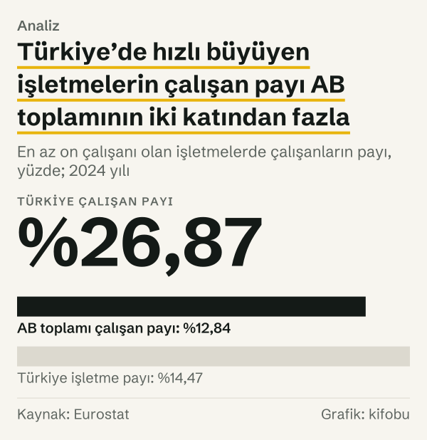
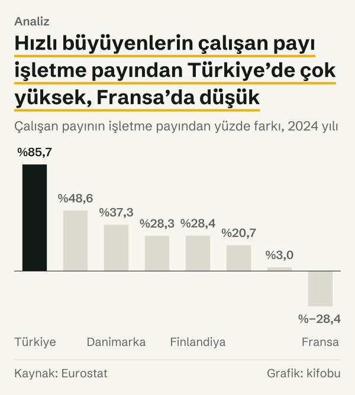

Türkiye’de 2024 yılında 3.451.887 çalışan, son üç yılda her yıl ortalama %10’dan fazla büyüyen işletmelerde çalışıyordu. Bu işletmeler, en az 10 çalışanı olan işletmelerin %14,47’sini oluşturuyor. Çalışanların ise %26,87’si onların çatısı altında. İşletme sayısındaki pay ile istihdamdaki pay arasındaki bu açıklık, yazının ilk ipucu.

AB’de aynı ölçüte göre işletmelerin %10,01’i hızlı büyüyor ve çalışanların %12,84’ü bu işletmelerde yer alıyor. Türkiye’deki çalışan payı AB’dekinden %109,27 yüksek; yani iki katını aşıyor.

Soru basit: büyüme işletmelerin hepsine mi yayılıyor, yoksa küçük bir kesimde mi toplanıyor? Ortalama işletmeye bakmak bu soruyu yanıtlamaz, çünkü ortalama uçları siler. Biz de uçlara baktık. Eurostat’ın işletme demografisi tablosundan Türkiye ve Avrupa ülkeleri için iki ayrı pay çektik, yan yana koyduk ve farkın nereden geldiğini aradık.

*En az on çalışanı olan işletmelerde çalışanların payı, yüzde; 2024 yılı. Kaynak: Eurostat.*
## Hangi işletmeye yüksek büyüme deniyor?

Eurostat tanımı şöyle: yüksek büyüme gösteren işletme, üç yıllık bir dönemde çalışan sayısı yıllık ortalama %10’dan fazla artan ve dönemin başında en az 10 çalışanı bulunan işletmedir. Dönemin başlangıç yılında kurulmuş işletmeler bu sınıfa dahil değil. Tanım yeni doğanları değil, dönem başında var olup büyüyenleri sayıyor.

Bu tanımın iki sonucu var. Birincisi, ölçü cirodan değil çalışan sayısından geliyor. İkincisi, paydada yalnızca en az 10 çalışanı olan aktif işletmeler yer alıyor. Daha küçük işletmeler hiçbir pay hesabına girmiyor. Dolayısıyla %26,87 ifadesi tüm çalışanların değil, en az 10 çalışanı olan işletmelerde çalışanların payı.

Eurostat iki ayrı pay yayımlıyor. İlki, hızlı büyüyen işletmelerin, en az 10 çalışanı olan aktif işletmeler içindeki sayı payı. İkincisi, bu işletmelerde çalışanların, aynı grubun toplam çalışanı içindeki payı. İkisi aynı işletme kümesini farklı biçimde tartıyor. Aralarındaki fark, yazının konusu.

## Sayı payı ile çalışan payı neden ayrışıyor?

Türkiye’de 2024 yılında hızlı büyüyen işletme sayısı 33.168’di. Bu işletmelerde çalışan 3.451.887 kişiyi 33.168’e bölünce işletme başına 104,07 çalışan çıkıyor. Eurostat bu ortalamayı doğrudan yayımlıyor.

Aynı bilgiyi iki payın karşılaştırması da verir. Türkiye’de çalışan payı işletme payından %85,69 yüksek. Bu fark, hızlı büyüyen işletmenin ortalama büyüklüğünün, en az 10 çalışanı olan tüm işletmelerin ortalamasından o kadar fazla olduğunu söylüyor. AB’de aynı karşılaştırma %28,27 veriyor.

İşletme sayısı payında Türkiye ile AB arasında 4,46 puan fark var. Çalışan payında ise fark 14,03 puana çıkıyor. İki taraf arasındaki açıklık, sayıdan istihdama geçerken belirgin biçimde büyüyor. Bu büyümeyi iki karşılaştırmanın ayrışması taşıyor: Türkiye’de çalışan payı işletme payından %85,69 yüksek, AB’de %28,27 yüksek.

Karşılaştırma her ülkede farklı sonuç veriyor. Danimarka’da çalışan payı işletme payından %37,26, Finlandiya’da %28,43, Almanya’da %48,56, İtalya’da %20,73, İspanya’da %2,97 yüksek. Fransa’da ise %28,41 düşük: orada hızlı büyüyenler, işletme sayısında aldıkları paydan daha az istihdam payı taşıyor. Aynı tanım Türkiye’de ortalamadan büyük işletmeleri, Fransa’da ortalamadan küçük işletmeleri öne çıkarıyor.

*Çalışan payının işletme payından yüzde farkı, 2024 yılı. Kaynak: Eurostat.*
## Ülkeler arasında sıra

Çalışan payı verisi bulunan ülkeler arasında, 2024 yılında Türkiye Malta’dan sonra ikinci sırada. Malta’da pay %31,87, Türkiye’de %26,87, Yunanistan’da %26,37. Ardından Portekiz (%21,73), Norveç (%20,43), Danimarka (%20,26), Finlandiya (%18,79) ve İsveç (%17,73) geliyor. AB toplamı %12,84. Almanya %12,39, İtalya %11,59, İspanya %11,09, Fransa %5,67.

İrlanda’nın 2024 yılı çalışan payı tabloda yok. 2023’te İrlanda %29,99 ile Türkiye’nin %29,13’ünün 0,86 puan üzerindeydi; Türkiye 2023 yılında da ikinci sıradaydı. İrlanda’nın bu değeri Eurostat’ta tahmin işaretiyle yayımlanıyor.

Sıra, işletme sayısı payına bakınca değişiyor. 2024 yılında bu payın en yüksek olduğu ülkeler İrlanda (%19,90), Malta (%16,94), Yunanistan (%15,57), Danimarka (%14,76) ve Finlandiya (%14,63). Türkiye %14,47 ile bu listede altıncı. Aynı ülke sayıda altıncı, istihdamda ikinci. Aradaki fark, yukarıda hesapladığımız ortalama büyüklük farkından geliyor.

Tek yılın sırasını okurken bir uyarı gerekiyor: ülke payları bir yıldan ötekine hızla oynayabiliyor. Aşağıdaki tablo, 2024 yılı sıralamasının üst yarısından beş ülkenin 2023 yılı ve 2024 yılı çalışan paylarını ve aradaki farkı gösteriyor. Malta yukarı çıkarken Finlandiya’nın payı altı puandan fazla geriledi. Bu oynaklık içinde Türkiye’nin ikinci sırası ihtiyatla okunmalı; yine de 2023 yılı değeri de aynı sırayı veriyor.

| Ülke | 2023 yılı çalışan payı | 2024 yılı çalışan payı | Fark (puan) |
|---|---|---|---|
| Malta | %24,45 | %31,87 | +7,42 |
| Yunanistan | %28,35 | %26,37 | −1,98 |
| Danimarka | %22,07 | %20,26 | −1,81 |
| Finlandiya | %25,30 | %18,79 | −6,51 |
| İsveç | %21,34 | %17,73 | −3,61 |

*Hızlı büyüyen işletmelerdeki çalışanların payı, yüzde. Kaynak: Eurostat.*

*Hızlı büyüyen işletmelerdeki çalışanların payı, yüzde; 2024 yılı. Kaynak: Eurostat.*
## Zaman içinde: on yıllık seyir

Çalışan payı Türkiye’de 2014 yılında %30,48’di. 2020 yılında %22,18’e düştü; serinin en düşük değeri bu. 2023 yılında %29,13’e kadar çıktı, 2024 yılında %26,87’ye geriledi. Bunlar sırasıyla 8,30 puanlık düşüş, 6,95 puanlık artış, 2,26 puanlık düşüş.

İşletme sayısı payı da aynı yolu izledi: 2014 yılında %16,66, 2020 yılında %11,91, 2023 yılında %15,49, 2024 yılında %14,47. 2014–2020 arasında 4,75 puan düşmüş, 2020–2023 arasında 3,58 puan artmış.

Sayılarla bakınca hareket daha çıplak. Hızlı büyüyen işletme sayısı 2014 yılında 30.519’du, 2020 yılında 22.114’e indi; bu %27,54’lük bir düşüş. 2023 yılında 34.571’e çıktı; 2020 yılına göre %56,33 artış. 2024 yılında 33.168’e geriledi; bir önceki yıla göre %4,06 azalış.

İki serinin de en düşük değeri 2020 yılında; ikisi de o yıldan 2023 yılına kadar yükseldi, 2024 yılında geriledi. Tek ayrıntı: çalışan payı 2019 yılında %23,72’den %24,29’a küçük bir toparlanma gösterdi, işletme payında böyle bir toparlanma yok. İşletme sayısı payı ile istihdam payı bu on yılda birbirinden kopmadı.

![Çizgi grafik: Türkiye’de işletme payı ve çalışan payı 2020 yılında dibe indi, sonra yeniden yükseldi: Çalışan payı: 2014 yılında %30,48, 2015 yılında %27,96, 2016 yılında %25,20, 2017 yılında %24,53, 2018 yılında %23,72, 2019 yılında %24,29, 2020 yılında %22,18, 2021 yılında %23,73, 2022 yılında %27,66, 2023 yılında %29,13, 2024 yılında %26,87; İşletme payı: 2014 yılında %16,66, 2015 yılında %15,13, 2016 yılında %13,52, 2017 yılında %13,29, 2018 yılında %12,61, 2019 yılında %12,32, 2020 yılında %11,91, 2021 yılında %12,99, 2022 yılında %14,79, 2023 yılında %15,49, 2024 yılında %14,47.](./graf-4.svg)
*Hızlı büyüyen işletmelerin payı, yüzde. Kaynak: Eurostat.*
## Sektörlere göre uçlar

Aynı pay sektörler arasında da eşit dağılmıyor. 2024 yılında Türkiye’de çalışan payı en yüksek sektör konaklama ve yiyecek hizmeti: %42,37. Ardından eğlence, dinlence ve spor (%34,23), inşaat (%32,15) ve toptan ve perakende ticaret (%32,12) geliyor. En düşük paylar finans ve sigortada (%14,18) ve sağlık ve sosyal hizmette (%15,35). İmalatta %21,02.

Sayı ve pay aynı şeyi söylemiyor. Hızlı büyüyen işletmelerin sayıca en kalabalık iki kesimi imalat (7.858 işletme) ve toptan ve perakende ticaret (6.831 işletme). Bu iki sektörün ardından inşaat (5.059 işletme) ile konaklama ve yiyecek hizmeti (3.491 işletme) geliyor; dört sektörün toplamı 23.239 işletme, yani Türkiye’deki hızlı büyüyenlerin %70,06’sı.

| Sektör | Hızlı büyüyen işletme | Tüm hızlı büyüyenler içindeki payı | Sektörde işletme payı | Sektörde çalışan payı |
|---|---|---|---|---|
| İmalat | 7.858 | %23,69 | %13,42 | %21,02 |
| Toptan ve perakende ticaret | 6.831 | %20,60 | %14,01 | %32,12 |
| İnşaat | 5.059 | %15,25 | %14,15 | %32,15 |
| Konaklama ve yiyecek hizmeti | 3.491 | %10,53 | %17,80 | %42,37 |

*Hızlı büyüyen işletme sayısı ve payları, Türkiye, 2024 yılı. Kaynak: Eurostat.*

Tablo iki farklı okuma sunuyor. İmalat sayıca ilk sırada, ama imalatta çalışan payı Türkiye toplamının altında kalıyor: sayı olarak çok, istihdam olarak görece az pay taşıyor. Konaklama ve yiyecek hizmetinde tersi geçerli: sayıca dördüncü, çalışan payında birinci. Aynı sektörde işletme payı %17,80 iken çalışan payı %42,37.

*Hızlı büyüyen işletmelerdeki çalışanların payı, yüzde; Türkiye, 2024 yılı. Kaynak: Eurostat.*
## Sonuca varırken: iki ipucu, bir tutarsızlık

Elimizdeki iki ipucu aynı yönü gösteriyor. Birincisi, Türkiye’de hızlı büyüyenlerin istihdamdaki payı AB’dekinden %109,27 yüksek. İkincisi, bu fark işletme sayısına bakınca çok daha küçük: sayı payında Türkiye’nin AB’den farkı %44,56, yani çalışan payındaki farkın yarısından az. Fark, hızlı büyüyen işletmelerin sayısından çok, onların büyüklüğünde birikiyor.

Tutarsız görünen tek şey zaman serisi. Pay 2014 yılında yüksekti, 2020 yılında dibe indi, sonra yeniden yükseldi. Bu hareket tanımın kendi pencere yapısından ayrılmadan okunamıyor (aşağıda ayrıntısı var). Sıralamadaki ikinci yer de tek yıla bağlı oynaklık taşıyor. Dolayısıyla veriden çıkarabildiğimiz en sağlam cümle şu: hızlı büyüyenler Türkiye’de sayıca küçük bir kesim, ama istihdamdaki ağırlıkları AB’dekinden belirgin biçimde yüksek ve bu ağırlık ortalamadan büyük işletmelerde toplanıyor.

## Karşı okuma: yüksek pay başka nasıl okunabilir?

Dört karşı okuma var.

Birincisi, paydanın dar olması. Tanım en az 10 çalışanı olan işletmeleri kapsıyor; daha küçük işletmeler hem payın hem paydanın dışında kalıyor. Bu yüzden %26,87, ekonominin tamamında hızlı büyüyenlerin ağırlığı değil, eşiğin üstündeki kümedeki ağırlığı. Aynı sınırlama AB için de geçerli, yani karşılaştırma eşit koşulda yapılıyor; ama eşiğin altındaki işletmelerin bu iki ekonomideki ağırlığı bu tablodan okunamıyor.

İkincisi, ölçünün çalışan sayısına dayanması. Eurostat sözlüğü büyümenin ciroyla da ölçülebileceğini ve farklı bir yüzde eşiğinin de uygulanabileceğini not ediyor; bu tablodaki ölçü yalnızca çalışan sayısı ve %10’luk eşik. Ciroya ya da başka bir eşiğe göre kurulan bir tablo, aynı ülkeleri farklı sıralayabilir.

Üçüncüsü, tanımın göreli artışa dayanması. Başlangıçta 10 çalışanı olan bir işletmenin eşiği geçmesi için birkaç çalışan eklemesi yeter. Eşiğe yakın işletmelerde küçük mutlak artışlar da sınıflamayı değiştirebilir. Tablo, çalışan sayısındaki artışın nedenini söylemiyor.

Dördüncüsü, ortalama büyüklüğün tek başına dağılımı anlatmaması. %85,69’luk fark ortalamaya dayanıyor; hızlı büyüyenlerin içinde bir avuç çok büyük işletme bulunuyorsa, farkı onlar yukarı çekebilir. Eurostat tablosu işletme başına çalışan dağılımını vermiyor; bu ayrımı veriden yapamıyoruz.

## Tanım ve pencere etkisi

Pay her yıl için üç yıllık pencereyle hesaplanıyor. 2023 yılı değeri 2020–2023 dönemini, 2024 yılı değeri 2021–2024 dönemini ölçüyor. Her iki pencerenin başlangıç noktası, pandemi dönemine (2020–2021) denk geliyor. Veri bu başlangıç etkisini ayırmıyor; biz de ayırmadık. Bu nedenle 2014–2020 arasındaki düşüş ile sonraki artışı aynı ölçekte yorumlamak mümkün değil; yalnızca iki serinin birlikte hareket ettiğini söyleyebiliyoruz.

Tablodaki bazı değerler Eurostat’ın kendi işaretleriyle yayımlanıyor: AB toplamının 2024 yılı çalışan payı tahmin, Almanya’nın ve Portekiz’in 2024 yılı değerleri seri kırılması işaretli. Karşılaştırmaya bu değerleri işaretleriyle birlikte aldık.

Bir sınır daha: bu tablo tek tek işletmeleri göstermiyor. Kırılım yalnızca sektör düzeyinde var; il, işletme büyüklüğü ya da işletmenin kuruluş yılı bu paylarda ayrıştırılmış değil.

## Nasıl hesapladık

Veri, Eurostat’ın yüksek büyüme gösteren işletmeler ve ilgili istihdam tablosundan (bd_hg) çekildi. Kapsam, kamu yönetimi ve benzeri alanlar dışındaki sanayi, inşaat ve piyasa hizmetleri. İşletme payı ve çalışan payı, Eurostat’ın yayımladığı iki göstergedir; biz bu iki değeri yeniden hesaplamadık.

Kendi hesabımız şunlar: çalışan payının işletme payından yüzde farkı (ikisi aynı yıl, aynı ülke için; iki ondalığa yuvarlandı), iki ülke ya da iki yıl arasındaki yüzde puan farkları ve işletme sayısındaki yüzde değişim. Hızlı büyüyen işletme başına çalışan sayısı Eurostat’ın kendi göstergesidir. Türkiye serisi 2014–2024 arasını, ülke karşılaştırması 2024 yılını kapsıyor; 2023 yılı yalnızca İrlanda ile sıra karşılaştırması ve ülke payı oynaklığı için kullanıldı. Her rakam, kaynak tablodan bu yazı hazırlanırken çekildi ve çekim tarihiyle kanıt dosyasına kaydedildi.

## Kaynaklar

- [Eurostat: Yüksek büyüme gösteren işletmeler ve ilgili istihdam, bd_hg](https://ec.europa.eu/eurostat/databrowser/view/bd_hg/default/table)
- [Eurostat: Yüksek büyüme gösteren işletme sözlüğü](https://ec.europa.eu/eurostat/statistics-explained/index.php?title=Glossary:High-growth_enterprise)
